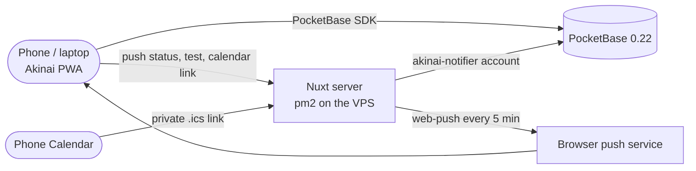

<div align="center">


# Akinai · 商い

**Sales, stock and commissions for a small 3D print shop — at the market stall and at home.**

*Akinai (商い) — "trade, doing business."*


</div>

---

## What Akinai does

Akinai is an installable web app for one owner. It runs on the phone at the market stall and on the laptop at home, and keeps its data in PocketBase.

| | |
|---|---|
| **Sales** | The dashboard shows the balance, today's takings and the Japan savings (10%). A sale can be typed in with the numpad or rung up from the catalog. Sales made offline are queued and sync once the connection is back. |
| **Catalog and deals** | Articles with photos, categories with base prices, and the stock of each article. Cart deals ("Keychain 2 for 7", "Big items") are applied at checkout. Every stock change is recorded as a movement. |
| **Commissions** | Made-to-order prints with several articles, from Open to Printing, Ready and Delivered. Delivering books the income. Customer data is wiped six months after a commission is finished. |
| **Print board** | What to print next: articles at or below their low-stock threshold, and open commissions. It also shows what is printing and what was done today. |
| **Reports** | Sales by article and category, a market day hour by hour, money over time and stock (what runs out soonest, printed vs sold), for any period. Each tab exports as CSV. |
| **Calendar and reminders** | Conventions from application to setup: open applications with their deadlines, an Upcoming list, a month grid, the stand fee (booked as an expense) and reminders. Reminders arrive as push notifications, and a private calendar link puts every convention in the phone's Calendar. |
| **Business card** | A digital business card with a QR code, to show or print. |

Everything works at 375 px with 44 px tap targets, in light and dark mode.

## How it works



- The app talks to PocketBase directly with the owner's login. PocketBase rules let only the owner write.
- The Nuxt server also runs the reminder job. Every 5 minutes it logs in as `akinai-notifier`, a second account that may only read conventions, read and delete push subscriptions, and mark reminders as sent. It sends the due reminders with `web-push`, and it serves the calendar feed.
- Rules that are worth testing live in plain modules under `utils/` (and `server/utils/` for the server). `node --test` runs them, and Playwright checks the pages against an in-memory fake PocketBase.

## Setup

You need Node 20 or newer.

```bash
git clone https://github.com/KuroTsubasa1/akinai.git
cd akinai
npm install
cp .env.example .env     # the PocketBase address, plus your admin login for the migration script
npm run dev              # http://localhost:3000
```

`nuxt dev` never starts the reminder job. Without the server env (see [The env file](#the-env-file)), Settings → Notifications shows "Notifications aren't configured on the server".

**Tests**

```bash
npm run test:unit                      # node --test, every rule module and the server job with fakes
npx playwright test                    # e2e against the dev server and a fake PocketBase (Chromium and a Pixel 7)
npx playwright test --project=mobile   # the phone layout only
```

## PocketBase and migrations

Akinai needs PocketBase **0.22** with an owner account in the `users` collection. Schema changes are made with a script that reads your PocketBase admin login from your local `.env`. Set `POCKETBASE_ADMIN_EMAIL` and `POCKETBASE_ADMIN_PASSWORD` there (`POCKETBASE_ADMIN_TOKEN` is an optional alternative). Never prefix them with `NUXT_PUBLIC_`.

```bash
npm run pb:migrate                       # dry run: prints the plan, writes scripts/category-mapping.json
npm run pb:migrate -- --apply            # create collections and fields, seed categories and deals, map articles to categories
npm run pb:migrate -- --apply-rules --owner you@example.com --notifier akinai-notifier@example.com
```

- **Collections:** `budget_tracket_catalog` (articles), `budget_tracker_transactions`, `categories`, `deals`, `stock_movements`, `commissions`, `print_jobs`, `conventions` and `push_subscriptions`.
- **New collections start locked.** Only the admin can use them until `--apply-rules` opens them to the owner.
- **`--apply-rules`** closes public sign-up on `users` and pins every write to the owner's record id. It prints that id: `Owner: you@example.com (abc123…)`.
  - `--owner` names the owner. It is required once `users` holds more than one account, which is the case as soon as the notifier exists.
  - `--notifier` lets the reminder account read and update conventions and read and delete push subscriptions. Without it those two collections stay owner-only, and the reminder job can't read them.
  - **Every later `--apply-rules` must repeat both** `--owner <email>` and `--notifier <email>`. Once the notifier exists, a run without `--notifier` stops with an error rather than silently cutting the notifier off.
- **The snapshot:** every run writes the resulting schema to `pocketbase/schema.json`. The unit tests check the plan against it.
- **Order:** run `--apply` before deploying a release that needs new fields, and `--apply-rules` right after the release is live.

**Earlier releases**, for a server that is behind:
- **Multi-article commissions:** `--apply` converts the old commissions to lines. Deploy right after it.
- **Sale date, and the reports (`items`, `sold_at`):** these fields are optional. Deploy before or after `--apply`; until a field exists, PocketBase ignores what the app sends.

## Deploy

Every push to `main` runs `.github/workflows/deploy.yml`, which can also be started by hand under Actions → Deploy → Run workflow. It does the following:
1. Installs the dependencies, runs the unit tests and builds the app.
2. Uploads the build to `/opt/budget-tracker/releases/<commit>` on the VPS and points `/opt/budget-tracker/current` at it.
3. Restarts it with pm2 (`ecosystem.config.cjs`: process `budget-tracker` on `127.0.0.1:3668`, `TZ=Europe/Berlin`, and the env file when it exists).
4. Checks that https://akinai.lasseharm.space answers.

The 5 newest releases are kept on the server.

**One-time server setup** (as root, for the `deploy` user):
1. Install Node 20.6 or newer (for `--env-file`) and pm2 for `deploy`:
   ```bash
   npm i -g pm2
   ```
2. Create the app folder and hand it to `deploy`:
   ```bash
   mkdir -p /opt/budget-tracker && chown deploy:deploy /opt/budget-tracker
   ```
3. Make pm2 start the app after a reboot. Run `pm2 startup` as `deploy`, then run the command it prints as root.
4. Point nginx for `akinai.lasseharm.space` at `http://127.0.0.1:3668` (`proxy_pass`, plus the usual `proxy_set_header Host $host;` and the `X-Forwarded-*` headers).
5. Put the public half of a key made only for GitHub into `/home/deploy/.ssh/authorized_keys`.

**Repository secrets** (Settings → Secrets and variables → Actions):

| Secret | Value |
|---|---|
| `DEPLOY_SSH_KEY` | the private half of that key |
| `DEPLOY_HOST` | `46.101.138.222` |
| `DEPLOY_USER` | `deploy` |
| `DEPLOY_KNOWN_HOSTS` | the output of `ssh-keyscan -t ed25519 46.101.138.222` (pins the server's identity) |

**Rollback:** start an older release:
```bash
pm2 delete budget-tracker
pm2 start /opt/budget-tracker/releases/<older-commit>/ecosystem.config.cjs
pm2 save
```

Schema changes are not part of the deploy: run `npm run pb:migrate` yourself first, as described above.

### The env file

Reminders run only in the built server (never in `nuxt dev`), every 5 minutes. They and the calendar feed need secrets that only the server knows. They live in `/opt/budget-tracker/shared/akinai.env` (mode 600, owned by `deploy`), outside the releases, so a deploy never overwrites them. `ecosystem.config.cjs` passes the file to Node with `--env-file` whenever it exists. Without it the app runs as before, with reminders and the feed switched off.

| Variable | What it is |
|---|---|
| `POCKETBASE_URL` | **required**: the PocketBase address, starting with `https://` (for example `https://pocket.lasseharm.space`). There is no fallback, so the notifier's password never goes to a guessed or plain-http address. |
| `OWNER_ID` | the owner's record id in `users`: the 15-character id that `--apply-rules` prints. The server's push and calendar-link routes accept only this account (and the notifier). |
| `NOTIFIER_EMAIL`, `NOTIFIER_PASSWORD` | the `akinai-notifier` account's login |
| `NUXT_PUBLIC_VAPID_PUBLIC_KEY` | the VAPID public key (public by design) |
| `VAPID_PRIVATE_KEY` | the VAPID private key |
| `VAPID_SUBJECT` | a `mailto:` address that push services can contact |
| `CALENDAR_SECRET` | the random part of the private calendar link: at least 32 characters of `A-Z a-z 0-9 _ -` (otherwise the feed stays off). `openssl rand -hex 32` works. |

Push goes only to the real push services (Apple, Google FCM, Mozilla and Microsoft), and only over https.

None of these may get a `NUXT_PUBLIC_` prefix, except the VAPID public key. None of them go into the repository or a local `.env` that is committed.

**Never put the server env (`NOTIFIER_*`, `VAPID_*`, `CALENDAR_SECRET`, `OWNER_ID`, `POCKETBASE_URL`) into a local `.env`, committed or not.** `nuxt preview` loads `.env` (and so does Playwright's webServer when no dev server is running), which would start a second reminder job against production and send every notification twice. These values belong only in `/opt/budget-tracker/shared/akinai.env` on the server.

pm2 reads the file when the process starts. After editing it, restart from the current release:
```bash
pm2 delete budget-tracker
pm2 start /opt/budget-tracker/current/ecosystem.config.cjs
pm2 save
```

### Rollout: convention calendar

Run these yourself, in this order. Each step names what to check.

1. **Schema.** Run `npm run pb:migrate`. The dry run should list `create collection "conventions" (…)` and `create collection "push_subscriptions" (endpoint, keys, device)`, plus `add to "budget_tracker_transactions": items, sold_at` if the reports release is not migrated yet. Then run `npm run pb:migrate -- --apply`.
2. **The notifier account.** In the PocketBase admin, create a user in `users` named `akinai-notifier`, with its own email address and a long random password (for example `openssl rand -base64 32`). Then run:
   ```bash
   npm run pb:migrate -- --apply-rules --owner <your email> --notifier <notifier email>
   ```
   Note the owner id that it prints (`Owner: … (<id>)`). From now on, every `--apply-rules` run needs both `--owner` and `--notifier`.
3. **The env file.** Make the keys and the feed secret:
   ```bash
   npx web-push generate-vapid-keys
   openssl rand -hex 32
   ```
   Then write the file on the server, as `deploy`:
   ```bash
   install -d -m 700 /opt/budget-tracker/shared
   install -m 600 /dev/null /opt/budget-tracker/shared/akinai.env
   nano /opt/budget-tracker/shared/akinai.env
   ```
   ```bash
   POCKETBASE_URL=https://pocket.lasseharm.space
   OWNER_ID=<owner id from step 2>
   NOTIFIER_EMAIL=<notifier email>
   NOTIFIER_PASSWORD=<notifier password>
   NUXT_PUBLIC_VAPID_PUBLIC_KEY=<public key>
   VAPID_PRIVATE_KEY=<private key>
   VAPID_SUBJECT=mailto:<your email>
   CALENDAR_SECRET=<random hex>
   ```
4. **Deploy.** Push to `main`. The deploy restarts pm2 from the new release, which loads the file. Within a minute, `pm2 logs budget-tracker` should show no `[reminders] off` line.
5. **On each phone:**
   - Open Settings → Notifications → *Turn on notifications on this device*. On an iPhone, add Akinai to the Home Screen first and open it from there; this needs iOS 16.4 or newer.
   - Tap *Send test notification*. Logging out turns notifications off on that device; turn them on again after you log back in.
   - Tap *Copy calendar link* and add it in the Calendar app as a subscribed calendar.

   The status line then reads `Reminders last checked <time>` (or shows the last error).

The calendar link contains `CALENDAR_SECRET`, so it shows up in nginx access logs, and anyone who has the link can read the whole feed. Treat it like a password. A new `CALENDAR_SECRET` ends every existing calendar subscription; add the new link on each phone again.

## Credits

The 商 in the Akinai logo is drawn from [Noto Sans JP](https://fonts.google.com/noto/specimen/Noto+Sans+JP) (SIL Open Font License 1.1). `node scripts/make-icons.mjs` renders the app icons from `public/logo.svg`.

Push notifications use [web-push](https://github.com/web-push-libs/web-push) (MPL 2.0).
