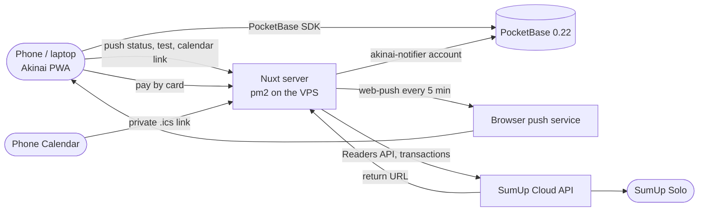

<div align="center">


# Akinai · 商い

**Sales, stock and commissions for a small 3D print shop — at the market stall and at home.**

*Akinai (商い) — "trade, doing business."*


</div>

---

## What Akinai does

Akinai is an installable web app for one owner. It runs on the phone at the market stall and on the laptop at home, and keeps its data in PocketBase.

| | |
|---|---|
| **Sales** | The dashboard shows the balance, today's takings and the Japan savings (10%). A sale can be typed in with the numpad or rung up from the catalog. Sales made offline are queued and sync once the connection is back. |
| **Catalog and deals** | Articles with photos, categories with base prices, and the stock of each article, set with one "Stock now" field. Cart deals ("Keychain 2 for 7", "Big items") are applied at checkout. A gatcha (an article with prize categories) asks for its prizes right after the checkout, also offline; the prizes' stock goes down, not the gatcha's. Every stock change is recorded as a movement. |
| **Card payments** | *Pay by card* in the cart and on Home puts the total on the shop's SumUp Solo. An approved card books the sale automatically, exactly once, as a card sale; a declined or cancelled one books nothing. Reports split takings into card, cash and other. |
| **Commissions** | Made-to-order prints with several articles, from Open to Printing, Ready and Delivered. Switching a commission to Paid books the income, Unpaid takes it back. Customer data is wiped six months after a commission is finished. |
| **Print board** | What to print next: articles at or below their low-stock threshold, and open commissions. It also shows what is printing and what was done today. |
| **Reports** | Sales by article and category, a market day hour by hour, money over time and stock (what runs out soonest, printed vs sold), for any period. Each tab exports as CSV. |
| **Calendar and reminders** | Conventions from application to setup: open applications with their deadlines, an Upcoming list, a month grid, the stand fee (booked as an expense) and reminders. Reminders arrive as push notifications, and a private calendar link puts every convention in the phone's Calendar. |
| **Business card** | A digital business card with a QR code, to show or print. |

Everything works at 375 px with 44 px tap targets, in light and dark mode.

## How it works



- The app talks to PocketBase directly with the owner's login. PocketBase rules let only the owner write.
- The Nuxt server also runs the reminder job. Every 5 minutes it logs in as `akinai-notifier`, a second account that may only read conventions, read and delete push subscriptions, and mark reminders as sent. It sends the due reminders with `web-push`, and it serves the calendar feed.
- Card payments go through the Nuxt server, which alone holds the SumUp keys. It creates a `card_payments` record with the owner's login and sends the checkout to the Solo. While the payment sheet is open, the app asks the server every 2 s to look the result up at SumUp; with the notifier login the server also takes SumUp's call to the return URL and checks pending payments every 15 s on its own. The app books the sale once the payment is approved.
- Rules that are worth testing live in plain modules under `utils/` (and `server/utils/` for the server). `node --test` runs them, and Playwright checks the pages against an in-memory fake PocketBase.

## Setup

You need Node 20 or newer.

```bash
git clone https://github.com/KuroTsubasa1/akinai.git
cd akinai
npm install
cp .env.example .env     # the PocketBase address, plus your admin login for the migration script
npm run dev              # http://localhost:3000
```

`nuxt dev` never starts the reminder job. Without the server env (see [The env file](#the-env-file)), Settings → Notifications shows "Notifications aren't configured on the server".

**Tests**

```bash
npm run test:unit                      # node --test, every rule module and the server job with fakes
npx playwright test                    # e2e against the dev server and a fake PocketBase (Chromium and a Pixel 7)
npx playwright test --project=mobile   # the phone layout only
```

The tests never reach SumUp: the unit tests use a fake SumUp client and the e2e tests fake the `/api/card/*` routes. `npm run sumup:sandbox-check` is the only thing that talks to SumUp from your machine, and only to a sandbox account (see [Rollout: card payments](#rollout-card-payments)).

## PocketBase and migrations

Akinai needs PocketBase **0.22** with an owner account in the `users` collection. Schema changes are made with a script that reads your PocketBase admin login from your local `.env`. Set `POCKETBASE_ADMIN_EMAIL` and `POCKETBASE_ADMIN_PASSWORD` there (`POCKETBASE_ADMIN_TOKEN` is an optional alternative). Never prefix them with `NUXT_PUBLIC_`.

```bash
npm run pb:migrate                       # dry run: prints the plan, writes scripts/category-mapping.json
npm run pb:migrate -- --apply            # create collections and fields, seed categories and deals, map articles to categories
npm run pb:migrate -- --apply-rules --owner you@example.com --notifier akinai-notifier@example.com
```

- **Collections:** `budget_tracket_catalog` (articles), `budget_tracker_transactions`, `categories`, `deals`, `stock_movements`, `commissions`, `print_jobs`, `conventions`, `push_subscriptions` and `card_payments`.
- **New collections start locked.** Only the admin can use them until `--apply-rules` opens them to the owner.
- **`--apply-rules`** closes public sign-up on `users` and pins every write to the owner's record id. It prints that id: `Owner: you@example.com (abc123…)`.
  - `--owner` names the owner. It is required once `users` holds more than one account, which is the case as soon as the notifier exists.
  - `--notifier` lets the reminder account read and update conventions, read and delete push subscriptions, and read card payments and record SumUp's result on them (`status`, `sumup_checkout`, `sumup_transaction`, nothing else). Without it those collections stay owner-only, and neither the reminder job nor card payments work.
  - **Every later `--apply-rules` must repeat both** `--owner <email>` and `--notifier <email>`. Once the notifier exists, a run without `--notifier` stops with an error rather than silently cutting the notifier off.
- **The snapshot:** every run writes the resulting schema to `pocketbase/schema.json`. The unit tests check the plan against it.
- **Order:** run `--apply` before deploying a release that needs new fields, and `--apply-rules` right after the release is live.

**Earlier releases**, for a server that is behind:
- **Multi-article commissions:** `--apply` converts the old commissions to lines. Deploy right after it.
- **Sale date, and the reports (`items`, `sold_at`):** these fields are optional. Deploy before or after `--apply`; until a field exists, PocketBase ignores what the app sends.

## Deploy

Every push to `main` runs `.github/workflows/deploy.yml`, which can also be started by hand under Actions → Deploy → Run workflow. It does the following:
1. Installs the dependencies, runs the unit tests and builds the app.
2. Uploads the build to `/opt/budget-tracker/releases/<commit>` on the VPS and points `/opt/budget-tracker/current` at it.
3. Restarts it with pm2 (`ecosystem.config.cjs`: process `budget-tracker` on `127.0.0.1:3668`, `TZ=Europe/Berlin`, and the env file when it exists).
4. Checks that https://akinai.lasseharm.space answers.

The 5 newest releases are kept on the server.

**One-time server setup** (as root, for the `deploy` user):
1. Install Node 20.6 or newer (for `--env-file`) and pm2 for `deploy`:
   ```bash
   npm i -g pm2
   ```
2. Create the app folder and hand it to `deploy`:
   ```bash
   mkdir -p /opt/budget-tracker && chown deploy:deploy /opt/budget-tracker
   ```
3. Make pm2 start the app after a reboot. Run `pm2 startup` as `deploy`, then run the command it prints as root.
4. Point nginx for `akinai.lasseharm.space` at `http://127.0.0.1:3668` (`proxy_pass`, plus the usual `proxy_set_header Host $host;` and the `X-Forwarded-*` headers).
5. Put the public half of a key made only for GitHub into `/home/deploy/.ssh/authorized_keys`.

**Repository secrets** (Settings → Secrets and variables → Actions):

| Secret | Value |
|---|---|
| `DEPLOY_SSH_KEY` | the private half of that key |
| `DEPLOY_HOST` | `46.101.138.222` |
| `DEPLOY_USER` | `deploy` |
| `DEPLOY_KNOWN_HOSTS` | the output of `ssh-keyscan -t ed25519 46.101.138.222` (pins the server's identity) |

**Rollback:** start an older release:
```bash
pm2 delete budget-tracker
pm2 start /opt/budget-tracker/releases/<older-commit>/ecosystem.config.cjs
pm2 save
```

Schema changes are not part of the deploy: run `npm run pb:migrate` yourself first, as described above.

### The env file

Reminders run only in the built server (never in `nuxt dev`), every 5 minutes. They and the calendar feed need secrets that only the server knows. They live in `/opt/budget-tracker/shared/akinai.env` (mode 600, owned by `deploy`), outside the releases, so a deploy never overwrites them. `ecosystem.config.cjs` passes the file to Node with `--env-file` whenever it exists. Without it the app runs as before, with reminders and the feed switched off.

| Variable | What it is |
|---|---|
| `POCKETBASE_URL` | **required**: the PocketBase address, starting with `https://` (for example `https://pocket.lasseharm.space`). There is no fallback, so the notifier's password never goes to a guessed or plain-http address. |
| `OWNER_ID` | the owner's record id in `users`: the 15-character id that `--apply-rules` prints. The server's push and calendar-link routes accept only this account (and the notifier). |
| `NOTIFIER_EMAIL`, `NOTIFIER_PASSWORD` | the `akinai-notifier` account's login |
| `NUXT_PUBLIC_VAPID_PUBLIC_KEY` | the VAPID public key (public by design) |
| `VAPID_PRIVATE_KEY` | the VAPID private key |
| `VAPID_SUBJECT` | a `mailto:` address that push services can contact |
| `CALENDAR_SECRET` | the random part of the private calendar link: at least 32 characters of `A-Z a-z 0-9 _ -` (otherwise the feed stays off). `openssl rand -hex 32` works. |
| `SUMUP_API_KEY` | SumUp API key (Developer settings → API keys). Card payments also need `POCKETBASE_URL` and `OWNER_ID`; SumUp's return URL and the 15 s check of pending payments also need the notifier login (without it, `[card] return URL and backup poll off` in the log). |
| `SUMUP_MERCHANT_CODE` | the merchant code of that SumUp account (letters and digits) |
| `SUMUP_AFFILIATE_KEY`, `SUMUP_AFFILIATE_APP_ID` | the affiliate key and the app id it was made for; SumUp's Cloud API needs them on every checkout |
| `SUMUP_API_URL` | optional, `https://api.sumup.com` by default; https only |
| `CARD_PUBLIC_URL` | optional: the app's public https address for SumUp's return URL (just the origin, for example `https://akinai.example.com`). Without it the built server uses `https://akinai.lasseharm.space`, and `nuxt dev` sends no return URL. Set it only if the app moves to another domain. |

Push goes only to the real push services (Apple, Google FCM, Mozilla and Microsoft), and only over https.

None of these may get a `NUXT_PUBLIC_` prefix, except the VAPID public key. None of them go into the repository or a local `.env` that is committed. The live SumUp keys go only into this file; the local `.env` may hold the sandbox `SUMUP_*` keys for the laptop test (see [Rollout: card payments](#rollout-card-payments)).

**Never put the server's secrets (`NOTIFIER_*`, `VAPID_*`, `CALENDAR_SECRET`) or live SumUp keys into a local `.env`, committed or not.** (`POCKETBASE_URL` and `OWNER_ID` are no secrets and may be there for the card payment test on the laptop.) `nuxt preview` loads `.env` (and so does Playwright's webServer when no dev server is running), which would start a second reminder job against production and send every notification twice. These values belong only in `/opt/budget-tracker/shared/akinai.env` on the server.

pm2 reads the file when the process starts. After editing it, restart from the current release:
```bash
pm2 delete budget-tracker
pm2 start /opt/budget-tracker/current/ecosystem.config.cjs
pm2 save
```

### Rollout: convention calendar

Run these yourself, in this order. Each step names what to check.

1. **Schema.** Run `npm run pb:migrate`. The dry run should list `create collection "conventions" (…)` and `create collection "push_subscriptions" (endpoint, keys, device)`, plus `add to "budget_tracker_transactions": items, sold_at` if the reports release is not migrated yet. Then run `npm run pb:migrate -- --apply`.
2. **The notifier account.** In the PocketBase admin, create a user in `users` named `akinai-notifier`, with its own email address and a long random password (for example `openssl rand -base64 32`). Then run:
   ```bash
   npm run pb:migrate -- --apply-rules --owner <your email> --notifier <notifier email>
   ```
   Note the owner id that it prints (`Owner: … (<id>)`). From now on, every `--apply-rules` run needs both `--owner` and `--notifier`.
3. **The env file.** Make the keys and the feed secret:
   ```bash
   npx web-push generate-vapid-keys
   openssl rand -hex 32
   ```
   Then write the file on the server, as `deploy`:
   ```bash
   install -d -m 700 /opt/budget-tracker/shared
   install -m 600 /dev/null /opt/budget-tracker/shared/akinai.env
   nano /opt/budget-tracker/shared/akinai.env
   ```
   ```bash
   POCKETBASE_URL=https://pocket.lasseharm.space
   OWNER_ID=<owner id from step 2>
   NOTIFIER_EMAIL=<notifier email>
   NOTIFIER_PASSWORD=<notifier password>
   NUXT_PUBLIC_VAPID_PUBLIC_KEY=<public key>
   VAPID_PRIVATE_KEY=<private key>
   VAPID_SUBJECT=mailto:<your email>
   CALENDAR_SECRET=<random hex>
   ```
4. **Deploy.** Push to `main`. The deploy restarts pm2 from the new release, which loads the file. Within a minute, `pm2 logs budget-tracker` should show no `[reminders] off` line.
5. **On each phone:**
   - Open Settings → Notifications → *Turn on notifications on this device*. On an iPhone, add Akinai to the Home Screen first and open it from there; this needs iOS 16.4 or newer.
   - Tap *Send test notification*. Logging out turns notifications off on that device; turn them on again after you log back in.
   - Tap *Copy calendar link* and add it in the Calendar app as a subscribed calendar.

   The status line then reads `Reminders last checked <time>` (or shows the last error).

The calendar link contains `CALENDAR_SECRET`, so it shows up in nginx access logs, and anyone who has the link can read the whole feed. Treat it like a password. A new `CALENDAR_SECRET` ends every existing calendar subscription; add the new link on each phone again.

### Rollout: gatcha prizes and reminder delivery

Run these yourself, in this order.

1. **Schema.** Run `npm run pb:migrate`. The dry run should list only `add to "budget_tracket_catalog": prize_categories`. Then run `npm run pb:migrate -- --apply`. The rules do not change, so no `--apply-rules` is needed (if you run `--apply-rules` later, pass both `--owner` and `--notifier`). Run it **before** the deploy: until the field exists, PocketBase ignores the prize categories the app saves.
2. **Deploy.** Push to `main`.
3. **The gatcha.** In the catalog, tap *Manage*, open GatchaPon, tick its prize categories and tap *Save changes*. Its card now shows `Gatcha`. Its own stock no longer changes. If it should not count in Reports → Stock value, set it to 0 once with *Stock now*.
4. **Notifications.** Open Settings → Notifications on the phone. A phone that showed "on" without a record on the server is registered again here. The status line should read `Reminders last checked …`, not `No device has notifications on`.
5. **The log.** Once a reminder is due, `pm2 logs budget-tracker` shows one line per run, for example `[reminders] sent 1, removed 0, failed 0`. While no device is registered, a due reminder waits (`waiting 1 (no device)`) instead of being used up, until it is more than 24 hours late.

### Rollout: commission Paid switch and phone

Run these yourself, in this order.

1. **Schema.** Run `npm run pb:migrate`. The dry run should list only `add to "commissions": customer_phone, paid_at, payment_transaction`. Then run `npm run pb:migrate -- --apply`. The rules do not change. Run it **before** the deploy: until the fields exist, PocketBase ignores the phone and the payment the app saves.
2. **Deploy.** Push to `main`. From now on *Mark delivered* books nothing; the income is booked when the commission's *Paid* switch is turned on, and taken back when it is turned off.
3. **Old commissions.** Commissions delivered before 16 October 2026 (UTC) count as delivered before payments were tracked: those from before the deploy already booked their income and show `Unpaid`. Turning one to *Paid* asks first: *Only mark paid* books nothing, *Book income again* books a second income.
4. **Unpaid and other devices.** *Unpaid* removes the income from this device's queue and from the server. It cannot reach an income still waiting in another device's offline queue: that one is sent when that device comes back online, so check the balance after switching a commission to Unpaid that another device marked Paid while offline.

### Rollout: card payments

Run these yourself, in this order.

1. **Schema.** Run `npm run pb:migrate`. The dry run should list exactly `create collection "card_payments" (amount, description, source, cart, status, sumup_checkout, sumup_transaction, booked_transaction, callback_token)` and `add to "budget_tracker_transactions": payment_method, sumup_transaction`. Then run `npm run pb:migrate -- --apply`.
2. **Rules.** Run `npm run pb:migrate -- --apply-rules --owner <your email> --notifier <notifier email>`. It should list only `set access rules on "card_payments"`: the owner may do everything, except that a payment's `status` can be changed only while it is `pending` (a settled payment stays settled; marking it booked still works). The notifier may read payments and set the status and SumUp's ids, also only while pending. Both steps run **before** the laptop test and before the deploy: the app needs the collection open to take any card payment.
3. **Sandbox test on the laptop** (`nuxt dev`, with the sandbox merchant and the Virtual Solo at virtual-solo.sumup.com):
   1. Put into the local `.env`: the four sandbox keys `SUMUP_API_KEY`, `SUMUP_MERCHANT_CODE`, `SUMUP_AFFILIATE_KEY`, `SUMUP_AFFILIATE_APP_ID`, plus `POCKETBASE_URL=https://pocket.lasseharm.space` and `OWNER_ID=<the id --apply-rules printed>`. **Never the notifier login.**
   2. Optional: `npm run sumup:sandbox-check` checks the keys without the app. It stops unless SumUp marks the account as a sandbox, lists the readers, sends a 1,00 € checkout to the paired one after you say yes, and prints how SumUp's status maps to Akinai's (`SUCCESSFUL → approved`, `FAILED → declined`, `CANCELLED → cancelled`). `-- --pair <code>` pairs the Virtual Solo first.
   3. Restart `npm run dev`. Its log shows `[card] return URL and backup poll off, missing: NOTIFIER_EMAIL, NOTIFIER_PASSWORD`: expected on the laptop. The open payment sheet asks for the result every 2 s instead, and the next start settles a payment whose sheet was closed.
   4. Log in and open Settings → Card terminal. The Virtual Solo is already paired with the sandbox account, so the section shows it as *Online*. (If it shows the code field instead, enter the code the Virtual Solo shows under *Connections → API → Connect* and tap *Pair terminal*.)
   5. Checklist:
      - [ ] Cart → *Pay by card · <total>*: the Solo shows the amount, the sheet shows `Waiting for card`.
      - [ ] Pay: `Paid ✓`, the cart empties, the sale is in the history once, as card, its description starting with `[Sandbox] `. Its SumUp code matches the sandbox transaction.
      - [ ] *Cancel on terminal* while the Solo waits: `Cancelled`, nothing booked.
      - [ ] Cancel on the Solo itself: `Cancelled` (or `Card declined`: note which; SumUp may report a cancel on the terminal as failed).
      - [ ] Decline a card on the Solo (the Virtual Solo can simulate one): `Card declined`, nothing booked. **Does the Solo then offer a retry on the same checkout?** Note it: if it does, a card that goes through on the retry would arrive after Akinai already showed `Card declined`.
      - [ ] Home → *Pay by card* for an income: booked with its description (with `[Sandbox] `), as card.
      - [ ] Reload the page while the customer pays, pay, then open the app again: `Card payment of <amount> booked`, once.
      - [ ] Log the Virtual Solo out and pay: `The terminal didn't answer. Check that it's on and online.`
      - [ ] Reports → Market day and Money show the card sales under Card.
   6. **Delete the test sales.** They are real entries in the production books. In the PocketBase admin:
      - `card_payments`: every test payment's `description` starts with `[Sandbox] `. Note each one's `id` and, in its `cart` field, the `id`s under `stockMovements`.
      - `budget_tracker_transactions`: the test sales are the ones whose description starts with `[Sandbox] `; a card sale's `id` is its card payment's `id`. Delete them.
      - `stock_movements`: delete the movements with the ids you noted (reason `sale`, the cart's articles, created right after the payment). A Home income has none. The article's stock is recounted from its movements at its next stock change; to correct it at once, set *Stock now* on the article in the catalog.
      - Then delete the `[Sandbox] ` card payments themselves.

      Afterwards remove the four `SUMUP_*` lines from `.env` (or keep them, with the Virtual Solo paired, for the next test). The sandbox and the live account have separate readers, so the Virtual Solo never shows up for the live keys.
4. **Live keys on the server.** Write the four live `SUMUP_*` lines into `/opt/budget-tracker/shared/akinai.env` (see [The env file](#the-env-file); the notifier login is already there; `CARD_PUBLIC_URL` only if the app no longer runs at `https://akinai.lasseharm.space`), then deploy (push to `main`). `pm2 logs budget-tracker` should show neither `[card] off` nor `[card] return URL and backup poll off`; pm2 reads the file only when the process starts, so if it still shows one of them, restart it as described there.
5. **Pair the real Solo** in Settings → Card terminal: enter the code the Solo shows under *Connections → API → Connect* and tap *Pair terminal*. The section shows the Solo as *Online*.
6. **First live payments:**
   - [ ] A small real payment: `Paid ✓`, and the code in `pm2 logs budget-tracker` (`[card] <id> approved (<SumUp code>)`) matches the SumUp app.
   - [ ] **The return URL reaches the server.** The open sheet's 2 s refresh and the 15 s poll write the same log line, so it proves nothing on its own. Check the nginx access log for `POST /api/card/callback/<id>/… 200` from that payment. Or start a payment, tap *Close, book it when it lands* once the sheet offers it (or close the app), pay, and watch `[card] <id> approved` appear within seconds instead of up to 15 s. Refund it in the SumUp app if you like; Akinai keeps the sale (delete it there too).
   - [ ] Pairing and paying work for the German merchant account (the Cloud API's region).
   - [ ] **Can the paired Solo still take manually typed amounts** (outside Akinai)? This decides how the stall works, not the code.

A card payment that stays pending is checked every 15 s on the server; after 10 minutes without SumUp knowing it, it is marked failed. Refunds stay in the SumUp app.

## Credits

The 商 in the Akinai logo is drawn from [Noto Sans JP](https://fonts.google.com/noto/specimen/Noto+Sans+JP) (SIL Open Font License 1.1). `node scripts/make-icons.mjs` renders the app icons from `public/logo.svg`.

Push notifications use [web-push](https://github.com/web-push-libs/web-push) (MPL 2.0).
