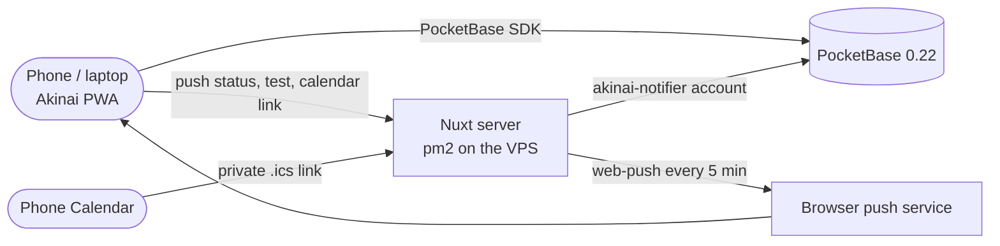

# Convention Calendar Implementation Plan

> **For agentic workers:** REQUIRED SUB-SKILL: Use superpowers:subagent-driven-development (recommended) or superpowers:executing-plans to implement this plan task-by-task. Steps use checkbox (`- [ ]`) syntax for tracking.

**Goal:** The owner keeps every convention in Akinai, from the application to the setup, and gets reminders for application deadlines, the stock check, packing and setup as push notifications and in a private calendar feed. The README then describes the whole app.

**Architecture:**
- **Pure rules** live in `utils/calendar/` and are unit-tested with `node:test`; tests build their dates with local constructors, so they hold in every time zone:
  - `dates.js`: calendar days and local times;
  - `status.js`: statuses and the derived Done;
  - `reminders.js`: the defaults, keeping them in step with the dates, due reminders, sent marks;
  - `messages.js`: the push texts;
  - `views.js`: Upcoming, the month grid, Next up;
  - `ics.js`: the feed;
  - `form.js`: the sheet's form;
  - `copy.js`: the offline copy.
  The low-stock rule moves into `utils/printBoard.js` as `lowStockArticles`, so the print board and the stock check share it.
- **The server is the Nuxt process itself (Nitro).** Its logic sits in plain ES modules under `server/utils/` that take their dependencies as arguments, so `node --test` runs them with fakes:
  - `notifier.js`: the `akinai-notifier` PocketBase client;
  - `reminderJob.js`: the job, its runner and the web-push sender;
  - `access.js`: the owner check and the feed secret;
  - `notifierSettings.js`: the env.
  The route files, the plugin and `requireCaller.js` are thin wrappers around them. The service worker gets `public/push-sw.js` through Workbox `importScripts`.
- **App:**
  - `composables/useConventions.js` and `composables/usePushNotifications.js`;
  - the page `pages/calendar.vue` with `components/calendar/*` (Upcoming list, month grid, sheet, reminder editor, status chip);
  - `components/NextUpCard.vue` on the dashboard;
  - `components/NotificationSettings.vue` in Settings;
  - Calendar in the navigation (More sheet on phones).
- **Tests:**
  - **e2e** runs against the in-memory fake PocketBase. The `api` fixture also answers Akinai's own `/api/push/*` and `/api/calendar/link` routes, so no test reaches the real server routes.
  - **Unit:** the server job runs with a fake store and a fake sender.

**Tech Stack:** Nuxt 3.21 / Vue 3.5 `<script setup>`, Nitro 2.13 (h3 1.15), Tailwind 3.4 semantic tokens, PocketBase 0.22 with `pocketbase@0.21.5`, `web-push@3.6.7`, `@vite-pwa/nuxt` (Workbox 7 `generateSW`), `node:test`, Playwright against the fake PocketBase.

**Spec:** `docs/superpowers/specs/2026-10-14-convention-calendar-design.md`

## Global Constraints

- **Statuses** (`select`): `interested` · `applied` · `booked` · `rejected` · `cancelled`. A booked convention whose last day (`ends_on`, else `starts_on`) has passed shows as **Done**. Done is derived and never stored.
- **Quick buttons** save immediately. Their labels are *Mark applied*, *Mark booked* and *Rejected*.
- **Default reminders** are `auto: true` and in local time:
  - **Applications close:** 7 days and 1 day before `applications_close`, at 09:00. Only while *interested*.
  - **Stock check:** 14 days before `starts_on`, at 09:00. Only while *booked*.
  - **Pack:** 2 days before `starts_on`, at 18:00. Only while *booked*.
  - **Setup:** 08:00 on `starts_on`, or 1 hour before `setup_at` when set. Only while *booked*.
  - **Editing and sending:** a reminder the owner edits loses `auto`, and a sent reminder is never sent again.
- **Reminder shape** (json): `{ id, kind: 'deadline'|'stock'|'pack'|'setup'|'custom', at: ISO, text?, auto, sent_at?, skipped?, missed?, removed? }`. `removed` is this plan's addition, see Decisions.
- **Job:**
  - runs every 5 minutes (`REMINDER_INTERVAL_MS = 300000`);
  - a reminder more than 24 hours late gets `sent_at` with `missed: true`, and nothing is sent;
  - a reminder whose status no longer allows it gets `sent_at` with `skipped: true`;
  - a device answered with 404 or 410 is deleted;
  - a notification tap opens `/calendar?c=<id>`;
  - push TTL is 86400 s.
- **Message texts** (verbatim from the spec):

  | Kind | Title | Body |
  |---|---|---|
  | deadline | `Applications close in N days` (`tomorrow` for 1) | `<name> · closes <Tue 21 Oct>` |
  | stock | `<name> in 14 days` | `Low stock: <article> (print N), …` (at most 5 articles, then `+N more`), else `Stock looks fine` |
  | pack | `<name> in 2 days` | `Time to pack` plus ` · <hall>, Table <table>` when set |
  | setup | `Setup today: <name>` | the hall, table and setup time that are set, joined by ` · ` |
  | custom | `<name>` | the reminder's text |

- **Feed** (`GET /api/calendar/<secret>.ics`, `text/calendar`):
  - **events:** all-day `<name> (<status>)` with an exclusive DTEND, LOCATION `venue, city`, and DESCRIPTION hall and table;
  - **deadlines:** `Applications close: <name>` all-day;
  - **setup:** `Setup: <name>` as a one-hour timed event;
  - rejected and cancelled conventions are left out;
  - text is escaped and lines are folded at 75 octets;
  - a wrong secret is a 404, and the secret is compared in constant time.
- **Strings** (verbatim from the spec):
  - `Applications close in N days`, `Results expected <date>`, `Saved copy from <time>`, `Needs a connection`;
  - `The calendar isn't set up on the server yet`, `Notifications aren't configured on the server`, `Reminders last checked <time>`;
  - `Paid <date>`, `Stand fee: <name>`;
  - *Turn on notifications on this device*, *Send test notification*, *Turn off*, *Copy calendar link*, *Mark fee paid*, *Add reminder*.
- **Data model:**
  - **`conventions`:**
    - text: `name` (required), `city`, `venue`, `hall`, `table`;
    - date: `starts_on`, `ends_on`, `applications_open`, `applications_close`, `results_expected`, `setup_at`, `fee_paid_at`;
    - `status`: select, required;
    - `stand_fee`: number, `min: 0`;
    - `fee_transaction`: text;
    - `reminders`: json, `maxSize: 200000`.
  - **`push_subscriptions`:** `endpoint` (url, required, unique index `idx_push_subscriptions_endpoint`), `keys` (json, required), `device` (text).
  - Both collections are created locked. Schema writes keep `MIGRATION_GAP_MS = 1500`.
- **Rules** (`--apply-rules`):
  - **`conventions`:** list, view and update `O || N`; create and delete `O`.
  - **`push_subscriptions`:** list, view and delete `O || N`; create `O`; update `null`.
  - **`N`** is the notifier's `ownerRule`, combined as `(${O}) || (${N})`. Without `--notifier` both collections get `O` only.
  - **`--notifier <email>`** requires `--owner <email>`.
- **Owner routes** (`/api/push/status`, `/api/push/test`, `/api/calendar/link`) let a caller in only when all of these hold:
  - its `Authorization` header is a JWT-shaped token of at most 4096 characters;
  - PocketBase `users/auth-refresh` accepts the token;
  - the account it returns is `OWNER_ID` or the notifier's own id.

  A 200 list with no items is never proof. The token goes to PocketBase only.
- **Server-only env** (`/opt/budget-tracker/shared/akinai.env`, mode 600, owned by `deploy`):
  - `OWNER_ID` (15 characters `[a-z0-9]`, added by the security review);
  - `NOTIFIER_EMAIL`, `NOTIFIER_PASSWORD`;
  - `VAPID_PRIVATE_KEY`, `VAPID_SUBJECT`;
  - `CALENDAR_SECRET`;
  - and the public `NUXT_PUBLIC_VAPID_PUBLIC_KEY`.

  Never give a secret the `NUXT_PUBLIC_` prefix, never put one in the repo, and never read `.env`. The server runs with `TZ=Europe/Berlin`. `ecosystem.config.cjs` adds `node_args: --env-file=<file>` only when the file exists.
- **Client storage:** the calendar's offline copy (`akinai-conventions`) holds only the fields the calendar shows. Logging out and *Clear All Local Data* delete it. Nothing about push subscriptions, the feed link or its secret is ever stored on the device.
- **Conventions:**
  - Vue 3 `<script setup>`; 2-space indent, single quotes, no semicolons; imports ordered Vue, components, composables, utilities.
  - Nested components (`components/calendar/*`) are imported explicitly.
  - Semantic colour tokens only (`surface`, `card`, `muted`, `line`, `ink`, `ink-muted`, `accent`, `income`, `expense`, `warning`); no raw gray/blue classes, no `dark:` classes, no `darkMode` ternaries. `tests/unit/no-raw-colours.test.js` enforces this.
  - 44px tap targets; 375px without horizontal scroll; `formatCurrency()` for money.
- **New dependency:** `web-push@3.6.7`, installed with `npm install web-push@3.6.7 --ignore-scripts`. `--ignore-scripts` skips `nuxt prepare` while the dev server runs.
- **Never:**
  - contact pocket.lasseharm.space;
  - run `pb:migrate` in any form, with or without flags;
  - read `.env`;
  - stop the `nuxt dev` server on :3000 (if new Tailwind classes do not apply, `touch tailwind.config.js`).
- **Git:** only `git add <files you changed>` and `git commit`. NEVER `git stash`, `reset`, `checkout`, `restore`, `clean`, `rebase` or `merge`.
- **Baselines before Task 1:** `npm run test:unit` 187 pass; `npx playwright test` 484 passed, 70 skipped, 0 failed.

## Review Focus

1. **A reminder the job sends while the owner has the sheet open** must not go out a second time when the owner saves the sheet. The save starts from a copy loaded before the job ran. *Pinned in Task 1: "sent marks land on the same reminder at the same time only". Pinned in Task 5: "a reminder the server sent while the sheet was open stays sent when the owner saves".*
2. **A device far from UTC, or the end of summer time on 25 October 2026,** must keep 09:00 at 09:00 local, and calendar days must not shift. *Pinned in Task 1: "09:00 stays 09:00 in Berlin across the end of summer time on 25 October 2026", and by running every unit suite with `TZ=Pacific/Auckland` and `TZ=Europe/Berlin`.*
3. **The notifier's token running out.** PocketBase 0.22 answers an expired token as a guest, and a guest's list is simply empty. The job must log in again before that point, not silently find "no conventions". *Pinned in Task 4: "the notifier logs in before its first call and again when the token runs out".*
4. **A valid token of another account, or a malformed header,** at the owner routes must be refused (401), and the token must go to PocketBase only. *Pinned in Task 4: "a valid token of any other account is refused" and "a missing or malformed header is refused without asking PocketBase".*
5. **A second device that already marked the stand fee paid** must not book the expense twice. *Pinned in Task 5: "a fee already marked paid on another device is not booked twice".*

## Decisions the spec leaves open

1. **Owner check (security review).** The spec's check ("list `push_subscriptions` with the token") cannot tell a stranger from the owner: PocketBase 0.22 answers a guest's list with 200 and no items. So the routes check the token as follows:
   - `users/auth-refresh` must accept it;
   - the returned record id must be `OWNER_ID` (a **new server env var**) or the notifier's own id;
   - a header that is not JWT-shaped is refused without asking PocketBase.

   `--apply-rules` already prints the owner id. **The owner has to add `OWNER_ID` to the env file.**
2. **Default reminders.**
   - A convention only gets the defaults that its status sends: the deadline reminders while *interested*, and stock, pack and setup while *booked*.
   - A status change swaps the unsent defaults.
   - A default whose time has already passed is not added fresh. It is kept if it was already waiting with that time, because the job may not have reached it yet.
3. **Default ids** are fixed slots: `auto-deadline-7`, `auto-deadline-1`, `auto-stock`, `auto-pack`, `auto-setup`. A slot that was sent, edited or removed never comes back as a fresh copy. A removed default stays in the list as `{ …, auto: false, removed: true }` and is never shown or sent. **This adds a `removed` key the spec's reminder shape does not list.** A removed custom reminder is deleted outright.
4. **Which reminders are sent.**
   - Custom reminders go out unless the convention is rejected or cancelled.
   - Stock, pack and setup go out only while booked and not yet over.
   - Edited deadline reminders go out only while interested.
5. **No devices.** With no subscribed device, a due reminder still counts as sent. A reminder that no device could receive (any error other than 404/410) stays unsent and is tried on every run until it is 24 hours late.
6. **`nuxt dev` never starts the job**, even with the env in a local `.env`, so a dev server never sends real reminders. The routes answer `{ configured: false }` without asking PocketBase until the env is complete. **Flag:** to try reminders, the owner has to build and run the server.
7. **Test notifications** go to this device only (its endpoint is in the request body). A gone device gets a 410: "This device has to turn notifications on again".
8. **The VAPID public key** reaches the browser through `/api/push/status`, not through `runtimeConfig`. The page therefore never subscribes against a server without keys.
9. **Upcoming.**
   - By month holds applied and booked conventions, and also interested ones without an open deadline (no close date, or already closed), so none of them vanishes. **Flag:** the spec lists only applied and booked there.
   - An applied convention whose dates have passed stays in By month until its status is changed.
   - Undated conventions are listed last under `Dates not set`.
10. **Feed.**
    - Deadlines and the setup are included for interested, applied and booked conventions.
    - DESCRIPTION reads `Hall 4 · Table B12`.
    - The setup time is written in UTC (`…Z`), so no VTIMEZONE block is needed.
    - The calendar is named `Akinai conventions`.
11. **lg+ layout.** The Upcoming list sits on the left and the Month grid on the right. An open convention takes the Month grid's place; the grid stays mounted on its month behind it. Phones get a `View` switch (Upcoming / Month) and the bottom sheet.
12. **Quick buttons by status.**
    - *Mark applied*: while interested.
    - *Mark booked*: while interested or applied. It needs both dates; otherwise it shows "Add the start and end dates before booking".
    - *Rejected*: while applied.
    - Cancelling goes through the Status field.
13. **Stand fee.** *Mark fee paid* books the saved fee and proceeds in this order:
    1. it reads the convention again; if it is already paid, it shows "The fee was already marked paid on another device";
    2. it generates the expense's record id;
    3. it stores `fee_paid_at` and `fee_transaction`;
    4. it books the expense through `addTransaction` with that `recordId`. `addTransaction` gains an optional `recordId`.
14. **Offline copy and logout.**
    - The copy holds `id`, `name`, `city`, `venue`, `hall`, `table`, the dates, `status`, `stand_fee`, `fee_paid_at` and `reminders`, and nothing else.
    - `useTransactions().forgetLocalData` deletes it, and both logout and *Clear All Local Data* call it.
    - A failed load (dropped connection) falls back to the copy and is read-only. Going offline with the page open also makes it read-only.
15. **Settings.** The old placeholder "Notification Settings" card (local toggles that did nothing) is replaced by `NotificationSettings.vue`. The unused `notifications` block in `useAppSettings` stays, so stored settings still load.
16. **Copy the spec does not give** (kept short):
    - **Calendar page:** `Calendar` / `Conventions, applications and reminders`, `New convention`, `Loading calendar...`, `Could not load the calendar. Check your connection and try again.`, `No conventions yet. Add the first one with New convention.`, `Open applications`, `Past (N)`, `Dates not set`, `Upcoming` / `Month`.
    - **Sheet:**
      - the group titles `Basics`, `Application`, `Setup`, `Stand fee`, `Reminders`, and the field labels (`Opens`, `Closes`, `Results expected`, `Setup time`, `Amount`);
      - the buttons `Create convention` / `Save changes`, `Delete convention`;
      - the fee hint `Books 45,00 € as an expense dated today`;
      - the toasts `Convention created` / `Convention saved` / `Convention deleted`, and the error toast `Could not save the convention. Check your connection and try again.`;
      - the checks `Enter a name`, `The end is before the start`, `Applications close before they open`, `Enter the stand fee as an amount, like 45 or 45,50`.
    - **Reminder editor:** the reminder rules (`7 days before applications close`, `Edited`, `Custom`, `1 hour before setup` / `On the first day`), `Remind me to`, `Pick a date and a time`, `Enter what to remind you of`.
    - **Next up card:** `Next up`, `Applications close in N days`, `Starts in N days` / `On now`.
    - **Notifications:**
      - the status lines `Reminders haven't been checked yet`, `Last check failed: <error>`;
      - the iPhone install hint and the denied-permission hint;
      - the calendar link: `Calendar link`, `Private link`, the iPhone subscription hint.
17. **Other details.**
    - Workbox gets `navigateFallbackDenylist: [/^\/api\//]`, so the service worker never answers the feed or the push routes with the app shell.
    - Calendar sits after Print board in the menu.
    - A long title in `BottomSheet` now wraps instead of squeezing the close button.

## Working setup

- **Dev server and e2e:**
  - A `nuxt dev` server serves this checkout on :3000, and Playwright reuses it. Nitro picks up new `server/` files without a restart.
  - The first run after edits may hit cold-compile timeouts. `mobile.spec.js` "the commission form fits at 375px with long lines" is a known flake under load. Re-run a failing test once on its own before investigating.
- **Unit tests:** `npm run test:unit` (187 pass before Task 1). For the time-zone runs:

  ```bash
  for tz in "" Pacific/Auckland Europe/Berlin; do TZ=$tz node --test tests/unit/*.test.js 2>&1 | grep -E '(tests|pass|fail) [0-9]+$'; done
  ```

  All three must show `fail 0`.
- **e2e:**
  - `npx playwright test <files>` runs the `chromium` project (1280px) and `mobile` (Pixel 7); the full suite is `npx playwright test`.
  - The fake PocketBase (`tests/e2e/fake-pocketbase.js`) holds exactly the posted body fields; records the app creates get `DEFAULTS`.
  - A `page.route` on the PocketBase host must end in `route.fallback()`: fulfilling it directly trips the fixture's escaped-requests check.
  - Akinai's own routes on localhost (`/api/push/*`, `/api/calendar/link`) are answered by the `api` fixture from Task 7 on. Before that, no test calls them.
- **Modules:** `utils/` and `server/utils/` are plain ES modules with relative `.js` imports, so `node --test` loads them. Vue files import them as `~/utils/...`.
- **Nitro wrappers** (`server/api`, `server/routes`, `server/plugins`, `server/utils/requireCaller.js`) use Nitro's auto-imports: `defineEventHandler`, `defineNitroPlugin`, `getHeader`, `getRouterParam`, `readBody`, `setResponseHeader`, `createError`.
- **Snapshot:** `pocketbase/schema.json` is the live snapshot and is not edited by hand. The migration tests hold before and after the owner refreshes it.

## File map

| File | Responsibility | Task |
|---|---|---|
| `utils/calendar/dates.js`, `status.js`, `reminders.js`, `messages.js`, `utils/printBoard.js` (`lowStockArticles`) | days and local times, statuses, reminders, push texts | 1 |
| `tests/unit/calendar-reminders.test.js`, `tests/unit/calendar-messages.test.js` | their tests | 1 |
| `utils/calendar/views.js`, `ics.js`, `tests/unit/calendar-views.test.js`, `tests/unit/calendar-ics.test.js` | Upcoming, month grid, Next up, the feed | 2 |
| `scripts/lib/pb-plan.mjs`, `scripts/pb-migrate.mjs`, `tests/unit/pb-plan.test.js` | the two collections, notifier rules, `--notifier` | 3 |
| `package.json`, `package-lock.json` | `web-push` | 4 |
| `server/utils/notifierSettings.js`, `notifier.js`, `reminderJob.js`, `access.js`, `requireCaller.js` | server logic and the owner check | 4 |
| `server/api/push/status.get.js`, `server/api/push/test.post.js`, `server/api/calendar/link.get.js`, `server/routes/api/calendar/[file].get.js`, `server/plugins/reminders.js` | thin Nitro wrappers | 4 |
| `public/push-sw.js`, `nuxt.config.ts`, `ecosystem.config.cjs` | service worker push, Workbox, pm2 | 4 |
| `tests/unit/reminder-job.test.js`, `server-access.test.js`, `push-sw.test.js`, `ecosystem.test.js` | server tests | 4 |
| `utils/calendar/form.js`, `copy.js`, `tests/unit/calendar-form.test.js`, `tests/unit/calendar-copy.test.js` | the sheet's form, the offline copy | 5 |
| `composables/useConventions.js`, `composables/useTransactions.js` | data access, `recordId`, the copy deleted on logout | 5 |
| `components/calendar/StatusChip.vue`, `ReminderEditor.vue`, `ConventionSheet.vue`, `UpcomingList.vue`, `pages/calendar.vue` | the page (5); Month view (6) | 5, 6 |
| `utils/navigation.js`, `tests/unit/navigation.test.js`, `components/AppBottomNav.vue`, `tests/e2e/shell.spec.js` | Calendar in the menu | 5 |
| `tests/e2e/fake-pocketbase.js`, `tests/e2e/fixtures.js` | `conventions` (5); `push_subscriptions` and the notifier routes (7) | 5, 7 |
| `tests/e2e/calendar-data.js`, `tests/e2e/calendar.spec.js` | e2e (5, 6) | 5, 6 |
| `components/calendar/MonthGrid.vue`, `components/NextUpCard.vue`, `pages/index.vue`, `components/BottomSheet.vue`, `tests/e2e/mobile.spec.js` | Month grid, dashboard card, 375px sweep | 6 |
| `utils/push.js`, `tests/unit/push.test.js`, `composables/usePushNotifications.js`, `components/NotificationSettings.vue`, `pages/settings.vue`, `tests/e2e/notifications.spec.js` | push on the device, Settings | 7 |
| `README.md` | the whole README and the rollout | 8 |

---

### Task 1: Calendar days, statuses, reminders and messages

**Files:**
- Create: `utils/calendar/dates.js`, `utils/calendar/status.js`, `utils/calendar/reminders.js`, `utils/calendar/messages.js`
- Modify: `utils/printBoard.js` (`buildBoard`'s low-stock filter becomes `lowStockArticles`)
- Test: `tests/unit/calendar-reminders.test.js`, `tests/unit/calendar-messages.test.js`

**Interfaces:**
- Consumes: `suggestedQuantity(article)`, `stockOf(article)` from `utils/printBoard.js`.
- Produces:
  - `dates.js`:
    - `DAY_MS`;
    - `dayKey(value) → 'YYYY-MM-DD' | ''`, `localDayKey(date) → 'YYYY-MM-DD'`;
    - `atLocal(key, offsetDays, hours, minutes?) → Date`, `addDays(key, n) → key`, `daysBetween(from, to) → number`;
    - `weekdayIndex(key) → 0..6` (Monday 0), `parseInstant(value) → Date | null`;
    - `formatDay(key) → 'Wed 21 Oct'`, `formatTime(date) → '09:00'`, `formatMoment(date) → 'Wed 21 Oct, 09:00'`, `formatMonth(year, month0) → 'November 2026'`, `inDays(n) → 'today' | 'tomorrow' | 'in N days'`.
  - `status.js`: `STATUSES`, `STATUS_LABEL`, `ACTIVE_STATUSES` (interested, applied, booked), `lastDayOf(convention) → key | ''`, `isDone(convention, now) → boolean`, `displayStatus(convention, now) → 'Done' | label`.
  - `reminders.js`:
    - `KIND_LABEL`, `MISS_AFTER_MS`;
    - `defaultReminders(convention)`, `syncReminders(convention, previous, now)`;
    - `allowedFor(reminder, convention, now)`, `dueReminders(conventions, now) → [{ convention, reminder, action: 'send' | 'skip' | 'miss' }]`;
    - `markFor(action, now)`, `withSentMarks(reminders, marked)`;
    - `editReminder(list, id, { at, text })`, `removeReminder(list, id)`, `addReminder(list, { id, at, text })`;
    - `visibleReminders(list)`, `ruleOf(reminder, convention)`, `stateOf(reminder) → 'Sent' | 'Skipped' | 'Missed' | ''`.
  - `messages.js`: `STOCK_LIST_LIMIT = 5`, `messageFor({ convention, reminder, articles, now }) → { title, body, url }`.
  - `printBoard.js`: `lowStockArticles(articles)`, which the stock check and the print board share.

- [ ] **Step 1: Write the failing tests**

Create `tests/unit/calendar-reminders.test.js`:

```js
import { test } from 'node:test'
import assert from 'node:assert/strict'
import {
  defaultReminders,
  syncReminders,
  allowedFor,
  dueReminders,
  markFor,
  withSentMarks,
  editReminder,
  removeReminder,
  addReminder,
  visibleReminders,
  ruleOf,
  stateOf
} from '../../utils/calendar/reminders.js'
import { addDays, daysBetween, dayKey, formatDay, inDays, weekdayIndex } from '../../utils/calendar/dates.js'

// Local times, so the tests hold in every time zone (run them with TZ=Pacific/Auckland too)
const local = (month, day, hours, minutes = 0) => new Date(2026, month - 1, day, hours, minutes)
const iso = (month, day, hours, minutes = 0) => local(month, day, hours, minutes).toISOString()
const convention = overrides => ({
  id: 'conv00000000001',
  name: 'Dokomi',
  city: 'Düsseldorf',
  venue: 'Messe',
  hall: 'Hall 4',
  table: 'B12',
  status: 'interested',
  starts_on: '2026-11-07',
  ends_on: '2026-11-08',
  applications_close: '2026-10-30',
  setup_at: '',
  reminders: [],
  ...overrides
})
const ids = reminders => reminders.map(reminder => reminder.id)
// Mid-October, before every default of the fixture
const NOW = local(10, 14, 12)

test('calendar days ignore the time zone and PocketBase date stamps', () => {
  assert.equal(dayKey('2026-10-30 00:00:00.000Z'), '2026-10-30')
  assert.equal(dayKey('2026-10-30'), '2026-10-30')
  assert.equal(dayKey(''), '')
  assert.equal(dayKey(null), '')
  assert.equal(addDays('2026-10-30', 3), '2026-11-02')
  assert.equal(addDays('2026-03-01', -1), '2026-02-28')
  assert.equal(daysBetween('2026-10-24', '2026-10-26'), 2)
  assert.equal(daysBetween('2026-10-26', '2026-10-24'), -2)
  assert.equal(formatDay('2026-10-21'), 'Wed 21 Oct')
  assert.equal(weekdayIndex('2026-10-26'), 0)
  assert.equal(weekdayIndex('2026-11-01'), 6)
  assert.deepEqual([0, 1, 5].map(inDays), ['today', 'tomorrow', 'in 5 days'])
})

test('an interested convention gets deadline reminders 7 days and 1 day before, at 09:00 local', () => {
  assert.deepEqual(defaultReminders(convention()), [
    { id: 'auto-deadline-7', kind: 'deadline', at: iso(10, 23, 9), auto: true },
    { id: 'auto-deadline-1', kind: 'deadline', at: iso(10, 29, 9), auto: true }
  ])
  for (const reminder of defaultReminders(convention())) assert.equal(new Date(reminder.at).getHours(), 9)
})

test('09:00 stays 09:00 in Berlin across the end of summer time on 25 October 2026', () => {
  const zone = process.env.TZ
  process.env.TZ = 'Europe/Berlin'
  try {
    // 23 Oct is summer time (UTC+2), 29 Oct winter time (UTC+1)
    assert.deepEqual(defaultReminders(convention()).map(reminder => reminder.at), ['2026-10-23T07:00:00.000Z', '2026-10-29T08:00:00.000Z'])
    const booked = defaultReminders(convention({ status: 'booked', starts_on: '2026-11-07' }))
    assert.equal(booked.find(reminder => reminder.kind === 'stock').at, '2026-10-24T07:00:00.000Z')
  } finally {
    if (zone === undefined) delete process.env.TZ
    else process.env.TZ = zone
  }
})

test('a booked convention gets the stock check, packing and setup reminders', () => {
  assert.deepEqual(defaultReminders(convention({ status: 'booked' })), [
    { id: 'auto-stock', kind: 'stock', at: iso(10, 24, 9), auto: true },
    { id: 'auto-pack', kind: 'pack', at: iso(11, 5, 18), auto: true },
    { id: 'auto-setup', kind: 'setup', at: iso(11, 7, 8), auto: true }
  ])
  // With a setup time the setup reminder comes an hour before it
  const setup = defaultReminders(convention({ status: 'booked', setup_at: local(11, 7, 10, 30).toISOString() }))
  assert.equal(setup.find(reminder => reminder.kind === 'setup').at, iso(11, 7, 9, 30))
})

test('other statuses and missing dates get no default reminders', () => {
  for (const status of ['applied', 'rejected', 'cancelled']) assert.deepEqual(defaultReminders(convention({ status })), [], status)
  assert.deepEqual(defaultReminders(convention({ applications_close: '' })), [])
  assert.deepEqual(defaultReminders(convention({ status: 'booked', starts_on: '', ends_on: '' })), [])
  // A setup time alone still gives the setup reminder
  assert.deepEqual(ids(defaultReminders(convention({ status: 'booked', starts_on: '', setup_at: local(11, 7, 10).toISOString() }))), ['auto-setup'])
})

test('a change of dates moves the unsent defaults', () => {
  const first = syncReminders(convention(), [], NOW)
  const moved = syncReminders(convention({ applications_close: '2026-11-02' }), first, NOW)
  assert.deepEqual(moved.map(reminder => reminder.at), [iso(10, 26, 9), iso(11, 1, 9)])
  assert.ok(moved.every(reminder => reminder.auto))
})

test('sent, edited, custom and removed reminders stay as they are', () => {
  const sent = { id: 'auto-deadline-7', kind: 'deadline', at: iso(10, 23, 9), auto: true, sent_at: iso(10, 23, 9, 2) }
  const edited = { id: 'auto-deadline-1', kind: 'deadline', at: iso(10, 28, 20), auto: false }
  const custom = { id: 'custom-1', kind: 'custom', at: iso(10, 20, 12), text: 'Order business cards', auto: false }
  const result = syncReminders(convention({ applications_close: '2026-11-02' }), [sent, edited, custom], NOW)
  // No second deadline-7 although the close date moved: that slot was sent
  assert.deepEqual(result, [custom, sent, edited])
  const removed = removeReminder(syncReminders(convention({ status: 'booked' }), [], NOW), 'auto-pack')
  assert.deepEqual(ids(visibleReminders(syncReminders(convention({ status: 'booked', starts_on: '2026-11-14' }), removed, NOW))), ['auto-stock', 'auto-setup'])
})

test('a status change swaps the unsent defaults and keeps the sent ones', () => {
  const sent = { id: 'auto-deadline-7', kind: 'deadline', at: iso(10, 23, 9), auto: true, sent_at: iso(10, 23, 9, 2) }
  const interested = syncReminders(convention(), [sent], local(10, 24, 12))
  assert.deepEqual(ids(interested), ['auto-deadline-7', 'auto-deadline-1'])
  const booked = syncReminders(convention({ status: 'booked' }), interested, local(10, 24, 12))
  assert.deepEqual(ids(booked), ['auto-deadline-7', 'auto-pack', 'auto-setup'])
})

test('a default whose time has passed is not added, but one already waiting is kept', () => {
  // Booked on 25 October: the stock check (24 October) is already late
  const late = local(10, 25, 12)
  assert.deepEqual(ids(syncReminders(convention({ status: 'booked' }), [], late)), ['auto-pack', 'auto-setup'])
  // The job has not reached the 09:00 reminder yet when the owner saves at 09:02
  const waiting = syncReminders(convention(), [], NOW)
  assert.deepEqual(syncReminders(convention(), waiting, local(10, 23, 9, 2)), waiting)
})

test('deadlines go out only while interested, the rest only while booked and not over', () => {
  const deadline = { kind: 'deadline' }
  const stock = { kind: 'stock' }
  const custom = { kind: 'custom' }
  assert.equal(allowedFor(deadline, convention(), NOW), true)
  assert.equal(allowedFor(deadline, convention({ status: 'applied' }), NOW), false)
  assert.equal(allowedFor(stock, convention({ status: 'booked' }), NOW), true)
  assert.equal(allowedFor(stock, convention({ status: 'applied' }), NOW), false)
  assert.equal(allowedFor(stock, convention({ status: 'booked' }), local(11, 9, 9)), false)
  assert.equal(allowedFor(custom, convention({ status: 'applied' }), NOW), true)
  assert.equal(allowedFor(custom, convention({ status: 'cancelled' }), NOW), false)
  assert.equal(allowedFor({ kind: 'custom', removed: true }, convention(), NOW), false)
})

test('due reminders are sent, skipped when the status changed, and missed after 24 hours', () => {
  const reminder = (id, kind, at, extra = {}) => ({ id, kind, at, auto: true, ...extra })
  const now = local(10, 29, 9, 30)
  const conventions = [
    convention({
      id: 'interested00001',
      reminders: [
        reminder('auto-deadline-7', 'deadline', iso(10, 23, 9)),
        reminder('auto-deadline-1', 'deadline', iso(10, 29, 9)),
        reminder('sent', 'custom', iso(10, 28, 9), { sent_at: iso(10, 28, 9, 1) }),
        reminder('future', 'custom', iso(10, 29, 9, 31)),
        reminder('gone', 'custom', iso(10, 29, 8), { removed: true })
      ]
    }),
    convention({ id: 'applied00000001', status: 'applied', reminders: [reminder('auto-deadline-1', 'deadline', iso(10, 29, 9))] }),
    // Exactly 24 hours late is still sent
    convention({ id: 'booked000000001', status: 'booked', reminders: [reminder('custom-1', 'custom', iso(10, 28, 9, 30))] }),
    convention({ id: 'old000000000001', reminders: null })
  ]
  const due = dueReminders(conventions, now)
  assert.deepEqual(due.map(item => [item.convention.id, item.reminder.id, item.action]), [
    ['interested00001', 'auto-deadline-7', 'miss'],
    ['booked000000001', 'custom-1', 'send'],
    ['interested00001', 'auto-deadline-1', 'send'],
    ['applied00000001', 'auto-deadline-1', 'skip']
  ])
})

test('the job marks a reminder sent, skipped or missed', () => {
  const now = local(10, 29, 9, 30)
  assert.deepEqual(markFor('send', now), { sent_at: now.toISOString() })
  assert.deepEqual(markFor('skip', now), { sent_at: now.toISOString(), skipped: true })
  assert.deepEqual(markFor('miss', now), { sent_at: now.toISOString(), missed: true })
})

test('sent marks land on the same reminder at the same time only', () => {
  const reminders = [
    { id: 'auto-deadline-7', kind: 'deadline', at: iso(10, 23, 9), auto: true },
    // Moved by the owner after the job loaded it
    { id: 'auto-deadline-1', kind: 'deadline', at: iso(10, 29, 20), auto: false },
    { id: 'custom-1', kind: 'custom', at: iso(10, 20, 9), auto: false, sent_at: iso(10, 20, 9, 1) }
  ]
  const marks = [
    { id: 'auto-deadline-7', at: iso(10, 23, 9), sent_at: iso(10, 23, 9, 5), skipped: true },
    { id: 'auto-deadline-1', at: iso(10, 29, 9), sent_at: iso(10, 29, 9, 5) },
    { id: 'custom-1', at: iso(10, 20, 9), sent_at: iso(10, 20, 9, 9), missed: true }
  ]
  assert.deepEqual(withSentMarks(reminders, marks), [
    { ...reminders[0], sent_at: iso(10, 23, 9, 5), skipped: true },
    reminders[1],
    reminders[2]
  ])
})

test('the owner edits, removes and adds reminders', () => {
  const list = syncReminders(convention(), [], NOW)
  const edited = editReminder(list, 'auto-deadline-1', { at: iso(10, 29, 20), text: 'ignored' })
  assert.deepEqual(edited[1], { id: 'auto-deadline-1', kind: 'deadline', at: iso(10, 29, 20), auto: false })
  assert.equal(ruleOf(edited[1], convention()), 'Edited')
  assert.equal(ruleOf(list[0], convention()), '7 days before applications close')

  const added = addReminder(list, { id: 'custom-1', at: iso(10, 25, 12), text: 'Book the hotel' })
  assert.deepEqual(ids(added), ['auto-deadline-7', 'custom-1', 'auto-deadline-1'])
  assert.equal(ruleOf(added[1], convention()), 'Custom')
  assert.deepEqual(editReminder(added, 'custom-1', { at: iso(10, 26, 12), text: 'Book the train' })[1].text, 'Book the train')

  // A removed custom reminder is gone; a removed default stays hidden as a marker
  assert.deepEqual(ids(removeReminder(added, 'custom-1')), ids(list))
  const removed = removeReminder(list, 'auto-deadline-7')
  assert.deepEqual(removed[0], { ...list[0], auto: false, removed: true })
  assert.deepEqual(ids(visibleReminders(removed)), ['auto-deadline-1'])
})

test('the setup rule names the setup time when there is one', () => {
  const [setup] = syncReminders(convention({ status: 'booked' }), [], NOW).filter(reminder => reminder.kind === 'setup')
  assert.equal(ruleOf(setup, convention({ status: 'booked' })), 'On the first day')
  assert.equal(ruleOf(setup, convention({ status: 'booked', setup_at: iso(11, 7, 10) })), '1 hour before setup')
})

test('a reminder reads Sent, Skipped, Missed or nothing', () => {
  assert.equal(stateOf({}), '')
  assert.equal(stateOf({ sent_at: 'x' }), 'Sent')
  assert.equal(stateOf({ sent_at: 'x', skipped: true }), 'Skipped')
  assert.equal(stateOf({ sent_at: 'x', missed: true }), 'Missed')
})
```

Create `tests/unit/calendar-messages.test.js`:

```js
import { test } from 'node:test'
import assert from 'node:assert/strict'
import { messageFor, STOCK_LIST_LIMIT } from '../../utils/calendar/messages.js'
import { lowStockArticles } from '../../utils/printBoard.js'

const local = (month, day, hours, minutes = 0) => new Date(2026, month - 1, day, hours, minutes)
const convention = overrides => ({
  id: 'conv00000000001',
  name: 'Dokomi',
  hall: '',
  table: '',
  status: 'booked',
  starts_on: '2026-11-07',
  ends_on: '2026-11-08',
  applications_close: '2026-10-21',
  setup_at: '',
  ...overrides
})
const reminder = (kind, text) => ({ id: `r-${kind}`, kind, at: '', auto: true, ...(text ? { text } : {}) })
const article = (id, name, stock, overrides = {}) => ({ id, name, active: true, stock, low_stock_threshold: 3, target_stock: 0, ...overrides })

test('a deadline counts the days to the close, and says tomorrow for one', () => {
  const deadline = convention({ status: 'interested' })
  assert.deepEqual(messageFor({ convention: deadline, reminder: reminder('deadline'), now: local(10, 14, 9) }), {
    title: 'Applications close in 7 days',
    body: 'Dokomi · closes Wed 21 Oct',
    url: '/calendar?c=conv00000000001'
  })
  assert.equal(messageFor({ convention: deadline, reminder: reminder('deadline'), now: local(10, 20, 9) }).title, 'Applications close tomorrow')
})

test('the stock check lists low articles with what to print, at most five', () => {
  const articles = [
    article('a', 'Abra', 1),
    article('b', 'Bulbasaur', 0),
    article('c', 'Charmander', 2),
    article('d', 'Ditto', 3),
    article('e', 'Eevee', 2),
    article('f', 'Flareon', 1),
    article('g', 'Gengar', 0),
    article('ok', 'Plenty', 9),
    article('off', 'Archived', 0, { active: false }),
    article('none', 'No threshold', 0, { low_stock_threshold: 0 })
  ]
  assert.equal(STOCK_LIST_LIMIT, 5)
  const message = messageFor({ convention: convention(), reminder: reminder('stock'), articles, now: local(10, 24, 9) })
  assert.equal(message.title, 'Dokomi in 14 days')
  // Lowest stock first, then by name; the print board suggests target (2 × 3) minus stock
  assert.equal(message.body, 'Low stock: Bulbasaur (print 6), Gengar (print 6), Abra (print 5), Flareon (print 5), Charmander (print 4), +2 more')
  assert.deepEqual(lowStockArticles(articles).map(item => item.id), ['b', 'g', 'a', 'f', 'c', 'e', 'd'])
})

test('the stock check says so when nothing is low', () => {
  const message = messageFor({ convention: convention(), reminder: reminder('stock'), articles: [article('ok', 'Plenty', 9)], now: local(10, 24, 9) })
  assert.equal(message.body, 'Stock looks fine')
})

test('packing names the hall and table when they are set', () => {
  const now = local(11, 5, 18)
  assert.deepEqual(messageFor({ convention: convention({ hall: 'Hall 4', table: 'B12' }), reminder: reminder('pack'), now }), {
    title: 'Dokomi in 2 days',
    body: 'Time to pack · Hall 4, Table B12',
    url: '/calendar?c=conv00000000001'
  })
  assert.equal(messageFor({ convention: convention({ table: 'B12' }), reminder: reminder('pack'), now }).body, 'Time to pack · Table B12')
  assert.equal(messageFor({ convention: convention(), reminder: reminder('pack'), now }).body, 'Time to pack')
})

test('setup lists the hall, table and setup time that are set', () => {
  const setupAt = local(11, 7, 10, 30).toISOString()
  const message = messageFor({ convention: convention({ hall: 'Hall 4', table: 'B12', setup_at: setupAt }), reminder: reminder('setup'), now: local(11, 7, 9, 30) })
  assert.deepEqual(message, { title: 'Setup today: Dokomi', body: 'Hall 4 · Table B12 · Setup 10:30', url: '/calendar?c=conv00000000001' })
  assert.equal(messageFor({ convention: convention({ hall: 'Hall 4' }), reminder: reminder('setup'), now: local(11, 7, 8) }).body, 'Hall 4')
})

test('a custom reminder shows its text under the convention name', () => {
  assert.deepEqual(messageFor({ convention: convention(), reminder: reminder('custom', 'Order business cards'), now: local(10, 20, 12) }), {
    title: 'Dokomi',
    body: 'Order business cards',
    url: '/calendar?c=conv00000000001'
  })
})

test('a reminder whose day was cleared still reads well', () => {
  assert.equal(messageFor({ convention: convention({ starts_on: '' }), reminder: reminder('pack'), now: local(11, 5, 18) }).title, 'Dokomi')
  assert.deepEqual(messageFor({ convention: convention({ applications_close: '' }), reminder: reminder('deadline'), now: local(10, 14, 9) }), {
    title: 'Applications close',
    body: 'Dokomi',
    url: '/calendar?c=conv00000000001'
  })
})
```

- [ ] **Step 2: Run the tests to verify they fail**

Run: `npm run test:unit`
Expected: FAIL in the two new files only:
- `calendar-reminders.test.js` with `ERR_MODULE_NOT_FOUND` for `utils/calendar/reminders.js`;
- `calendar-messages.test.js` with `ERR_MODULE_NOT_FOUND` for `utils/calendar/messages.js`.

The other 187 tests pass.

- [ ] **Step 3: Share the low-stock rule**

In `utils/printBoard.js`, replace

```js
export function buildBoard ({ articles = [], jobs = [], commissions = [], now = new Date() }) {
  const printingJobs = jobs.filter(job => job.status === 'printing').sort(oldestFirst)
  const printingArticles = new Set(printingJobs.map(job => job.article))
  const lowStock = articles
    .filter(article =>
      article.active &&
      Number(article.low_stock_threshold) > 0 &&
      stockOf(article) <= Number(article.low_stock_threshold) &&
      !printingArticles.has(article.id))
    .sort((a, b) => stockOf(a) - stockOf(b) || String(a.name).localeCompare(String(b.name)))
```

with

```js
// Active articles with a threshold whose stock is at or below it, lowest stock first, then by name.
// The reminder job's stock check uses the same rule.
export const lowStockArticles = articles => articles
  .filter(article =>
    article.active &&
    Number(article.low_stock_threshold) > 0 &&
    stockOf(article) <= Number(article.low_stock_threshold))
  .sort((a, b) => stockOf(a) - stockOf(b) || String(a.name).localeCompare(String(b.name)))

export function buildBoard ({ articles = [], jobs = [], commissions = [], now = new Date() }) {
  const printingJobs = jobs.filter(job => job.status === 'printing').sort(oldestFirst)
  const printingArticles = new Set(printingJobs.map(job => job.article))
  const lowStock = lowStockArticles(articles).filter(article => !printingArticles.has(article.id))
```

- [ ] **Step 4: Write the calendar modules**

Create `utils/calendar/dates.js`:

```js
// Calendar days and local times for the convention calendar. See docs/superpowers/specs/2026-10-14-convention-calendar-design.md
// A date-only field ('2026-10-30', or PocketBase's '2026-10-30 00:00:00.000Z') is a calendar day, never an instant.
// Times are local: the device's on the phone, the server's TZ (Europe/Berlin) in the reminder job and the feed.
export const DAY_MS = 86_400_000

const DAY = /^(\d{4})-(\d{2})-(\d{2})/
const WEEKDAYS = ['Sun', 'Mon', 'Tue', 'Wed', 'Thu', 'Fri', 'Sat']
const MONTHS = ['Jan', 'Feb', 'Mar', 'Apr', 'May', 'Jun', 'Jul', 'Aug', 'Sep', 'Oct', 'Nov', 'Dec']
const MONTH_NAMES = ['January', 'February', 'March', 'April', 'May', 'June', 'July', 'August', 'September', 'October', 'November', 'December']

const pad = value => String(value).padStart(2, '0')
const partsOf = key => key.split('-').map(Number)

// 'YYYY-MM-DD' of a date field, or '' when it is unset
export const dayKey = value => DAY.exec(String(value ?? ''))?.[0] ?? ''

// The local calendar day of an instant
export const localDayKey = (date = new Date()) => `${date.getFullYear()}-${pad(date.getMonth() + 1)}-${pad(date.getDate())}`

// Local time hours:minutes on the day `offsetDays` after `key`. Built from local parts, so 09:00 stays 09:00 across a DST change
export const atLocal = (key, offsetDays, hours, minutes = 0) => {
  const [year, month, day] = partsOf(key)
  return new Date(year, month - 1, day + offsetDays, hours, minutes)
}

// Calendar arithmetic in UTC, so it never depends on the time zone
export const addDays = (key, days) => {
  const [year, month, day] = partsOf(key)
  const date = new Date(Date.UTC(year, month - 1, day + days))
  return `${date.getUTCFullYear()}-${pad(date.getUTCMonth() + 1)}-${pad(date.getUTCDate())}`
}

// Whole days from one day to another; negative when `to` is earlier
export const daysBetween = (from, to) => {
  const [y1, m1, d1] = partsOf(from)
  const [y2, m2, d2] = partsOf(to)
  return Math.round((Date.UTC(y2, m2 - 1, d2) - Date.UTC(y1, m1 - 1, d1)) / DAY_MS)
}

// Monday 0 … Sunday 6
export const weekdayIndex = (key) => {
  const [year, month, day] = partsOf(key)
  return (new Date(Date.UTC(year, month - 1, day)).getUTCDay() + 6) % 7
}

// PocketBase writes 'YYYY-MM-DD HH:MM:SS.sssZ', the app ISO; null when unset or unreadable
export const parseInstant = (value) => {
  if (!value) return null
  const date = new Date(String(value).replace(' ', 'T'))
  return Number.isNaN(date.getTime()) ? null : date
}

// 'Tue 21 Oct'
export const formatDay = (key) => {
  const [year, month, day] = partsOf(key)
  return `${WEEKDAYS[new Date(Date.UTC(year, month - 1, day)).getUTCDay()]} ${day} ${MONTHS[month - 1]}`
}

// '09:00' in local time
export const formatTime = date => `${pad(date.getHours())}:${pad(date.getMinutes())}`

// 'Tue 21 Oct, 09:00' in local time
export const formatMoment = date => `${formatDay(localDayKey(date))}, ${formatTime(date)}`

// 'November 2026'; month is 0-based like Date
export const formatMonth = (year, month) => `${MONTH_NAMES[month]} ${year}`

// 'today', 'tomorrow', 'in 5 days'
export const inDays = days => (days === 0 ? 'today' : days === 1 ? 'tomorrow' : `in ${days} days`)
```

Create `utils/calendar/status.js`:

```js
// Convention statuses. "Done" is derived: a booked convention whose last day has passed.
import { dayKey, localDayKey } from './dates.js'

export const STATUSES = ['interested', 'applied', 'booked', 'rejected', 'cancelled']
export const STATUS_LABEL = { interested: 'Interested', applied: 'Applied', booked: 'Booked', rejected: 'Rejected', cancelled: 'Cancelled' }
// Shown in the Upcoming list, the month grid and the feed; rejected and cancelled ones are history
export const ACTIVE_STATUSES = ['interested', 'applied', 'booked']

// The convention's last day: ends_on, or starts_on for a one-day event; '' without dates
export const lastDayOf = convention => dayKey(convention.ends_on) || dayKey(convention.starts_on)

export const isDone = (convention, now = new Date()) => {
  const last = lastDayOf(convention)
  return convention.status === 'booked' && !!last && last < localDayKey(now)
}

export const displayStatus = (convention, now = new Date()) =>
  isDone(convention, now) ? 'Done' : STATUS_LABEL[convention.status] ?? convention.status
```

Create `utils/calendar/reminders.js`:

```js
// Convention reminders: the defaults, keeping them in step with the dates, and which ones are due.
// A reminder: { id, kind, at (ISO), text?, auto, sent_at?, skipped?, missed?, removed? }
import { dayKey, atLocal, parseInstant } from './dates.js'
import { isDone } from './status.js'

export const KIND_LABEL = { deadline: 'Applications close', stock: 'Stock check', pack: 'Pack', setup: 'Setup', custom: 'Custom' }
// A reminder more than this late is recorded as missed and not sent
export const MISS_AFTER_MS = 24 * 3_600_000
const HOUR_MS = 3_600_000

// One slot per default reminder. Its id stays the same when its time moves, so a default the owner
// edited, removed or that was already sent is recognised and never comes back as a fresh copy.
const SLOTS = [
  { id: 'auto-deadline-7', kind: 'deadline', status: 'interested', rule: '7 days before applications close', at: c => fromDay(c.applications_close, -7, 9) },
  { id: 'auto-deadline-1', kind: 'deadline', status: 'interested', rule: '1 day before applications close', at: c => fromDay(c.applications_close, -1, 9) },
  { id: 'auto-stock', kind: 'stock', status: 'booked', rule: '14 days before the start', at: c => fromDay(c.starts_on, -14, 9) },
  { id: 'auto-pack', kind: 'pack', status: 'booked', rule: '2 days before the start', at: c => fromDay(c.starts_on, -2, 18) },
  { id: 'auto-setup', kind: 'setup', status: 'booked', rule: c => (parseInstant(c.setup_at) ? '1 hour before setup' : 'On the first day'), at: setupAt }
]

function fromDay (value, offsetDays, hours) {
  const key = dayKey(value)
  return key ? atLocal(key, offsetDays, hours) : null
}

function setupAt (convention) {
  const setup = parseInstant(convention.setup_at)
  return setup ? new Date(setup.getTime() - HOUR_MS) : fromDay(convention.starts_on, 0, 8)
}

const remindersOf = convention => (Array.isArray(convention?.reminders) ? convention.reminders : [])
const byTime = (a, b) => String(a.at).localeCompare(String(b.at)) || String(a.id).localeCompare(String(b.id))

// The defaults the convention's dates and status call for, in local time
export function defaultReminders (convention) {
  return SLOTS
    .filter(slot => slot.status === convention.status)
    .map(slot => ({ slot, at: slot.at(convention) }))
    .filter(({ at }) => at)
    .map(({ slot, at }) => ({ id: slot.id, kind: slot.kind, at: at.toISOString(), auto: true }))
}

// Sent, edited, custom and removed reminders stay as they are. Unsent defaults follow the dates and the status;
// a default whose time has already passed is only kept when it was already there with that time
// (the job may not have reached it yet), never added fresh.
export function syncReminders (convention, previous = [], now = new Date()) {
  const list = Array.isArray(previous) ? previous : []
  const kept = list.filter(reminder => reminder.sent_at || !reminder.auto)
  const taken = new Set(kept.map(reminder => reminder.id))
  const waiting = new Map(list.filter(reminder => reminder.auto && !reminder.sent_at).map(reminder => [reminder.id, reminder]))
  const fresh = defaultReminders(convention)
    .filter(reminder => !taken.has(reminder.id))
    .map(reminder => (waiting.get(reminder.id)?.at === reminder.at ? waiting.get(reminder.id) : reminder))
    .filter(reminder => waiting.get(reminder.id) === reminder || Date.parse(reminder.at) >= now.getTime())
  return [...kept, ...fresh].sort(byTime)
}

// Deadlines only while interested; stock, pack and setup only while booked and not over; custom ones unless rejected or cancelled
export function allowedFor (reminder, convention, now = new Date()) {
  if (reminder.removed) return false
  if (reminder.kind === 'deadline') return convention.status === 'interested'
  if (reminder.kind === 'custom') return convention.status !== 'rejected' && convention.status !== 'cancelled'
  return convention.status === 'booked' && !isDone(convention, now)
}

// Every unsent reminder whose time has come: send it, skip it (its status no longer allows it), or
// record it as missed (more than 24 hours late). Oldest first.
export function dueReminders (conventions, now = new Date()) {
  const due = []
  for (const convention of conventions) {
    for (const reminder of remindersOf(convention)) {
      if (reminder.sent_at || reminder.removed) continue
      const at = parseInstant(reminder.at)
      if (!at || at > now) continue
      const action = !allowedFor(reminder, convention, now) ? 'skip' : now - at > MISS_AFTER_MS ? 'miss' : 'send'
      due.push({ convention, reminder, action })
    }
  }
  return due.sort((a, b) => byTime(a.reminder, b.reminder))
}

// What the job writes for an action
export const markFor = (action, now = new Date()) => ({
  sent_at: now.toISOString(),
  ...(action === 'skip' ? { skipped: true } : {}),
  ...(action === 'miss' ? { missed: true } : {})
})

// Copies the sent marks of `marked` ([{ id, at, sent_at, skipped?, missed? }]) onto the unsent reminders
// with the same id and time. A reminder moved in the meantime is a new one and keeps waiting.
export function withSentMarks (reminders, marked) {
  const marks = new Map(marked.filter(mark => mark.sent_at).map(mark => [`${mark.id}|${mark.at}`, mark]))
  return reminders.map((reminder) => {
    const mark = !reminder.sent_at && marks.get(`${reminder.id}|${reminder.at}`)
    if (!mark) return reminder
    return {
      ...reminder,
      sent_at: mark.sent_at,
      ...(mark.skipped ? { skipped: true } : {}),
      ...(mark.missed ? { missed: true } : {})
    }
  })
}

// The owner's changes. An edited default loses `auto` and keeps its id; a removed default stays as a
// `removed` marker so it does not come back; a removed custom reminder is gone.
export const editReminder = (reminders, id, { at, text }) => reminders.map(reminder => (reminder.id === id
  ? { ...reminder, at, auto: false, ...(reminder.kind === 'custom' ? { text } : {}) }
  : reminder))

export const removeReminder = (reminders, id) => reminders.flatMap((reminder) => {
  if (reminder.id !== id) return [reminder]
  return reminder.kind === 'custom' ? [] : [{ ...reminder, auto: false, removed: true }]
})

export const addReminder = (reminders, { id, at, text }) =>
  [...reminders, { id, kind: 'custom', at, text, auto: false }].sort(byTime)

// What the sheet lists: everything but removed markers
export const visibleReminders = reminders => reminders.filter(reminder => !reminder.removed)

// The rule shown next to a reminder
export function ruleOf (reminder, convention) {
  if (reminder.kind === 'custom') return 'Custom'
  const slot = SLOTS.find(item => item.id === reminder.id)
  if (!slot || !reminder.auto) return 'Edited'
  return typeof slot.rule === 'function' ? slot.rule(convention) : slot.rule
}

// 'Sent', 'Skipped', 'Missed' or ''
export const stateOf = reminder => (!reminder.sent_at ? '' : reminder.skipped ? 'Skipped' : reminder.missed ? 'Missed' : 'Sent')
```

Create `utils/calendar/messages.js`:

```js
// Push message texts for convention reminders (spec, "Server job"). Times and days are local.
import { dayKey, localDayKey, daysBetween, formatDay, formatTime, inDays, parseInstant } from './dates.js'
import { lowStockArticles, suggestedQuantity } from '../printBoard.js'

// The stock check names at most this many articles, then "+N more"
export const STOCK_LIST_LIMIT = 5

// ' in 5 days', or nothing when the day is not set
const when = days => (Number.isFinite(days) ? ` ${inDays(days)}` : '')
const placeOf = convention => [convention.hall, convention.table ? `Table ${convention.table}` : ''].filter(Boolean).join(', ')

function stockBody (articles) {
  const low = lowStockArticles(articles)
  if (!low.length) return 'Stock looks fine'
  const named = low.slice(0, STOCK_LIST_LIMIT).map(article => `${article.name} (print ${suggestedQuantity(article)})`)
  const more = low.length - named.length
  return `Low stock: ${[...named, ...(more ? [`+${more} more`] : [])].join(', ')}`
}

// { title, body, url } for one reminder; `articles` are the active articles (only the stock check reads them)
export function messageFor ({ convention, reminder, articles = [], now = new Date() }) {
  const name = convention.name
  const url = `/calendar?c=${convention.id}`
  const today = localDayKey(now)
  const until = field => (dayKey(convention[field]) ? daysBetween(today, dayKey(convention[field])) : NaN)

  if (reminder.kind === 'deadline') {
    const close = dayKey(convention.applications_close)
    const days = until('applications_close')
    return { title: `Applications close${when(days)}`, body: close ? `${name} · closes ${formatDay(close)}` : name, url }
  }
  if (reminder.kind === 'stock') {
    return { title: `${name}${when(until('starts_on'))}`, body: stockBody(articles), url }
  }
  if (reminder.kind === 'pack') {
    const place = placeOf(convention)
    return { title: `${name}${when(until('starts_on'))}`, body: place ? `Time to pack · ${place}` : 'Time to pack', url }
  }
  if (reminder.kind === 'setup') {
    const setup = parseInstant(convention.setup_at)
    const days = setup ? daysBetween(today, localDayKey(setup)) : until('starts_on')
    const body = [convention.hall, convention.table ? `Table ${convention.table}` : '', setup ? `Setup ${formatTime(setup)}` : '']
      .filter(Boolean)
      .join(' · ')
    return { title: `Setup${when(days)}: ${name}`, body, url }
  }
  return { title: name, body: reminder.text || '', url }
}
```

- [ ] **Step 5: Run the tests to verify they pass**

Run: `npm run test:unit`
Expected: `tests 210`, `pass 210`, `fail 0`. The print board tests still pass with `lowStockArticles`.

Run the time-zone loop from Working setup.
Expected: `fail 0` three times (default, `Pacific/Auckland`, `Europe/Berlin`).

- [ ] **Step 6: Commit**

```bash
git add utils/calendar/dates.js utils/calendar/status.js utils/calendar/reminders.js utils/calendar/messages.js utils/printBoard.js tests/unit/calendar-reminders.test.js tests/unit/calendar-messages.test.js
git commit -m "Add convention reminders, statuses and push texts"
```

---

### Task 2: Upcoming, month grid, Next up and the calendar feed

**Files:**
- Create: `utils/calendar/views.js`, `utils/calendar/ics.js`
- Test: `tests/unit/calendar-views.test.js`, `tests/unit/calendar-ics.test.js`

**Interfaces:**
- Consumes (Task 1):
  - from `dates.js`: `dayKey`, `localDayKey`, `daysBetween`, `addDays`, `weekdayIndex`, `formatMonth`, `parseInstant`;
  - from `status.js`: `ACTIVE_STATUSES`, `isDone`, `lastDayOf`, `displayStatus`.
- Produces:
  - `views.js`:
    - `upcoming(conventions, now) → { openApplications: [{ convention, daysLeft }], byMonth: [{ key, label, conventions }], past }`;
    - `monthGrid(year, month0, conventions) → weeks: [[{ date, day, inMonth, bars: [{ id, name, status, starts, ends }], dots: [{ id, name }] }]]`;
    - `nextUp(conventions, now) → { deadline: { convention, daysLeft } | null, booked: { convention, daysLeft } | null }`;
    - `displayStatus`, re-exported.
  - `ics.js`: `escapeText(value)`, `foldLine(line)`, `calendarFeed(conventions, { now }) → string` (CRLF lines).

- [ ] **Step 1: Write the failing tests**

Create `tests/unit/calendar-views.test.js`:

```js
import { test } from 'node:test'
import assert from 'node:assert/strict'
import { upcoming, monthGrid, nextUp, displayStatus } from '../../utils/calendar/views.js'

// Wednesday 14 October 2026, noon local
const NOW = new Date(2026, 9, 14, 12, 0)
const convention = (id, overrides) => ({
  id,
  name: id,
  status: 'interested',
  starts_on: '',
  ends_on: '',
  applications_close: '',
  results_expected: '',
  ...overrides
})
const ids = list => list.map(item => item.id ?? item.convention.id)

const CONVENTIONS = [
  convention('closes-later', { applications_close: '2026-10-30', starts_on: '2027-03-01', ends_on: '2027-03-02' }),
  convention('closes-today', { applications_close: '2026-10-14 00:00:00.000Z', starts_on: '2027-01-10' }),
  convention('missed-deadline', { applications_close: '2026-10-01', starts_on: '2026-11-21' }),
  convention('applied-nov', { status: 'applied', starts_on: '2026-11-21', ends_on: '2026-11-22', results_expected: '2026-10-20' }),
  convention('booked-nov', { status: 'booked', starts_on: '2026-11-07', ends_on: '2026-11-08' }),
  convention('booked-running', { status: 'booked', starts_on: '2026-10-13', ends_on: '2026-10-15' }),
  convention('undated', { status: 'applied' }),
  convention('done', { status: 'booked', starts_on: '2026-09-05', ends_on: '2026-09-06' }),
  convention('rejected', { status: 'rejected', starts_on: '2026-12-01' }),
  convention('cancelled', { status: 'cancelled', starts_on: '2026-08-01' })
]

test('open applications are interested conventions still open, soonest first, with the days left', () => {
  const { openApplications } = upcoming(CONVENTIONS, NOW)
  assert.deepEqual(openApplications.map(item => [item.convention.id, item.daysLeft]), [['closes-today', 0], ['closes-later', 16]])
})

test('everything else that is not past is grouped by the month it starts in, undated last', () => {
  const { byMonth } = upcoming(CONVENTIONS, NOW)
  assert.deepEqual(byMonth.map(group => [group.key, group.label, ids(group.conventions)]), [
    ['2026-10', 'October 2026', ['booked-running']],
    ['2026-11', 'November 2026', ['booked-nov', 'applied-nov', 'missed-deadline']],
    ['undated', 'Dates not set', ['undated']]
  ])
})

test('past holds done, rejected and cancelled conventions, latest first', () => {
  assert.deepEqual(ids(upcoming(CONVENTIONS, NOW).past), ['rejected', 'done', 'cancelled'])
})

test('a booked convention reads Done once its last day has passed', () => {
  const booked = convention('b', { status: 'booked', starts_on: '2026-10-10', ends_on: '2026-10-13' })
  assert.equal(displayStatus(booked, NOW), 'Done')
  assert.equal(displayStatus({ ...booked, ends_on: '2026-10-14' }, NOW), 'Booked')
  assert.equal(displayStatus({ ...booked, ends_on: '' }, NOW), 'Done')
  assert.equal(displayStatus({ ...booked, status: 'applied' }, NOW), 'Applied')
  assert.equal(displayStatus(convention('x', { status: 'booked' }), NOW), 'Booked')
})

test('a month is laid out in weeks from Monday, with days from the months around it', () => {
  const october = monthGrid(2026, 9, [])
  assert.equal(october.length, 5)
  assert.deepEqual(october[0].map(day => day.date), ['2026-09-28', '2026-09-29', '2026-09-30', '2026-10-01', '2026-10-02', '2026-10-03', '2026-10-04'])
  assert.deepEqual(october[0].map(day => day.inMonth), [false, false, false, true, true, true, true])
  assert.equal(october[4][6].date, '2026-11-01')
  // November 2026 starts on a Sunday and needs six rows; the week of the time change has seven days
  const november = monthGrid(2026, 10, [])
  assert.equal(november.length, 6)
  assert.equal(november[0][0].date, '2026-10-26')
  assert.equal(november[5][6].date, '2026-12-06')
  assert.ok(november.every(week => week.length === 7))
})

test('convention days are bars and application deadlines are dots', () => {
  const grid = monthGrid(2026, 10, CONVENTIONS).flat()
  const day = date => grid.find(item => item.date === date)
  assert.deepEqual(day('2026-11-07').bars, [{ id: 'booked-nov', name: 'booked-nov', status: 'booked', starts: true, ends: false }])
  assert.deepEqual(day('2026-11-08').bars, [{ id: 'booked-nov', name: 'booked-nov', status: 'booked', starts: false, ends: true }])
  assert.deepEqual(day('2026-11-21').bars.map(bar => [bar.id, bar.starts, bar.ends]), [['applied-nov', true, false], ['missed-deadline', true, true]])
  assert.deepEqual(day('2026-10-30').dots, [{ id: 'closes-later', name: 'closes-later' }])
  // Rejected and cancelled conventions are not drawn
  assert.deepEqual(monthGrid(2026, 11, CONVENTIONS).flat().find(item => item.date === '2026-12-01').bars, [])
})

test('next up is the next open deadline and the next or running booked convention', () => {
  const next = nextUp(CONVENTIONS, NOW)
  assert.equal(next.deadline.convention.id, 'closes-today')
  assert.equal(next.deadline.daysLeft, 0)
  assert.equal(next.booked.convention.id, 'booked-running')
  assert.equal(next.booked.daysLeft, 0)
  const later = nextUp(CONVENTIONS, new Date(2026, 9, 16, 9))
  assert.deepEqual([later.deadline.convention.id, later.deadline.daysLeft], ['closes-later', 14])
  assert.deepEqual([later.booked.convention.id, later.booked.daysLeft], ['booked-nov', 22])
  assert.deepEqual(nextUp([], NOW), { deadline: null, booked: null })
})
```

Create `tests/unit/calendar-ics.test.js`:

```js
import { test } from 'node:test'
import assert from 'node:assert/strict'
import { calendarFeed, escapeText, foldLine } from '../../utils/calendar/ics.js'

const NOW = new Date(Date.UTC(2026, 9, 14, 11, 0, 0))
const convention = (id, overrides) => ({
  id,
  name: id,
  status: 'booked',
  city: '',
  venue: '',
  hall: '',
  table: '',
  starts_on: '',
  ends_on: '',
  applications_close: '',
  setup_at: '',
  ...overrides
})
// Unfolded lines of the feed
const linesOf = feed => feed.replace(/\r\n /g, '').split('\r\n')
const eventsOf = feed => feed.split('BEGIN:VEVENT').slice(1).map(block => linesOf(`BEGIN:VEVENT${block}`).filter(line => line && line !== 'END:VCALENDAR'))

test('a booked convention is an all-day event whose DTEND is the day after its last day', () => {
  const feed = calendarFeed([convention('dokomi0000000001', {
    name: 'Dokomi',
    city: 'Düsseldorf',
    venue: 'Messe; Nord',
    hall: 'Hall 4',
    table: 'B12',
    starts_on: '2026-11-07 00:00:00.000Z',
    ends_on: '2026-11-08 00:00:00.000Z'
  })], { now: NOW })
  assert.ok(feed.startsWith('BEGIN:VCALENDAR\r\nVERSION:2.0\r\nPRODID:-//Akinai//Convention calendar//EN\r\n'))
  assert.ok(feed.endsWith('END:VCALENDAR\r\n'))
  assert.deepEqual(eventsOf(feed), [[
    'BEGIN:VEVENT',
    'UID:dokomi0000000001-event@akinai',
    'DTSTAMP:20261014T110000Z',
    'DTSTART;VALUE=DATE:20261107',
    'DTEND;VALUE=DATE:20261109',
    'SUMMARY:Dokomi (booked)',
    'LOCATION:Messe\\; Nord\\, Düsseldorf',
    'DESCRIPTION:Hall 4 · Table B12',
    'END:VEVENT'
  ]])
})

test('a one-day convention ends the next day, and a deadline is its own all-day event', () => {
  const feed = calendarFeed([convention('c1', { status: 'interested', starts_on: '2027-01-31', applications_close: '2026-12-31' })], { now: NOW })
  const [event, deadline] = eventsOf(feed)
  assert.ok(event.includes('DTSTART;VALUE=DATE:20270131'))
  assert.ok(event.includes('DTEND;VALUE=DATE:20270201'))
  assert.ok(event.includes('SUMMARY:c1 (interested)'))
  assert.deepEqual(deadline.slice(1), [
    'UID:c1-deadline@akinai',
    'DTSTAMP:20261014T110000Z',
    'DTSTART;VALUE=DATE:20261231',
    'DTEND;VALUE=DATE:20270101',
    'SUMMARY:Applications close: c1',
    'END:VEVENT'
  ])
})

test('the setup is a one-hour timed event in UTC', () => {
  const [, setup] = eventsOf(calendarFeed([convention('c1', { starts_on: '2026-11-07', setup_at: '2026-11-07 08:30:00.000Z', venue: 'Messe' })], { now: NOW }))
  assert.deepEqual(setup.slice(3), ['DTSTART:20261107T083000Z', 'DTEND:20261107T093000Z', 'SUMMARY:Setup: c1', 'LOCATION:Messe', 'END:VEVENT'])
})

test('rejected and cancelled conventions are left out', () => {
  const feed = calendarFeed([
    convention('rejected', { status: 'rejected', starts_on: '2026-11-07', applications_close: '2026-10-20' }),
    convention('cancelled', { status: 'cancelled', starts_on: '2026-11-07', setup_at: '2026-11-07 08:00:00.000Z' }),
    convention('applied', { status: 'applied', starts_on: '2026-11-07' })
  ], { now: NOW })
  assert.deepEqual(eventsOf(feed).map(event => event[1]), ['UID:applied-event@akinai'])
})

test('text is escaped as RFC 5545 asks', () => {
  assert.equal(escapeText('a\\b;c,d\ne'), 'a\\\\b\\;c\\,d\\ne')
})

test('long lines fold at 75 octets without splitting a character', () => {
  const line = `SUMMARY:${'商'.repeat(40)}`
  const folded = foldLine(line)
  const parts = folded.split('\r\n')
  assert.ok(parts.length > 1)
  for (const part of parts) assert.ok(Buffer.byteLength(part) <= 75, `${Buffer.byteLength(part)} octets`)
  assert.ok(parts.slice(1).every(part => part.startsWith(' ')))
  assert.equal(parts.map((part, index) => (index ? part.slice(1) : part)).join(''), line)
  assert.equal(foldLine('SHORT:x'), 'SHORT:x')
  // Exactly 75 octets stay on one line
  assert.equal(foldLine('X'.repeat(75)), 'X'.repeat(75))
  assert.equal(foldLine('X'.repeat(76)), `${'X'.repeat(75)}\r\n X`)
})

test('every line of a feed with long names stays within 75 octets', () => {
  const name = 'Supercalifragilisticexpialidocious Convention of Extremely Long Names, Part 2'
  const feed = calendarFeed([convention('c1', { name, starts_on: '2026-11-07', venue: name, city: name })], { now: NOW })
  for (const line of feed.split('\r\n')) assert.ok(Buffer.byteLength(line) <= 75, line)
  assert.ok(linesOf(feed).includes(`SUMMARY:${escapeText(`${name} (booked)`)}`))
})
```

- [ ] **Step 2: Run the tests to verify they fail**

Run: `npm run test:unit`
Expected: FAIL in `calendar-views.test.js` and `calendar-ics.test.js` only (`ERR_MODULE_NOT_FOUND`). The other 210 tests pass.

- [ ] **Step 3: Write the views**

Create `utils/calendar/views.js`:

```js
// What the calendar page and the dashboard show: the Upcoming list, the month grid and Next up
import { dayKey, localDayKey, daysBetween, addDays, weekdayIndex, formatMonth } from './dates.js'
import { ACTIVE_STATUSES, isDone, lastDayOf, displayStatus } from './status.js'

export { displayStatus }

const pad = value => String(value).padStart(2, '0')
const startOf = convention => dayKey(convention.starts_on)
// The last day, never before the first (a typo in the dates must not hide the convention)
const endOf = (convention) => {
  const last = lastDayOf(convention)
  return last < startOf(convention) ? startOf(convention) : last
}
const byName = (a, b) => String(a.name).localeCompare(String(b.name))
// Undated conventions sort last
const byStart = (a, b) => (startOf(a) || '9999').localeCompare(startOf(b) || '9999') || byName(a, b)
const isPast = (convention, now) => isDone(convention, now) || convention.status === 'rejected' || convention.status === 'cancelled'

// openApplications: interested conventions whose applications close today or later, soonest first, with the days left.
// byMonth: every other convention that is not past (applied, booked, and interested ones without an open
// deadline), grouped by the month they start in; undated ones last under 'Dates not set'.
// past: done, rejected and cancelled conventions, latest first.
export function upcoming (conventions, now = new Date()) {
  const today = localDayKey(now)
  const openApplications = conventions
    .filter(convention => convention.status === 'interested' && dayKey(convention.applications_close) >= today)
    .map(convention => ({ convention, daysLeft: daysBetween(today, dayKey(convention.applications_close)) }))
    .sort((a, b) => a.daysLeft - b.daysLeft || byName(a.convention, b.convention))
  const open = new Set(openApplications.map(item => item.convention.id))

  const months = new Map()
  for (const convention of conventions.filter(item => !open.has(item.id) && !isPast(item, now)).sort(byStart)) {
    const key = startOf(convention).slice(0, 7)
    if (!months.has(key)) months.set(key, [])
    months.get(key).push(convention)
  }
  const byMonth = [...months].map(([key, list]) => ({
    key: key || 'undated',
    label: key ? formatMonth(Number(key.slice(0, 4)), Number(key.slice(5, 7)) - 1) : 'Dates not set',
    conventions: list
  }))

  const past = conventions
    .filter(convention => isPast(convention, now))
    .sort((a, b) => (lastDayOf(b) || '').localeCompare(lastDayOf(a) || '') || byName(a, b))
  return { openApplications, byMonth, past }
}

// The weeks (Monday first) that cover the month; month is 0-based like Date. Each day has the conventions
// running on it as bars and the application deadlines on it as dots. Rejected and cancelled ones are left out.
export function monthGrid (year, month, conventions) {
  const first = `${year}-${pad(month + 1)}-01`
  const last = `${year}-${pad(month + 1)}-${pad(new Date(Date.UTC(year, month + 1, 0)).getUTCDate())}`
  const shown = conventions.filter(convention => ACTIVE_STATUSES.includes(convention.status)).sort(byStart)
  const weeks = []
  for (let day = addDays(first, -weekdayIndex(first)); day <= addDays(last, 6 - weekdayIndex(last)); day = addDays(day, 1)) {
    if (weekdayIndex(day) === 0) weeks.push([])
    weeks[weeks.length - 1].push({
      date: day,
      day: Number(day.slice(8)),
      inMonth: day.slice(0, 7) === first.slice(0, 7),
      bars: shown
        .filter(convention => startOf(convention) && startOf(convention) <= day && day <= endOf(convention))
        .map(convention => ({ id: convention.id, name: convention.name, status: convention.status, starts: day === startOf(convention), ends: day === endOf(convention) })),
      dots: shown
        .filter(convention => dayKey(convention.applications_close) === day)
        .map(convention => ({ id: convention.id, name: convention.name }))
    })
  }
  return weeks
}

// The dashboard card: the next open application deadline and the next (or running) booked convention
export function nextUp (conventions, now = new Date()) {
  const today = localDayKey(now)
  const [deadline = null] = upcoming(conventions, now).openApplications
  const [booked = null] = conventions
    .filter(convention => convention.status === 'booked' && startOf(convention) && endOf(convention) >= today)
    .map(convention => ({ convention, daysLeft: Math.max(0, daysBetween(today, startOf(convention))) }))
    .sort((a, b) => a.daysLeft - b.daysLeft || byName(a.convention, b.convention))
  return { deadline, booked }
}
```

- [ ] **Step 4: Write the feed**

Create `utils/calendar/ics.js`:

```js
// The private calendar feed (RFC 5545) that the phone's Calendar subscribes to
import { dayKey, addDays, parseInstant } from './dates.js'
import { ACTIVE_STATUSES, lastDayOf } from './status.js'

const HOUR_MS = 3_600_000
const encoder = new TextEncoder()

// TEXT values escape backslash, semicolon, comma and line breaks
export const escapeText = value => String(value ?? '')
  .replace(/\\/g, '\\\\')
  .replace(/;/g, '\\;')
  .replace(/,/g, '\\,')
  .replace(/\r?\n/g, '\\n')

// Lines longer than 75 octets continue after CRLF and a space (which counts towards the next 75);
// a UTF-8 character is never split
export function foldLine (line) {
  const parts = []
  let current = ''
  let size = 0
  for (const char of line) {
    const bytes = encoder.encode(char).length
    if (size + bytes > (parts.length ? 74 : 75)) {
      parts.push(current)
      current = ''
      size = 0
    }
    current += char
    size += bytes
  }
  parts.push(current)
  return parts.join('\r\n ')
}

const dateValue = key => key.replace(/-/g, '')
const utcValue = date => date.toISOString().replace(/[-:]/g, '').replace(/\.\d{3}/, '')
const byStart = (a, b) => (dayKey(a.starts_on) || '9999').localeCompare(dayKey(b.starts_on) || '9999') || String(a.id).localeCompare(String(b.id))

// Interested, applied and booked conventions as all-day events (DTEND is the day after the last day),
// their application deadlines as all-day events and their setup as a one-hour timed event
export function calendarFeed (conventions, { now = new Date() } = {}) {
  const stamp = utcValue(now)
  const lines = [
    'BEGIN:VCALENDAR',
    'VERSION:2.0',
    'PRODID:-//Akinai//Convention calendar//EN',
    'CALSCALE:GREGORIAN',
    'METHOD:PUBLISH',
    'X-WR-CALNAME:Akinai conventions'
  ]
  const event = (uid, fields) => lines.push('BEGIN:VEVENT', `UID:${uid}`, `DTSTAMP:${stamp}`, ...fields, 'END:VEVENT')

  for (const convention of conventions.filter(item => ACTIVE_STATUSES.includes(item.status)).sort(byStart)) {
    const location = [convention.venue, convention.city].filter(Boolean).join(', ')
    const place = [convention.hall, convention.table ? `Table ${convention.table}` : ''].filter(Boolean).join(' · ')
    const where = location ? [`LOCATION:${escapeText(location)}`] : []
    const start = dayKey(convention.starts_on)
    if (start) {
      const last = lastDayOf(convention) < start ? start : lastDayOf(convention)
      event(`${convention.id}-event@akinai`, [
        `DTSTART;VALUE=DATE:${dateValue(start)}`,
        `DTEND;VALUE=DATE:${dateValue(addDays(last, 1))}`,
        `SUMMARY:${escapeText(`${convention.name} (${convention.status})`)}`,
        ...where,
        ...(place ? [`DESCRIPTION:${escapeText(place)}`] : [])
      ])
    }
    const close = dayKey(convention.applications_close)
    if (close) {
      event(`${convention.id}-deadline@akinai`, [
        `DTSTART;VALUE=DATE:${dateValue(close)}`,
        `DTEND;VALUE=DATE:${dateValue(addDays(close, 1))}`,
        `SUMMARY:${escapeText(`Applications close: ${convention.name}`)}`
      ])
    }
    const setup = parseInstant(convention.setup_at)
    if (setup) {
      event(`${convention.id}-setup@akinai`, [
        `DTSTART:${utcValue(setup)}`,
        `DTEND:${utcValue(new Date(setup.getTime() + HOUR_MS))}`,
        `SUMMARY:${escapeText(`Setup: ${convention.name}`)}`,
        ...where,
        ...(place ? [`DESCRIPTION:${escapeText(place)}`] : [])
      ])
    }
  }
  lines.push('END:VCALENDAR')
  return `${lines.map(foldLine).join('\r\n')}\r\n`
}
```

- [ ] **Step 5: Run the tests to verify they pass**

Run: `npm run test:unit`
Expected: `tests 224`, `pass 224`, `fail 0`.

Run the time-zone loop from Working setup.
Expected: `fail 0` three times.

- [ ] **Step 6: Commit**

```bash
git add utils/calendar/views.js utils/calendar/ics.js tests/unit/calendar-views.test.js tests/unit/calendar-ics.test.js
git commit -m "Add the Upcoming list, month grid, Next up and calendar feed rules"
```

---

### Task 3: `conventions`, `push_subscriptions` and the notifier rules in the migration

**Files:**
- Modify: `scripts/lib/pb-plan.mjs` (`json` helper, new `url` helper, `rulesFor`, `planSchema`, `planRules`, new `resolveAccounts`)
- Modify: `scripts/pb-migrate.mjs` (header comment, imports, `writeSnapshot`, `migrateRules`)
- Test: `tests/unit/pb-plan.test.js`

**Interfaces:**
- Consumes: nothing from Tasks 1–2 (the script stays independent of `utils/`).
- Produces:
  - `planSchema(collections)` adds `createCollection` ops for `conventions` and `push_subscriptions` (both locked), right after `print_jobs` and before the article fields.
  - `planRules(collections, ownerId, notifierId = null)`: `conventions` and `push_subscriptions` come last. It throws `The notifier must be a different account from the owner` when the two ids are the same.
  - `resolveAccounts(users, { owner, notifier }) → { owner, notifier | null }`. It throws `Pass --owner <email> together with --notifier <email>, so the notifier is never taken for the owner.`.
  - `--apply-rules` prints `Owner: <email> (<id>)`. That id is the `OWNER_ID` of Task 4.

- [ ] **Step 1: Write the failing tests**

In `tests/unit/pb-plan.test.js`:

1. In the import list, replace

```js
  resolveOwner,
  simulate,
```

with

```js
  resolveOwner,
  resolveAccounts,
  simulate,
```

2. In the test 'plans the new collections, article fields and optional price', replace

```js
    'createCollection:print_jobs',
    `addFields:${ARTICLES}`,
    `updateField:${ARTICLES}.price`,
    `addFields:${TRANSACTIONS}`
  ])
  assert.deepEqual(ops[5].fields.map(field => field.name), ['category', 'stock', 'low_stock_threshold', 'target_stock'])
```

with

```js
    'createCollection:print_jobs',
    'createCollection:conventions',
    'createCollection:push_subscriptions',
    `addFields:${ARTICLES}`,
    `updateField:${ARTICLES}.price`,
    `addFields:${TRANSACTIONS}`
  ])
  assert.deepEqual(ops[7].fields.map(field => field.name), ['category', 'stock', 'low_stock_threshold', 'target_stock'])
```

3. In the test 'rules pin the owner record id, close sign-up first, and apply only once', replace

```js
    'setRules:commissions',
    'setRules:print_jobs'
  ])
```

with

```js
    'setRules:commissions',
    'setRules:print_jobs',
    'setRules:conventions',
    'setRules:push_subscriptions'
  ])
```

4. Replace everything from the line `// The snapshot follows production, so it is checked as it is and as it was before these fields.` to the end of the file with the block below. `DATE_FIELD`, `SOLD_AT_FIELD`, `ITEMS_FIELD` and `live` stay as they are above it.

   The live-snapshot tests hold in both states: before `--apply`, when the snapshot lacks the report fields and both calendar collections, and after the owner's refreshed snapshot has them. The first test expects exactly what is still missing. The others strip it first.

```js
// The snapshot follows production, so it is checked as it is and as it was before these changes.
// Every check holds before and after `npm run pb:migrate -- --apply` refreshes the snapshot.
const REPORT_FIELDS = ['items', 'sold_at']
const CALENDAR = ['conventions', 'push_subscriptions']
const withoutFields = (collections, names) => collections.map(collection => collection.name === TRANSACTIONS
  ? { ...collection, schema: collection.schema.filter(field => !names.includes(field.name)) }
  : collection)
const withoutCalendar = collections => collections.filter(collection => !CALENDAR.includes(collection.name))
const withoutDate = collections => withoutFields(collections, ['date', ...REPORT_FIELDS])
const CALENDAR_KEYS = CALENDAR.map(name => `createCollection:${name}`)

test('the live schema needs nothing beyond the report fields and the calendar collections', () => {
  const has = name => live().find(collection => collection.name === TRANSACTIONS).schema.some(field => field.name === name)
  const missingFields = [ITEMS_FIELD, SOLD_AT_FIELD].filter(field => !has(field.name))
  const missingCollections = CALENDAR.filter(name => !live().some(collection => collection.name === name))
  const ops = planSchema(live())
  assert.deepEqual(opKeys(ops), [
    ...missingCollections.map(name => `createCollection:${name}`),
    ...(missingFields.length ? [`addFields:${TRANSACTIONS}`] : [])
  ])
  if (missingFields.length) assert.deepEqual(ops.at(-1).fields, missingFields)
  assert.deepEqual(planSchema(simulate(live(), ops)), [])
})

test('without the calendar collections the live schema needs exactly those two, and only once', () => {
  const before = withoutCalendar(simulate(live(), planSchema(live())))
  const ops = planSchema(before)
  assert.deepEqual(opKeys(ops), CALENDAR_KEYS)
  assert.equal(describeOp(ops[1]), 'create collection "push_subscriptions" (endpoint, keys, device)')
  assert.deepEqual(planSchema(simulate(before, ops)), [])
})

test('without the report fields the live schema needs exactly those two, and only once', () => {
  const before = withoutFields(withoutCalendar(live()), REPORT_FIELDS)
  const ops = planSchema(before)
  assert.deepEqual(opKeys(ops), [...CALENDAR_KEYS, `addFields:${TRANSACTIONS}`])
  assert.deepEqual(ops[2], { op: 'addFields', collection: TRANSACTIONS, fields: [ITEMS_FIELD, SOLD_AT_FIELD] })
  assert.equal(describeOp(ops[2]), `add to "${TRANSACTIONS}": items, sold_at`)
  assert.deepEqual(planSchema(simulate(before, ops)), [])
})

test('before the date field the live schema needs it and the report fields, and only once', () => {
  const before = withoutDate(withoutCalendar(live()))
  const ops = planSchema(before)
  assert.deepEqual(opKeys(ops), [...CALENDAR_KEYS, `addFields:${TRANSACTIONS}`])
  assert.deepEqual(ops[2], { op: 'addFields', collection: TRANSACTIONS, fields: [DATE_FIELD, ITEMS_FIELD, SOLD_AT_FIELD] })
  assert.deepEqual(planSchema(simulate(before, ops)), [])
})

const NOTIFIER_ID = 'notifier0000001'
const NOTIFIER_EXPR = `@request.auth.collectionName = "users" && @request.auth.id = "${NOTIFIER_ID}"`
const OWNER_OR_NOTIFIER = `(${OWNER_EXPR}) || (${NOTIFIER_EXPR})`
const LOCKED_RULES = [null, null, null, null, null]
const rulesOf = collection => [collection.listRule, collection.viewRule, collection.createRule, collection.updateRule, collection.deleteRule]

test('conventions are created locked, with optional dates, a status and a 200 kB reminders field', () => {
  const op = planSchema(current()).find(item => item.op === 'createCollection' && item.name === 'conventions')
  const field = name => op.body.schema.find(f => f.name === name)
  assert.deepEqual(op.body.schema.map(f => [f.name, f.type, f.required]), [
    ['name', 'text', true],
    ['city', 'text', false],
    ['venue', 'text', false],
    ['hall', 'text', false],
    ['table', 'text', false],
    ['starts_on', 'date', false],
    ['ends_on', 'date', false],
    ['status', 'select', true],
    ['applications_open', 'date', false],
    ['applications_close', 'date', false],
    ['results_expected', 'date', false],
    ['setup_at', 'date', false],
    ['stand_fee', 'number', false],
    ['fee_paid_at', 'date', false],
    ['fee_transaction', 'text', false],
    ['reminders', 'json', false]
  ])
  assert.deepEqual(field('status').options, { maxSelect: 1, values: ['interested', 'applied', 'booked', 'rejected', 'cancelled'] })
  assert.deepEqual(field('stand_fee').options, { min: 0, max: null, noDecimal: false })
  assert.deepEqual(field('reminders').options, { maxSize: 200000 })
  assert.deepEqual(rulesOf(op.body), LOCKED_RULES)
})

test('push subscriptions are created locked, with a required unique endpoint and keys', () => {
  const op = planSchema(current()).find(item => item.op === 'createCollection' && item.name === 'push_subscriptions')
  assert.deepEqual(op.body.schema, [
    { name: 'endpoint', type: 'url', required: true, presentable: false, options: { exceptDomains: null, onlyDomains: null } },
    { name: 'keys', type: 'json', required: true, presentable: false, options: { maxSize: 2000000 } },
    { name: 'device', type: 'text', required: false, presentable: false, options: { min: null, max: null, pattern: '' } }
  ])
  assert.deepEqual(op.body.indexes, ['CREATE UNIQUE INDEX `idx_push_subscriptions_endpoint` ON `push_subscriptions` (`endpoint`)'])
  assert.deepEqual(rulesOf(op.body), LOCKED_RULES)
})

test('without a notifier the calendar collections belong to the owner alone', () => {
  const afterSchema = simulate(current(), planSchema(current()))
  const ops = planRules(afterSchema, OWNER_ID)
  assert.deepEqual(ops.find(op => op.collection === 'conventions').rules, { listRule: OWNER_EXPR, viewRule: OWNER_EXPR, createRule: OWNER_EXPR, updateRule: OWNER_EXPR, deleteRule: OWNER_EXPR })
  assert.deepEqual(ops.find(op => op.collection === 'push_subscriptions').rules, { listRule: OWNER_EXPR, viewRule: OWNER_EXPR, createRule: OWNER_EXPR, updateRule: null, deleteRule: OWNER_EXPR })
})

test('the notifier may read and update conventions and read and delete subscriptions, nothing else', () => {
  const afterSchema = simulate(current(), planSchema(current()))
  const ops = planRules(afterSchema, OWNER_ID, NOTIFIER_ID)
  assert.deepEqual(ops.find(op => op.collection === 'conventions').rules, { listRule: OWNER_OR_NOTIFIER, viewRule: OWNER_OR_NOTIFIER, createRule: OWNER_EXPR, updateRule: OWNER_OR_NOTIFIER, deleteRule: OWNER_EXPR })
  assert.deepEqual(ops.find(op => op.collection === 'push_subscriptions').rules, { listRule: OWNER_OR_NOTIFIER, viewRule: OWNER_OR_NOTIFIER, createRule: OWNER_EXPR, updateRule: null, deleteRule: OWNER_OR_NOTIFIER })
  // Every other collection keeps the owner rules
  const others = ops.filter(op => !CALENDAR.includes(op.collection))
  assert.deepEqual(others, planRules(afterSchema, OWNER_ID).filter(op => !CALENDAR.includes(op.collection)))
  assert.ok(others.every(op => !JSON.stringify(op.rules).includes(NOTIFIER_ID)))
  // Applied once, the same rules plan nothing; dropping the notifier again plans the two calendar collections
  const applied = simulate(afterSchema, ops)
  assert.deepEqual(planRules(applied, OWNER_ID, NOTIFIER_ID), [])
  assert.deepEqual(opKeys(planRules(applied, OWNER_ID)), ['setRules:conventions', 'setRules:push_subscriptions'])
})

test('the notifier id is checked like the owner id and must be another account', () => {
  const afterSchema = simulate(current(), planSchema(current()))
  assert.throws(() => planRules(afterSchema, OWNER_ID, 'x" || 1=1'), /Invalid owner id/)
  assert.throws(() => planRules(afterSchema, OWNER_ID, OWNER_ID), /notifier must be a different account/)
})

test('--notifier needs --owner, and both are looked up by email', () => {
  const users = [{ id: 'aaaaaaaaaaaaaaa', email: 'lasse@x.de' }, { id: 'bbbbbbbbbbbbbbb', email: 'akinai-notifier@x.de' }]
  assert.throws(() => resolveAccounts(users, { notifier: 'akinai-notifier@x.de' }), /Pass --owner <email> together with --notifier <email>/)
  assert.deepEqual(resolveAccounts(users, { owner: 'lasse@x.de', notifier: 'Akinai-Notifier@x.de' }), { owner: users[0], notifier: users[1] })
  assert.deepEqual(resolveAccounts(users, { owner: 'lasse@x.de' }), { owner: users[0], notifier: null })
  assert.throws(() => resolveAccounts(users, { owner: 'lasse@x.de', notifier: 'lasse@x.de' }), /notifier must be a different account/)
  assert.throws(() => resolveAccounts(users, { owner: 'lasse@x.de', notifier: 'nobody@x.de' }), /No user with email nobody@x.de/)
  // Two accounts and no --owner: the existing message names them
  assert.throws(() => resolveAccounts(users), /Pass --owner <email> to choose the owner account/)
})
```

- [ ] **Step 2: Run the tests to verify they fail**

Run: `npm run test:unit`
Expected: FAIL in `pb-plan.test.js` only. The failure is `resolveAccounts` not being exported: `SyntaxError: The requested module '../../scripts/lib/pb-plan.mjs' does not provide an export named 'resolveAccounts'`, and the file counts as one failed test. The other 186 tests pass (the 38 migration tests are in that file).

- [ ] **Step 3: Implement the plan**

In `scripts/lib/pb-plan.mjs`:

1. Replace

```js
const json = name =>
  ({ name, type: 'json', required: false, presentable: false, options: { maxSize: 2000000 } })
```

with

```js
const json = (name, { required = false, maxSize = 2000000 } = {}) =>
  ({ name, type: 'json', required, presentable: false, options: { maxSize } })
const url = (name, required = false) =>
  ({ name, type: 'url', required, presentable: false, options: { exceptDomains: null, onlyDomains: null } })
```

(`json('items')` keeps its exact shape, so the existing commission and transaction fields do not change.)

2. Replace

```js
// Key order matters: sign-up on "users" is closed before anything else is pinned to the owner
const rulesFor = (ownerId) => {
  const O = ownerRule(ownerId)
  return {
```

with

```js
// Key order matters: sign-up on "users" is closed before anything else is pinned to the owner.
// With a notifier account the reminder job may also read and update conventions and read and delete
// push subscriptions; without one those two collections are the owner's alone.
const rulesFor = (ownerId, notifierId = null) => {
  const O = ownerRule(ownerId)
  if (notifierId && notifierId === ownerId) throw new Error('The notifier must be a different account from the owner')
  const ON = notifierId ? `(${O}) || (${ownerRule(notifierId)})` : O
  return {
```

3. Replace

```js
    print_jobs: { listRule: O, viewRule: O, createRule: O, updateRule: O, deleteRule: O }
  }
}
```

with

```js
    print_jobs: { listRule: O, viewRule: O, createRule: O, updateRule: O, deleteRule: O },
    conventions: { listRule: ON, viewRule: ON, createRule: O, updateRule: ON, deleteRule: O },
    push_subscriptions: { listRule: ON, viewRule: ON, createRule: O, updateRule: null, deleteRule: ON }
  }
}
```

4. In `planSchema`, replace

```js
  const missing = []
  if (!findField(articles, 'category')) missing.push(relation('category', '@categories'))
```

with

```js
  // Convention calendar: conventions with their reminders, and one record per device that gets push notifications
  if (!byName(collections, 'conventions')) {
    ops.push({
      op: 'createCollection',
      name: 'conventions',
      body: {
        name: 'conventions',
        type: 'base',
        // Dates are optional: an application can exist before its dates are known (booking needs both, checked in the app)
        schema: [
          text('name', true),
          text('city'),
          text('venue'),
          text('hall'),
          text('table'),
          date('starts_on'),
          date('ends_on'),
          select('status', ['interested', 'applied', 'booked', 'rejected', 'cancelled'], true),
          date('applications_open'),
          date('applications_close'),
          date('results_expected'),
          date('setup_at'),
          number('stand_fee', { min: 0 }),
          date('fee_paid_at'),
          text('fee_transaction'),
          json('reminders', { maxSize: 200000 })
        ],
        indexes: [],
        ...LOCKED
      }
    })
  }
  if (!byName(collections, 'push_subscriptions')) {
    ops.push({
      op: 'createCollection',
      name: 'push_subscriptions',
      body: {
        name: 'push_subscriptions',
        type: 'base',
        schema: [url('endpoint', true), json('keys', { required: true }), text('device')],
        indexes: ['CREATE UNIQUE INDEX `idx_push_subscriptions_endpoint` ON `push_subscriptions` (`endpoint`)'],
        ...LOCKED
      }
    })
  }

  const missing = []
  if (!findField(articles, 'category')) missing.push(relation('category', '@categories'))
```

5. Replace

```js
export function planRules (collections, ownerId) {
  return Object.entries(rulesFor(ownerId))
```

with

```js
export function planRules (collections, ownerId, notifierId = null) {
  return Object.entries(rulesFor(ownerId, notifierId))
```

6. Directly above `export function resolveField (field, collections) {`, add:

```js
// --apply-rules with --notifier: the owner must be named too, so the notifier is never taken for the owner
export function resolveAccounts (users, { owner, notifier } = {}) {
  if (notifier && !owner) throw new Error('Pass --owner <email> together with --notifier <email>, so the notifier is never taken for the owner.')
  const ownerAccount = resolveOwner(users, owner)
  if (!notifier) return { owner: ownerAccount, notifier: null }
  const notifierAccount = resolveOwner(users, notifier)
  if (notifierAccount.id === ownerAccount.id) throw new Error('The notifier must be a different account from the owner')
  return { owner: ownerAccount, notifier: notifierAccount }
}

```

- [ ] **Step 4: Wire `--notifier` into the script**

In `scripts/pb-migrate.mjs`:

1. Replace the first four lines

```js
// PocketBase 0.22 migration for categories, deals, stock, commissions (with items), print jobs, sale lines and owner-only rules.
//   npm run pb:migrate                 dry run: prints the plan, writes scripts/category-mapping.json
//   npm run pb:migrate -- --apply      schema + seed (categories, deals) + category mapping + commission items (old rules stay)
//   npm run pb:migrate -- --apply-rules [--owner <email>]  owner-only rules (run after the new app is deployed)
```

with

```js
// PocketBase 0.22 migration for categories, deals, stock, commissions (with items), print jobs, sale lines,
// the convention calendar and owner-only rules.
//   npm run pb:migrate                 dry run: prints the plan, writes scripts/category-mapping.json
//   npm run pb:migrate -- --apply      schema + seed (categories, deals) + category mapping + commission items (old rules stay)
//   npm run pb:migrate -- --apply-rules [--owner <email>] [--notifier <email>]
//                                      owner-only rules (run after the new app is deployed); --notifier also lets the
//                                      reminder account read conventions and push subscriptions (needs --owner)
```

2. In the import list, replace `  resolveOwner,` with `  resolveAccounts,`.

3. In `writeSnapshot`, replace

```js
  const ours = new Set(['categories', 'deals', 'stock_movements', 'commissions', 'print_jobs', ARTICLES, TRANSACTIONS])
```

with

```js
  const ours = new Set(['categories', 'deals', 'stock_movements', 'commissions', 'print_jobs', 'conventions', 'push_subscriptions', ARTICLES, TRANSACTIONS])
```

4. In `migrateRules`, replace

```js
  const owner = resolveOwner(users, argValue('--owner'))
  console.log(`Owner: ${owner.email} (${owner.id})`)
  // users comes first, so sign-up is closed before the other collections are pinned
  const ops = planRules(await listCollections(), owner.id)
```

with

```js
  const { owner, notifier } = resolveAccounts(users, { owner: argValue('--owner'), notifier: argValue('--notifier') })
  console.log(`Owner: ${owner.email} (${owner.id})`)
  console.log(notifier
    ? `Notifier: ${notifier.email} (${notifier.id}), may read conventions and push subscriptions`
    : 'No --notifier: conventions and push subscriptions stay owner-only (the reminder job cannot read them)')
  // users comes first, so sign-up is closed before the other collections are pinned
  const ops = planRules(await listCollections(), owner.id, notifier?.id)
```

Do NOT run `npm run pb:migrate` in any form.

- [ ] **Step 5: Run the tests to verify they pass**

Run: `npm run test:unit`
Expected: `tests 231`, `pass 231`, `fail 0`.

Run: `node --check scripts/pb-migrate.mjs`
Expected: no output, exit code 0.

Run (reads only the local snapshot of production; no network):

```bash
node --input-type=module -e "import { readFileSync } from 'node:fs'; import { planSchema, describeOp } from './scripts/lib/pb-plan.mjs'; planSchema(JSON.parse(readFileSync('pocketbase/schema.json', 'utf8'))).forEach(op => console.log(describeOp(op)))"
```

Expected exactly (while the snapshot predates the reports migration):

```
create collection "conventions" (name, city, venue, hall, table, starts_on, ends_on, status, applications_open, applications_close, results_expected, setup_at, stand_fee, fee_paid_at, fee_transaction, reminders)
create collection "push_subscriptions" (endpoint, keys, device)
add to "budget_tracker_transactions": items, sold_at
```

- [ ] **Step 6: Commit**

```bash
git add scripts/lib/pb-plan.mjs scripts/pb-migrate.mjs tests/unit/pb-plan.test.js
git commit -m "Add conventions, push subscriptions and the notifier rules to the migration"
```

---

### Task 4: The reminder job, the owner routes, the feed and the service worker

**Files:**
- Modify: `package.json`, `package-lock.json` (via `npm install`)
- Create:
  - `server/utils/notifierSettings.js`, `server/utils/notifier.js`, `server/utils/reminderJob.js`, `server/utils/access.js`, `server/utils/requireCaller.js`;
  - `server/api/push/status.get.js`, `server/api/push/test.post.js`, `server/api/calendar/link.get.js`, `server/routes/api/calendar/[file].get.js`, `server/plugins/reminders.js`;
  - `public/push-sw.js`.
- Modify: `nuxt.config.ts` (Workbox), `ecosystem.config.cjs` (whole file)
- Test: `tests/unit/reminder-job.test.js`, `tests/unit/server-access.test.js`, `tests/unit/push-sw.test.js`, `tests/unit/ecosystem.test.js`

**Interfaces:**
- Consumes:
  - Task 1: `dueReminders`, `markFor`, `withSentMarks` (`utils/calendar/reminders.js`) and `messageFor` (`utils/calendar/messages.js`);
  - Task 2: `calendarFeed` (`utils/calendar/ics.js`);
  - Task 3: the collections and rules (the notifier can read and update `conventions`, and read and delete `push_subscriptions`).
- Produces:
  - **Settings:** `notifierSettings(env) → { pocketbaseUrl, ownerId, email, password, publicKey, privateKey, subject, calendarSecret, push, feed, missing }`.
  - **The notifier client:**
    - `createNotifier({ PocketBaseClass?, url, email, password })` returns a store with `listConventions()`, `listActiveArticles()`, `listSubscriptions()`, `findSubscription(endpoint)`, `deleteSubscription(id)`, `accountId()` and `markReminders(id, marks)`;
    - `useNotifier(settings)` is the process-wide instance.
  - **The job:**
    - `runReminderJob({ store, send, now }) → { sent, skipped, missed, failed, removed, errors }`;
    - `createReminderRunner({ store, send, status?, log? }) → { run(now), status }`;
    - `reminderStatus` (`{ lastRun, lastError }`), `createPushSender({ webpush, publicKey, privateKey, subject })`;
    - `REMINDER_INTERVAL_MS`, `PUSH_TTL_S`, `TEST_MESSAGE`.
  - **Access:** `verifyCaller({ authorization, pocketbaseUrl, allowedIds, fetch? }) → boolean`, `feedFileMatches(file, secret) → boolean`, `requireCaller(event, settings)` (throws 401).
  - **HTTP**, for Task 7. The app calls:
    - `GET /api/push/status` → `{ configured: false, feed }`, or for the owner `{ configured: true, feed, publicKey, lastRun, lastError }`;
    - `POST /api/push/test` with `{ endpoint }` → `{ sent: true }`, or 401 / 404 / 410 / 502 / 503;
    - `GET /api/calendar/link` → `{ path: '/api/calendar/<secret>.ics' }`, or 401 / 503.

    The phone's Calendar calls `GET /api/calendar/<secret>.ics` → `text/calendar`, or a 404.

- [ ] **Step 1: Add the dependency**

Run: `npm install web-push@3.6.7 --ignore-scripts`
Expected: `package.json` lists `"web-push": "^3.6.7"` under `dependencies`. `--ignore-scripts` skips the `nuxt prepare` postinstall while the dev server runs.

Run: `node --input-type=module -e "import webpush from 'web-push'; console.log(typeof webpush.sendNotification)"`
Expected: `function`

- [ ] **Step 2: Write the failing tests**

Create `tests/unit/reminder-job.test.js`:

```js
import { test } from 'node:test'
import assert from 'node:assert/strict'
import { runReminderJob, createReminderRunner, createPushSender, PUSH_TTL_S } from '../../server/utils/reminderJob.js'
import { createNotifier } from '../../server/utils/notifier.js'

const local = (month, day, hours, minutes = 0) => new Date(2026, month - 1, day, hours, minutes)
const iso = (...parts) => local(...parts).toISOString()
// 29 October, 09:05 local: the 09:00 reminders are due
const NOW = local(10, 29, 9, 5)

const reminder = (id, kind, at, extra = {}) => ({ id, kind, at, auto: true, ...extra })
const convention = (id, status, reminders, extra = {}) => ({
  id,
  name: id,
  status,
  starts_on: '2026-11-07',
  ends_on: '2026-11-08',
  applications_close: '2026-10-30',
  hall: '',
  table: '',
  setup_at: '',
  reminders,
  ...extra
})
const pushError = statusCode => Object.assign(new Error(`push ${statusCode}`), { statusCode })

// An in-memory notifier store that records what the job wrote
function fakeStore ({ conventions = [], articles = [], subscriptions = [] } = {}) {
  const db = { conventions: structuredClone(conventions), subscriptions: structuredClone(subscriptions) }
  return {
    db,
    calls: [],
    async listConventions () { this.calls.push('conventions'); return structuredClone(db.conventions) },
    async listActiveArticles () { this.calls.push('articles'); return structuredClone(articles) },
    async listSubscriptions () { this.calls.push('subscriptions'); return structuredClone(db.subscriptions) },
    async deleteSubscription (id) { db.subscriptions = db.subscriptions.filter(item => item.id !== id) },
    async markReminders (id, marks) {
      const record = db.conventions.find(item => item.id === id)
      record.reminders = record.reminders.map((item) => {
        const mark = marks.find(entry => entry.id === item.id && entry.at === item.at)
        if (!mark || item.sent_at) return item
        const { id: _id, at: _at, ...fields } = mark
        return { ...item, ...fields }
      })
    }
  }
}

// Records every push; `fail` maps an endpoint to the error it answers with
function fakeSend (fail = {}) {
  const sent = []
  const send = async (subscription, message) => {
    if (fail[subscription.endpoint]) throw fail[subscription.endpoint]
    sent.push({ endpoint: subscription.endpoint, ...message })
  }
  return { sent, send }
}

const PHONE = { id: 'sub000000000001', endpoint: 'https://push.example/phone', keys: { p256dh: 'p', auth: 'a' } }
const TABLET = { id: 'sub000000000002', endpoint: 'https://push.example/tablet', keys: { p256dh: 'p', auth: 'a' } }
const remindersOf = (store, id) => store.db.conventions.find(item => item.id === id).reminders

test('due reminders are sent to every device and recorded as sent', async () => {
  const store = fakeStore({
    conventions: [convention('dokomi', 'interested', [reminder('auto-deadline-1', 'deadline', iso(10, 29, 9)), reminder('later', 'custom', iso(10, 29, 18))])],
    subscriptions: [PHONE, TABLET]
  })
  const { sent, send } = fakeSend()
  const summary = await runReminderJob({ store, send, now: NOW })
  assert.deepEqual(sent, [
    { endpoint: PHONE.endpoint, title: 'Applications close tomorrow', body: 'dokomi · closes Fri 30 Oct', url: '/calendar?c=dokomi' },
    { endpoint: TABLET.endpoint, title: 'Applications close tomorrow', body: 'dokomi · closes Fri 30 Oct', url: '/calendar?c=dokomi' }
  ])
  assert.deepEqual(remindersOf(store, 'dokomi'), [
    reminder('auto-deadline-1', 'deadline', iso(10, 29, 9), { sent_at: NOW.toISOString() }),
    reminder('later', 'custom', iso(10, 29, 18))
  ])
  assert.deepEqual(summary, { sent: 1, skipped: 0, missed: 0, failed: 0, removed: 0, errors: [] })
  // Never sent twice
  await runReminderJob({ store, send, now: local(10, 29, 9, 10) })
  assert.equal(sent.length, 2)
})

test('a reminder the status no longer allows is skipped, one more than a day late is missed, and neither is sent', async () => {
  const store = fakeStore({
    conventions: [
      convention('applied', 'applied', [reminder('auto-deadline-1', 'deadline', iso(10, 29, 9))]),
      convention('late', 'interested', [reminder('auto-deadline-7', 'deadline', iso(10, 23, 9))])
    ],
    subscriptions: [PHONE]
  })
  const { sent, send } = fakeSend()
  const summary = await runReminderJob({ store, send, now: NOW })
  assert.deepEqual(sent, [])
  assert.deepEqual(remindersOf(store, 'applied')[0], reminder('auto-deadline-1', 'deadline', iso(10, 29, 9), { sent_at: NOW.toISOString(), skipped: true }))
  assert.deepEqual(remindersOf(store, 'late')[0], reminder('auto-deadline-7', 'deadline', iso(10, 23, 9), { sent_at: NOW.toISOString(), missed: true }))
  assert.deepEqual([summary.sent, summary.skipped, summary.missed], [0, 1, 1])
  // Nothing to send: neither the devices nor the articles are loaded
  assert.deepEqual(store.calls, ['conventions'])
})

test('a device the push service no longer knows is deleted', async () => {
  const store = fakeStore({
    conventions: [convention('dokomi', 'interested', [reminder('auto-deadline-1', 'deadline', iso(10, 29, 9))])],
    subscriptions: [PHONE, TABLET]
  })
  const { sent, send } = fakeSend({ [PHONE.endpoint]: pushError(410) })
  const summary = await runReminderJob({ store, send, now: NOW })
  assert.deepEqual(store.db.subscriptions.map(item => item.id), [TABLET.id])
  assert.deepEqual(sent.map(item => item.endpoint), [TABLET.endpoint])
  assert.deepEqual([summary.sent, summary.removed], [1, 1])
  assert.equal(remindersOf(store, 'dokomi')[0].sent_at, NOW.toISOString())

  const gone = fakeStore({ conventions: [convention('x', 'interested', [reminder('r', 'custom', iso(10, 29, 9))])], subscriptions: [PHONE] })
  await runReminderJob({ store: gone, send: fakeSend({ [PHONE.endpoint]: pushError(404) }).send, now: NOW })
  assert.deepEqual(gone.db.subscriptions, [])
})

test('a reminder no device could get stays unsent for the next run, and the error is reported', async () => {
  const store = fakeStore({
    conventions: [convention('dokomi', 'interested', [reminder('auto-deadline-1', 'deadline', iso(10, 29, 9))])],
    subscriptions: [PHONE]
  })
  const summary = await runReminderJob({ store, send: fakeSend({ [PHONE.endpoint]: pushError(500) }).send, now: NOW })
  assert.deepEqual([summary.sent, summary.failed], [0, 1])
  assert.deepEqual(summary.errors, ['push 500'])
  assert.equal(remindersOf(store, 'dokomi')[0].sent_at, undefined)
  // Next run the push service is back
  const { sent, send } = fakeSend()
  await runReminderJob({ store, send, now: local(10, 29, 9, 10) })
  assert.equal(sent.length, 1)
  assert.equal(remindersOf(store, 'dokomi')[0].sent_at, local(10, 29, 9, 10).toISOString())
})

test('the stock check reads the active articles and lists what to print', async () => {
  const store = fakeStore({
    conventions: [convention('dokomi', 'booked', [reminder('auto-stock', 'stock', iso(10, 24, 9))])],
    articles: [{ id: 'k1', name: 'Pikachu Keychain', active: true, stock: 1, low_stock_threshold: 3, target_stock: 0 }],
    subscriptions: [PHONE]
  })
  const { sent, send } = fakeSend()
  await runReminderJob({ store, send, now: local(10, 24, 9, 1) })
  assert.deepEqual(sent.map(item => [item.title, item.body]), [['dokomi in 14 days', 'Low stock: Pikachu Keychain (print 5)']])
  assert.deepEqual(store.calls, ['conventions', 'articles', 'subscriptions'])
})

test('without any device a due reminder still counts as sent', async () => {
  const store = fakeStore({ conventions: [convention('dokomi', 'interested', [reminder('r', 'custom', iso(10, 29, 9))])] })
  const summary = await runReminderJob({ store, send: fakeSend().send, now: NOW })
  assert.equal(summary.sent, 1)
  assert.equal(remindersOf(store, 'dokomi')[0].sent_at, NOW.toISOString())
})

test('the runner keeps the last run and the last error for the status line, and retries next time', async () => {
  const logged = []
  const log = { error: message => logged.push(message) }
  let broken = true
  const store = fakeStore({ conventions: [] })
  const listConventions = store.listConventions.bind(store)
  store.listConventions = async () => {
    if (broken) throw new Error('PocketBase is unreachable')
    return listConventions()
  }
  const status = { lastRun: null, lastError: null }
  const runner = createReminderRunner({ store, send: fakeSend().send, status, log })
  assert.equal(await runner.run(NOW), null)
  assert.deepEqual(status, { lastRun: null, lastError: 'PocketBase is unreachable' })
  assert.deepEqual(logged, ['[reminders] PocketBase is unreachable'])
  broken = false
  await runner.run(local(10, 29, 9, 10))
  assert.deepEqual(status, { lastRun: local(10, 29, 9, 10).toISOString(), lastError: null })
})

test('the runner never runs twice at once', async () => {
  let calls = 0
  let release
  const store = fakeStore()
  store.listConventions = () => { calls++; return new Promise(resolve => { release = () => resolve([]) }) }
  const runner = createReminderRunner({ store, send: fakeSend().send, status: { lastRun: null, lastError: null }, log: { error () {} } })
  const first = runner.run(NOW)
  const second = runner.run(NOW)
  assert.equal(first, second)
  release()
  await first
  assert.equal(calls, 1)
})

test('a device failure is shown in the status line even though the run finished', async () => {
  const store = fakeStore({ conventions: [convention('dokomi', 'interested', [reminder('r', 'custom', iso(10, 29, 9))])], subscriptions: [PHONE] })
  const status = { lastRun: null, lastError: null }
  const runner = createReminderRunner({ store, send: fakeSend({ [PHONE.endpoint]: pushError(500) }).send, status, log: { error () {} } })
  await runner.run(NOW)
  assert.deepEqual(status, { lastRun: NOW.toISOString(), lastError: 'Could not reach a device: push 500' })
})

test('pushes go out with the VAPID details and a day to live', async () => {
  const calls = []
  const webpush = { sendNotification: async (...args) => { calls.push(args) } }
  const send = createPushSender({ webpush, publicKey: 'pub', privateKey: 'priv', subject: 'mailto:owner@example.com' })
  await send(PHONE, { title: 'T', body: 'B', url: '/calendar?c=x' })
  assert.deepEqual(calls, [[
    { endpoint: PHONE.endpoint, keys: PHONE.keys },
    '{"title":"T","body":"B","url":"/calendar?c=x"}',
    { vapidDetails: { subject: 'mailto:owner@example.com', publicKey: 'pub', privateKey: 'priv' }, TTL: PUSH_TTL_S }
  ]])
  assert.equal(PUSH_TTL_S, 86400)
})

// A stand-in for the PocketBase SDK: tokens are JWTs with an exp, answers come from `handlers`
const jwt = exp => ['h', Buffer.from(JSON.stringify({ exp })).toString('base64url'), 's'].join('.')
function fakeSdk (handlers) {
  const log = []
  class FakePocketBase {
    constructor (url, authStore) {
      this.url = url
      this.authStore = authStore
      log.push(['new', url])
    }

    autoCancellation () {}
    filter (expression, params) { return expression.replace('{:endpoint}', JSON.stringify(params.endpoint)) }
    collection (name) {
      const pb = this
      const answer = async (method, ...args) => {
        log.push([name, method, pb.authStore.token ? 'auth' : 'guest'])
        return handlers[`${name}.${method}`](pb, ...args)
      }
      return {
        authWithPassword: async (email, password) => {
          log.push(['login', email, password])
          pb.authStore.save(handlers.nextToken(), { id: 'notifier0000001' })
        },
        getFullList: options => answer('getFullList', options),
        getOne: id => answer('getOne', id),
        update: (id, body) => answer('update', id, body),
        delete: id => answer('delete', id)
      }
    }
  }
  return { FakePocketBase, log }
}

test('the notifier logs in before its first call and again when the token runs out', async () => {
  const fresh = () => jwt(Math.floor(Date.now() / 1000) + 14 * 86400)
  let tokens = [jwt(Math.floor(Date.now() / 1000) + 600), fresh()]
  const { FakePocketBase, log } = fakeSdk({
    nextToken: () => tokens.shift(),
    'conventions.getFullList': async () => []
  })
  const notifier = createNotifier({ PocketBaseClass: FakePocketBase, url: 'http://pb.test', email: 'notifier@example.com', password: 'secret' })
  await notifier.listConventions()
  // The first token expires within the hour, so the next call logs in again
  await notifier.listConventions()
  await notifier.listConventions()
  assert.deepEqual(log.filter(entry => entry[0] === 'login').length, 2)
  assert.deepEqual(log[0], ['new', 'http://pb.test'])
  assert.ok(log.filter(entry => entry[0] === 'conventions').every(entry => entry[2] === 'auth'))
  // The notifier knows its own account, so the owner's routes can accept it
  assert.equal(await notifier.accountId(), 'notifier0000001')
  tokens = []
})

test('the notifier logs in again once on a 401 and retries', async () => {
  let failures = 1
  const { FakePocketBase, log } = fakeSdk({
    nextToken: () => jwt(Math.floor(Date.now() / 1000) + 14 * 86400),
    'push_subscriptions.getFullList': async () => {
      if (failures-- > 0) throw Object.assign(new Error('unauthorized'), { status: 401 })
      return [PHONE]
    }
  })
  const notifier = createNotifier({ PocketBaseClass: FakePocketBase, url: 'http://pb.test', email: 'n@example.com', password: 'p' })
  assert.deepEqual(await notifier.listSubscriptions(), [PHONE])
  assert.equal(log.filter(entry => entry[0] === 'login').length, 2)
})

test('the notifier marks reminders on a fresh copy, so an edit made meanwhile survives', async () => {
  const stored = convention('dokomi', 'interested', [
    reminder('auto-deadline-7', 'deadline', iso(10, 23, 9)),
    // The owner moved this one after the job loaded it
    reminder('auto-deadline-1', 'deadline', iso(10, 29, 20), { auto: false })
  ])
  let written = null
  const { FakePocketBase } = fakeSdk({
    nextToken: () => jwt(Math.floor(Date.now() / 1000) + 14 * 86400),
    'conventions.getOne': async () => structuredClone(stored),
    'conventions.update': async (pb, id, body) => { written = { id, body } }
  })
  const notifier = createNotifier({ PocketBaseClass: FakePocketBase, url: 'http://pb.test', email: 'n@example.com', password: 'p' })
  await notifier.markReminders('dokomi', [
    { id: 'auto-deadline-7', at: iso(10, 23, 9), sent_at: NOW.toISOString(), missed: true },
    { id: 'auto-deadline-1', at: iso(10, 29, 9), sent_at: NOW.toISOString() }
  ])
  assert.deepEqual(written, {
    id: 'dokomi',
    body: {
      reminders: [
        reminder('auto-deadline-7', 'deadline', iso(10, 23, 9), { sent_at: NOW.toISOString(), missed: true }),
        reminder('auto-deadline-1', 'deadline', iso(10, 29, 20), { auto: false })
      ]
    }
  })
})

test('the notifier finds a device by its endpoint', async () => {
  let filter = ''
  const { FakePocketBase } = fakeSdk({
    nextToken: () => jwt(Math.floor(Date.now() / 1000) + 14 * 86400),
    'push_subscriptions.getFullList': async (pb, options) => { filter = options.filter; return [PHONE] }
  })
  const notifier = createNotifier({ PocketBaseClass: FakePocketBase, url: 'http://pb.test', email: 'n@example.com', password: 'p' })
  assert.deepEqual(await notifier.findSubscription(PHONE.endpoint), PHONE)
  assert.equal(filter, `endpoint = "${PHONE.endpoint}"`)
})
```

Create `tests/unit/server-access.test.js`:

```js
import { test } from 'node:test'
import assert from 'node:assert/strict'
import { notifierSettings } from '../../server/utils/notifierSettings.js'
import { verifyCaller, feedFileMatches } from '../../server/utils/access.js'

const OWNER_ID = 'owner0000000001'
const NOTIFIER_ID = 'notifier0000001'
const jwt = id => ['eyJhbGciOiJIUzI1NiJ9', Buffer.from(JSON.stringify({ id })).toString('base64url'), 'sig'].join('.')
const TOKENS = { owner: jwt(OWNER_ID), notifier: jwt(NOTIFIER_ID), stranger: jwt('stranger0000001'), expired: jwt('expired00000001') }

// PocketBase's auth-refresh: 200 with the account for a valid token, 401 otherwise
function fakeFetch () {
  const requests = []
  const accounts = { [TOKENS.owner]: OWNER_ID, [TOKENS.notifier]: NOTIFIER_ID, [TOKENS.stranger]: 'stranger0000001' }
  const fetch = async (url, options) => {
    requests.push({ url, method: options.method, authorization: options.headers.Authorization })
    const id = accounts[options.headers.Authorization]
    return id
      ? { ok: true, json: async () => ({ token: 'renewed', record: { collectionName: 'users', id } }) }
      : { ok: false, status: 401, json: async () => ({ code: 401 }) }
  }
  return { fetch, requests }
}
const check = (authorization, fetch) => verifyCaller({ authorization, pocketbaseUrl: 'http://pb.test', allowedIds: [OWNER_ID, NOTIFIER_ID], fetch })

test('the owner and the notifier are let in, and the token goes only to auth-refresh', async () => {
  const { fetch, requests } = fakeFetch()
  assert.equal(await check(TOKENS.owner, fetch), true)
  assert.equal(await check(TOKENS.notifier, fetch), true)
  assert.deepEqual(requests[0], { url: 'http://pb.test/api/collections/users/auth-refresh', method: 'POST', authorization: TOKENS.owner })
})

test('a valid token of any other account is refused', async () => {
  const { fetch } = fakeFetch()
  assert.equal(await check(TOKENS.stranger, fetch), false)
})

test('a token PocketBase rejects is refused', async () => {
  const { fetch } = fakeFetch()
  assert.equal(await check(TOKENS.expired, fetch), false)
})

test('a missing or malformed header is refused without asking PocketBase', async () => {
  const { fetch, requests } = fakeFetch()
  for (const header of [undefined, '', 'Bearer x', 'not-a-token', `${TOKENS.owner}\nX-Injected: 1`, `${'a'.repeat(5000)}.b.c`]) {
    assert.equal(await check(header, fetch), false, String(header).slice(0, 20))
  }
  assert.deepEqual(requests, [])
})

test('without an allow-list, or when PocketBase cannot be reached, nobody is let in', async () => {
  const { fetch, requests } = fakeFetch()
  assert.equal(await verifyCaller({ authorization: TOKENS.owner, pocketbaseUrl: 'http://pb.test', allowedIds: ['', null], fetch }), false)
  assert.deepEqual(requests, [])
  assert.equal(await check(TOKENS.owner, async () => { throw new Error('offline') }), false)
  // A list-style answer (200, no record) is not proof either
  assert.equal(await check(TOKENS.owner, async () => ({ ok: true, json: async () => ({ items: [] }) })), false)
})

test('the feed link needs the exact secret', () => {
  assert.equal(feedFileMatches('s3cret.ics', 's3cret'), true)
  assert.equal(feedFileMatches('s3cret', 's3cret'), false)
  assert.equal(feedFileMatches('S3cret.ics', 's3cret'), false)
  assert.equal(feedFileMatches('.ics', ''), false)
  assert.equal(feedFileMatches('', ''), false)
})

const FULL = {
  OWNER_ID,
  NOTIFIER_EMAIL: 'akinai-notifier@example.com',
  NOTIFIER_PASSWORD: 'long-random',
  NUXT_PUBLIC_VAPID_PUBLIC_KEY: 'BPub',
  VAPID_PRIVATE_KEY: 'priv',
  VAPID_SUBJECT: 'mailto:owner@example.com',
  CALENDAR_SECRET: 'feedsecret',
  NUXT_PUBLIC_POCKETBASE_URL: 'https://pb.example/'
}

test('push needs the owner id, the notifier login and the VAPID keys; the feed the owner id, the login and its secret', () => {
  const settings = notifierSettings(FULL)
  assert.deepEqual([settings.push, settings.feed, settings.missing, settings.ownerId], [true, true, [], OWNER_ID])
  assert.equal(settings.pocketbaseUrl, 'https://pb.example')
  assert.equal(notifierSettings({}).pocketbaseUrl, 'https://pocket.lasseharm.space')
  const noKeys = notifierSettings({ ...FULL, VAPID_PRIVATE_KEY: ' ' })
  assert.deepEqual([noKeys.push, noKeys.feed, noKeys.missing], [false, true, ['VAPID_PRIVATE_KEY']])
  // A malformed owner id counts as missing: nobody could pass the check
  const badOwner = notifierSettings({ ...FULL, OWNER_ID: 'owner@example.com' })
  assert.deepEqual([badOwner.push, badOwner.feed, badOwner.ownerId, badOwner.missing], [false, false, '', ['OWNER_ID']])
  const nothing = notifierSettings({})
  assert.deepEqual([nothing.push, nothing.feed], [false, false])
  assert.deepEqual(nothing.missing, ['OWNER_ID', 'NOTIFIER_EMAIL', 'NOTIFIER_PASSWORD', 'NUXT_PUBLIC_VAPID_PUBLIC_KEY', 'VAPID_PRIVATE_KEY', 'VAPID_SUBJECT', 'CALENDAR_SECRET'])
})
```

Create `tests/unit/push-sw.test.js`:

```js
import { test } from 'node:test'
import assert from 'node:assert/strict'
import { readFileSync } from 'node:fs'
import vm from 'node:vm'

const SOURCE = readFileSync(new URL('../../public/push-sw.js', import.meta.url), 'utf8')

// Runs public/push-sw.js against a stand-in service worker scope
function loadWorker ({ windows = [] } = {}) {
  const listeners = {}
  const shown = []
  const opened = []
  const self = {
    location: { origin: 'https://akinai.example' },
    addEventListener: (type, listener) => { listeners[type] = listener },
    // Copied out of the worker's realm, so deepEqual compares plain objects
    registration: { showNotification: async (title, options) => { shown.push(JSON.parse(JSON.stringify({ title, ...options }))) } },
    clients: {
      matchAll: async () => windows,
      openWindow: async (url) => { opened.push(url) }
    }
  }
  vm.runInNewContext(SOURCE, { self, URL })
  const dispatch = async (type, event) => {
    const waits = []
    listeners[type]({ ...event, waitUntil: promise => waits.push(promise) })
    await Promise.all(waits)
  }
  return { dispatch, shown, opened }
}

const pushEvent = payload => ({ data: { json: () => JSON.parse(payload), text: () => payload } })

test('a push shows the notification with its text and keeps the page to open', async () => {
  const worker = loadWorker()
  await worker.dispatch('push', pushEvent(JSON.stringify({ title: 'Setup today: Dokomi', body: 'Hall 4', url: '/calendar?c=c1' })))
  assert.deepEqual(worker.shown, [{
    title: 'Setup today: Dokomi',
    body: 'Hall 4',
    icon: '/icons/icon-192x192.png',
    badge: '/icons/icon-192x192.png',
    data: { url: '/calendar?c=c1' }
  }])
})

test('a push with plain text still shows something', async () => {
  const worker = loadWorker()
  await worker.dispatch('push', pushEvent('not json'))
  assert.equal(worker.shown[0].title, 'Akinai')
  assert.equal(worker.shown[0].body, 'not json')
})

test('tapping a notification focuses an open window on the page, or opens one', async () => {
  const visited = []
  const open = { url: 'https://akinai.example/catalog', focus: async () => { visited.push('focus') }, navigate: async (url) => { visited.push(url) } }
  const notification = { data: { url: '/calendar?c=c1' }, close: () => visited.push('close') }
  const withWindow = loadWorker({ windows: [open] })
  await withWindow.dispatch('notificationclick', { notification })
  assert.deepEqual(visited, ['close', 'focus', 'https://akinai.example/calendar?c=c1'])
  assert.deepEqual(withWindow.opened, [])

  const none = loadWorker()
  await none.dispatch('notificationclick', { notification: { data: { url: '/calendar?c=c1' }, close () {} } })
  assert.deepEqual(none.opened, ['https://akinai.example/calendar?c=c1'])
})
```

Create `tests/unit/ecosystem.test.js`:

```js
import { test } from 'node:test'
import assert from 'node:assert/strict'
import { createRequire } from 'node:module'
import { existsSync } from 'node:fs'

const require = createRequire(import.meta.url)
const [app] = require('../../ecosystem.config.cjs').apps

test('pm2 runs the server in Berlin time and loads the secrets file only when it exists', () => {
  assert.equal(app.env.TZ, 'Europe/Berlin')
  assert.equal(app.env.PORT, '3668')
  const file = '/opt/budget-tracker/shared/akinai.env'
  assert.equal(app.node_args, existsSync(file) ? `--env-file=${file}` : undefined)
})
```

- [ ] **Step 3: Run the tests to verify they fail**

Run: `npm run test:unit`
Expected: FAIL in the four new files only:
- `reminder-job.test.js` and `server-access.test.js` with `ERR_MODULE_NOT_FOUND` (`server/utils/...`);
- `push-sw.test.js` with `ENOENT` for `public/push-sw.js`;
- `ecosystem.test.js` with `AssertionError` (`undefined !== 'Europe/Berlin'`).

The other 231 tests pass.

- [ ] **Step 4: Write the server modules**

Create `server/utils/notifierSettings.js`:

```js
// Server-only settings for push reminders and the calendar feed, read from the environment
// (/opt/budget-tracker/shared/akinai.env on the server). Secrets never get a NUXT_PUBLIC_ prefix;
// only the VAPID public key is public by design.
// OWNER_ID is the owner's record id in "users" (printed by --apply-rules): the owner's routes accept only it
const PUSH_KEYS = ['OWNER_ID', 'NOTIFIER_EMAIL', 'NOTIFIER_PASSWORD', 'NUXT_PUBLIC_VAPID_PUBLIC_KEY', 'VAPID_PRIVATE_KEY', 'VAPID_SUBJECT']
const FEED_KEYS = ['OWNER_ID', 'NOTIFIER_EMAIL', 'NOTIFIER_PASSWORD', 'CALENDAR_SECRET']
const RECORD_ID = /^[a-z0-9]{15}$/

export function notifierSettings (env = process.env) {
  const has = key => typeof env[key] === 'string' && env[key].trim() !== '' && (key !== 'OWNER_ID' || RECORD_ID.test(env[key]))
  return {
    pocketbaseUrl: (env.NUXT_PUBLIC_POCKETBASE_URL || 'https://pocket.lasseharm.space').replace(/\/$/, ''),
    ownerId: has('OWNER_ID') ? env.OWNER_ID : '',
    email: env.NOTIFIER_EMAIL || '',
    password: env.NOTIFIER_PASSWORD || '',
    publicKey: env.NUXT_PUBLIC_VAPID_PUBLIC_KEY || '',
    privateKey: env.VAPID_PRIVATE_KEY || '',
    subject: env.VAPID_SUBJECT || '',
    calendarSecret: env.CALENDAR_SECRET || '',
    // Push needs the notifier login and the VAPID keys; the feed needs the login and its secret
    push: PUSH_KEYS.every(has),
    feed: FEED_KEYS.every(has),
    // Names only, never values: safe to log
    missing: [...new Set([...PUSH_KEYS, ...FEED_KEYS])].filter(key => !has(key))
  }
}
```

Create `server/utils/notifier.js`:

```js
// The reminder job's PocketBase client: the akinai-notifier account with an SDK instance of its own.
// PocketBase 0.22 treats an expired token as a guest, and a guest's list just comes back empty, so the
// client logs in again before every call once the token is near its end, and once more on a 401 or 403.
import PocketBase, { BaseAuthStore, isTokenExpired } from 'pocketbase'
import { withSentMarks } from '../../utils/calendar/reminders.js'

const ARTICLES = 'budget_tracket_catalog'
// Log in again when the token has less than an hour left
const RENEW_BEFORE_S = 3600

export function createNotifier ({ PocketBaseClass = PocketBase, url, email, password }) {
  const pb = new PocketBaseClass(url, new BaseAuthStore())
  pb.autoCancellation(false)
  let login = null

  const logIn = () => {
    // Concurrent calls share one login
    login ??= pb.collection('users').authWithPassword(email, password).finally(() => { login = null })
    return login
  }

  const call = async (work) => {
    if (!pb.authStore.token || isTokenExpired(pb.authStore.token, RENEW_BEFORE_S)) await logIn()
    try {
      return await work()
    } catch (error) {
      if (error?.status !== 401 && error?.status !== 403) throw error
      await logIn()
      return work()
    }
  }

  return {
    listConventions: () => call(() => pb.collection('conventions').getFullList({ sort: 'starts_on' })),
    listActiveArticles: () => call(() => pb.collection(ARTICLES).getFullList({ filter: 'active = true', sort: 'name' })),
    listSubscriptions: () => call(() => pb.collection('push_subscriptions').getFullList({ sort: 'created' })),
    findSubscription: endpoint => call(async () => {
      const [found = null] = await pb.collection('push_subscriptions').getFullList({ filter: pb.filter('endpoint = {:endpoint}', { endpoint }) })
      return found
    }),
    deleteSubscription: id => call(() => pb.collection('push_subscriptions').delete(id)),
    // The notifier's own record id in "users", so its token is accepted by the owner's routes too
    accountId: () => call(async () => pb.authStore.model?.id ?? ''),
    // Read the convention again and mark only the reminders that are still the same, so an edit the owner
    // saved since the job loaded it is never overwritten
    markReminders: (id, marks) => call(async () => {
      const fresh = await pb.collection('conventions').getOne(id)
      const reminders = Array.isArray(fresh.reminders) ? fresh.reminders : []
      return pb.collection('conventions').update(id, { reminders: withSentMarks(reminders, marks) })
    })
  }
}

// One client per server process, shared by the job, the feed and the routes
let shared = null
export const useNotifier = settings => {
  shared ??= createNotifier({ url: settings.pocketbaseUrl, email: settings.email, password: settings.password })
  return shared
}
```

Create `server/utils/reminderJob.js`:

```js
// The reminder job: every 5 minutes it sends the due reminders and records them. The store is the
// notifier's PocketBase client (or a fake in the tests), `send(subscription, message)` sends one push.
import { dueReminders, markFor } from '../../utils/calendar/reminders.js'
import { messageFor } from '../../utils/calendar/messages.js'

export const REMINDER_INTERVAL_MS = 5 * 60_000
// The push service drops a message it cannot deliver within a day
export const PUSH_TTL_S = 24 * 3600
// What Settings → Notifications → Send test notification shows
export const TEST_MESSAGE = { title: 'Akinai', body: 'Notifications work on this device', url: '/settings#notifications' }

// A device the push service no longer knows: its subscription is deleted
const isGone = error => error?.statusCode === 404 || error?.statusCode === 410

// Sends one message to every device. A device that is gone is deleted; any other failure counts as
// not delivered. With no devices at all there is nobody to wait for, so the reminder counts as sent.
async function deliver ({ store, send, subscriptions, message, summary, errors }) {
  let delivered = 0
  let failed = 0
  for (const subscription of [...subscriptions]) {
    try {
      await send(subscription, message)
      delivered++
    } catch (error) {
      if (isGone(error)) {
        await store.deleteSubscription(subscription.id)
        subscriptions.splice(subscriptions.indexOf(subscription), 1)
        summary.removed++
      } else {
        failed++
        errors.push(error?.message || String(error))
      }
    }
  }
  return delivered > 0 || failed === 0
}

// Returns { sent, skipped, missed, failed, removed, errors }. A reminder that could not reach any device
// stays unsent and is tried again on the next run (until it is 24 hours late and counts as missed).
export async function runReminderJob ({ store, send, now = new Date() }) {
  const summary = { sent: 0, skipped: 0, missed: 0, failed: 0, removed: 0, errors: [] }
  const due = dueReminders(await store.listConventions(), now)
  if (!due.length) return summary
  const sending = due.filter(item => item.action === 'send')
  const articles = sending.some(item => item.reminder.kind === 'stock') ? await store.listActiveArticles() : []
  const subscriptions = sending.length ? await store.listSubscriptions() : []

  const marks = new Map()
  for (const { convention, reminder, action } of due) {
    if (action === 'send') {
      const message = messageFor({ convention, reminder, articles, now })
      if (!await deliver({ store, send, subscriptions, message, summary, errors: summary.errors })) {
        summary.failed++
        continue
      }
      summary.sent++
    } else {
      summary[action === 'skip' ? 'skipped' : 'missed']++
    }
    marks.set(convention.id, [...(marks.get(convention.id) ?? []), { id: reminder.id, at: reminder.at, ...markFor(action, now) }])
  }
  for (const [id, list] of marks) await store.markReminders(id, list)
  return summary
}

// What Settings shows: the last successful run and the error of the latest run, if it failed
export const reminderStatus = { lastRun: null, lastError: null }

// Runs the job, never two at once, and keeps the status. A failure is logged and kept for the status line;
// the next run simply tries again.
export function createReminderRunner ({ store, send, status = reminderStatus, log = console }) {
  let running = null
  const run = (now = new Date()) => {
    running ??= runReminderJob({ store, send, now })
      .then((summary) => {
        status.lastRun = now.toISOString()
        status.lastError = summary.errors.length ? `Could not reach a device: ${summary.errors[0]}` : null
        if (summary.errors.length) log.error(`[reminders] ${status.lastError}`)
        return summary
      })
      .catch((error) => {
        status.lastError = error?.message || String(error)
        log.error(`[reminders] ${status.lastError}`)
        return null
      })
      .finally(() => { running = null })
    return running
  }
  return { run, status }
}

// web-push behind the job's `send`: VAPID details per call, so tests can pass a fake module
export const createPushSender = ({ webpush, publicKey, privateKey, subject }) =>
  (subscription, message) => webpush.sendNotification(
    { endpoint: subscription.endpoint, keys: subscription.keys },
    JSON.stringify(message),
    { vapidDetails: { subject, publicKey, privateKey }, TTL: PUSH_TTL_S }
  )
```

Create `server/utils/access.js`:

```js
// Who may call the owner's routes, and the feed's secret link
import { createHash, timingSafeEqual } from 'node:crypto'

// A PocketBase token is a JWT: three base64url parts. Anything else is refused without asking PocketBase.
const TOKEN = /^[\w-]+\.[\w-]+\.[\w-]+$/
const MAX_TOKEN_LENGTH = 4096
const digest = value => createHash('sha256').update(String(value)).digest()
const sameText = (a, b) => timingSafeEqual(digest(a), digest(b))

// PocketBase 0.22 answers a list with an unknown or expired token as a guest (200, no items), so a list call
// proves nothing. auth-refresh answers 200 only for a valid token and names its account; that account must be
// one of `allowedIds` (OWNER_ID from the env, and the notifier's own id). The token goes to PocketBase only.
export async function verifyCaller ({ authorization, pocketbaseUrl, allowedIds, fetch = globalThis.fetch }) {
  if (typeof authorization !== 'string' || authorization.length > MAX_TOKEN_LENGTH || !TOKEN.test(authorization)) return false
  const allowed = (allowedIds ?? []).filter(Boolean)
  if (!allowed.length) return false
  try {
    const response = await fetch(`${pocketbaseUrl}/api/collections/users/auth-refresh`, {
      method: 'POST',
      headers: { Authorization: authorization }
    })
    if (!response.ok) return false
    const record = (await response.json())?.record
    if (record?.collectionName !== 'users' || typeof record.id !== 'string') return false
    return allowed.some(id => sameText(id, record.id))
  } catch {
    return false
  }
}

// `file` is the last path segment, '<secret>.ics'. Compared in constant time; no secret, no feed
export const feedFileMatches = (file, secret) => !!secret && sameText(file, `${secret}.ics`)
```

Create `server/utils/requireCaller.js`:

```js
// Thin h3 wrapper (h3 helpers are auto-imported in Nitro): 401 unless the request carries the owner's
// (OWNER_ID) or the notifier's token
import { verifyCaller } from './access.js'
import { useNotifier } from './notifier.js'

export async function requireCaller (event, settings) {
  const notifierId = await useNotifier(settings).accountId().catch(() => '')
  const allowed = await verifyCaller({
    authorization: getHeader(event, 'authorization'),
    pocketbaseUrl: settings.pocketbaseUrl,
    allowedIds: [settings.ownerId, notifierId]
  })
  if (!allowed) throw createError({ statusCode: 401, statusMessage: 'Log in again' })
}
```

- [ ] **Step 5: Write the routes and the plugin (thin Nitro wrappers)**

Create `server/api/push/status.get.js`:

```js
// GET /api/push/status: is push set up on the server, and how did the reminder job do?
// Unconfigured, it answers without asking PocketBase anything.
import { notifierSettings } from '../../utils/notifierSettings.js'
import { requireCaller } from '../../utils/requireCaller.js'
import { reminderStatus } from '../../utils/reminderJob.js'

export default defineEventHandler(async (event) => {
  const settings = notifierSettings(process.env)
  if (!settings.push) return { configured: false, feed: settings.feed }
  await requireCaller(event, settings)
  return { configured: true, feed: settings.feed, publicKey: settings.publicKey, lastRun: reminderStatus.lastRun, lastError: reminderStatus.lastError }
})
```

Create `server/api/push/test.post.js`:

```js
// POST /api/push/test { endpoint }: sends a test notification to this device
import webpush from 'web-push'
import { notifierSettings } from '../../utils/notifierSettings.js'
import { requireCaller } from '../../utils/requireCaller.js'
import { useNotifier } from '../../utils/notifier.js'
import { createPushSender, TEST_MESSAGE } from '../../utils/reminderJob.js'

export default defineEventHandler(async (event) => {
  const settings = notifierSettings(process.env)
  if (!settings.push) throw createError({ statusCode: 503, statusMessage: "Notifications aren't configured on the server" })
  await requireCaller(event, settings)
  const { endpoint } = (await readBody(event)) ?? {}
  if (typeof endpoint !== 'string' || !endpoint) throw createError({ statusCode: 400, statusMessage: 'Missing endpoint' })
  const store = useNotifier(settings)
  const subscription = await store.findSubscription(endpoint)
  if (!subscription) throw createError({ statusCode: 404, statusMessage: "This device isn't subscribed" })
  try {
    await createPushSender({ webpush, ...settings })(subscription, TEST_MESSAGE)
  } catch (error) {
    if (error?.statusCode === 404 || error?.statusCode === 410) {
      await store.deleteSubscription(subscription.id)
      throw createError({ statusCode: 410, statusMessage: 'This device has to turn notifications on again' })
    }
    throw createError({ statusCode: 502, statusMessage: 'The push service did not accept the notification' })
  }
  return { sent: true }
})
```

Create `server/api/calendar/link.get.js`:

```js
// GET /api/calendar/link: the path of the private calendar feed, for the owner only
import { notifierSettings } from '../../utils/notifierSettings.js'
import { requireCaller } from '../../utils/requireCaller.js'

export default defineEventHandler(async (event) => {
  const settings = notifierSettings(process.env)
  if (!settings.feed) throw createError({ statusCode: 503, statusMessage: "The calendar feed isn't configured on the server" })
  await requireCaller(event, settings)
  return { path: `/api/calendar/${settings.calendarSecret}.ics` }
})
```

Create `server/routes/api/calendar/[file].get.js` (Nitro prefers the static `/api/calendar/link` over this parameter route):

```js
// GET /api/calendar/<secret>.ics: the private calendar feed. A wrong secret, or none set, is a 404.
import { notifierSettings } from '../../../utils/notifierSettings.js'
import { feedFileMatches } from '../../../utils/access.js'
import { useNotifier } from '../../../utils/notifier.js'
import { calendarFeed } from '../../../../utils/calendar/ics.js'

export default defineEventHandler(async (event) => {
  const settings = notifierSettings(process.env)
  if (!settings.feed || !feedFileMatches(getRouterParam(event, 'file') ?? '', settings.calendarSecret)) {
    throw createError({ statusCode: 404, statusMessage: 'Not found' })
  }
  const conventions = await useNotifier(settings).listConventions()
  setResponseHeader(event, 'Content-Type', 'text/calendar; charset=utf-8')
  setResponseHeader(event, 'Cache-Control', 'private, max-age=300')
  return calendarFeed(conventions, { now: new Date() })
})
```

Create `server/plugins/reminders.js`:

```js
// Starts the reminder job inside the built Nuxt server, every 5 minutes, once the env is complete.
// `nuxt dev` never runs it, even with the env in a local .env: a dev server must not send real reminders.
import webpush from 'web-push'
import { notifierSettings } from '../utils/notifierSettings.js'
import { useNotifier } from '../utils/notifier.js'
import { createReminderRunner, createPushSender, REMINDER_INTERVAL_MS } from '../utils/reminderJob.js'

export default defineNitroPlugin(() => {
  if (import.meta.prerender) return
  if (import.meta.dev) {
    console.info('[reminders] off in nuxt dev')
    return
  }
  const settings = notifierSettings(process.env)
  if (!settings.push) {
    console.info(`[reminders] off, missing: ${settings.missing.join(', ')}`)
    return
  }
  const runner = createReminderRunner({ store: useNotifier(settings), send: createPushSender({ webpush, ...settings }) })
  // A first run shortly after start, then every 5 minutes
  setTimeout(() => runner.run(), 30_000)
  setInterval(() => runner.run(), REMINDER_INTERVAL_MS)
})
```

- [ ] **Step 6: Push in the service worker, and pm2**

Create `public/push-sw.js`:

```js
// Push notifications for Akinai's service worker; Workbox loads this file with importScripts (nuxt.config.ts)
self.addEventListener('push', (event) => {
  let data = {}
  try {
    data = event.data ? event.data.json() : {}
  } catch {
    data = { body: event.data ? event.data.text() : '' }
  }
  event.waitUntil(self.registration.showNotification(data.title || 'Akinai', {
    body: data.body || '',
    icon: '/icons/icon-192x192.png',
    badge: '/icons/icon-192x192.png',
    data: { url: data.url || '/calendar' }
  }))
})

// Tapping a notification focuses an open Akinai window on its page, or opens one
self.addEventListener('notificationclick', (event) => {
  event.notification.close()
  const url = new URL(event.notification.data?.url || '/calendar', self.location.origin).href
  event.waitUntil((async () => {
    const windows = await self.clients.matchAll({ type: 'window', includeUncontrolled: true })
    const open = windows.find(client => new URL(client.url).origin === self.location.origin)
    if (open) {
      try {
        await open.focus()
        return await open.navigate(url)
      } catch {
        // An uncontrolled window cannot be navigated from here: open a new one instead
      }
    }
    return self.clients.openWindow(url)
  })())
})
```

In `nuxt.config.ts`, replace

```ts
    workbox: {
      navigateFallback: '/',
      globPatterns: ['**/*.{js,css,html,png,svg,ico,json}']
    },
```

with

```ts
    workbox: {
      navigateFallback: '/',
      // Server routes (the calendar feed, the push routes) are never answered with the app shell
      navigateFallbackDenylist: [/^\/api\//],
      globPatterns: ['**/*.{js,css,html,png,svg,ico,json}'],
      // Push and notification taps (public/push-sw.js)
      importScripts: ['push-sw.js']
    },
```

With `generateSW`, vite-plugin-pwa forces the dev service worker to `classic`, so `importScripts` works under `nuxt dev` too. `tests/e2e/pwa.spec.js` only forbids `runtimeCaching`, `api-cache` and `pocket` in the `pwa` block.

Replace the whole of `ecosystem.config.cjs` with:

```js
// pm2 process for the built Nuxt server. The deploy workflow copies this file into each release
// directory next to .output and starts it from there: pm2 start ecosystem.config.cjs
const { existsSync } = require('node:fs')

// Server-only secrets for reminders and the calendar feed (mode 600, owned by deploy); see the README
const ENV_FILE = '/opt/budget-tracker/shared/akinai.env'

module.exports = {
  apps: [
    {
      name: 'budget-tracker',
      cwd: __dirname,
      script: '.output/server/index.mjs',
      // Node 20.6+ reads the file itself; without it the app runs with reminders and the feed switched off
      ...(existsSync(ENV_FILE) ? { node_args: `--env-file=${ENV_FILE}` } : {}),
      // nginx proxies akinai.lasseharm.space (and the old budget-tracker address) to this port; only reachable from the server itself
      env: {
        NODE_ENV: 'production',
        HOST: '127.0.0.1',
        PORT: '3668',
        // Reminder times and the feed's texts are the owner's local time
        TZ: 'Europe/Berlin'
      },
      max_memory_restart: '300M'
    }
  ]
}
```

- [ ] **Step 7: Run the tests to verify they pass**

Run: `npm run test:unit`
Expected: `tests 256`, `pass 256`, `fail 0`.

Run the time-zone loop from Working setup.
Expected: `fail 0` three times.

Run: `curl -s localhost:3000/api/push/status`
Expected: `{"configured": false, "feed": false}` (pretty-printed). Unconfigured, the route answers without asking PocketBase.

Run: `curl -s -o /dev/null -w '%{http_code}\n' localhost:3000/api/calendar/anything.ics`
Expected: `404`

Run: `npx playwright test tests/e2e/pwa.spec.js`
Expected: no failed tests.

Run: `npx playwright test`
Expected: `484 passed`, `70 skipped`, no failed tests.

- [ ] **Step 8: Commit**

```bash
git add package.json package-lock.json server/utils/notifierSettings.js server/utils/notifier.js server/utils/reminderJob.js server/utils/access.js server/utils/requireCaller.js server/api/push/status.get.js server/api/push/test.post.js server/api/calendar/link.get.js "server/routes/api/calendar/[file].get.js" server/plugins/reminders.js public/push-sw.js nuxt.config.ts ecosystem.config.cjs tests/unit/reminder-job.test.js tests/unit/server-access.test.js tests/unit/push-sw.test.js tests/unit/ecosystem.test.js
git commit -m "Send convention reminders by push from the Nuxt server and serve the calendar feed"
```

---

### Task 5: The Calendar page with the Upcoming list and the convention sheet

**Files:**
- Create: `utils/calendar/form.js`, `utils/calendar/copy.js`, `composables/useConventions.js`
- Create: `components/calendar/StatusChip.vue`, `components/calendar/ReminderEditor.vue`, `components/calendar/ConventionSheet.vue`, `components/calendar/UpcomingList.vue`, `pages/calendar.vue`
- Modify: `composables/useTransactions.js` (`addTransaction` takes a `recordId`; `forgetLocalData` deletes the calendar copy)
- Modify: `utils/navigation.js`, `components/AppBottomNav.vue` (comment)
- Modify: `tests/e2e/fake-pocketbase.js`, `tests/e2e/fixtures.js` (the `conventions` collection)
- Create: `tests/e2e/calendar-data.js`, `tests/e2e/calendar.spec.js`
- Test: `tests/unit/calendar-form.test.js`, `tests/unit/calendar-copy.test.js`, `tests/unit/navigation.test.js`, `tests/e2e/shell.spec.js`

**Interfaces:**
- Consumes:
  - Task 1: `syncReminders`, `withSentMarks`, `editReminder`, `removeReminder`, `addReminder`, `visibleReminders`, `ruleOf`, `stateOf`, `KIND_LABEL`, `STATUSES`, `STATUS_LABEL`, `displayStatus`, `lastDayOf`, and the formatters in `dates.js`;
  - Task 2: `upcoming`, `displayStatus` (`views.js`);
  - `newRecordId()` (`utils/inventory.js`), `localDate()` (`utils/transactions.js`), `formatCurrency()`.
- Produces, for Task 6 and Task 7:
  - **Form** (`utils/calendar/form.js`): `blankForm()`, `formFrom(record)`, `fieldsFrom(form)`, `validateConvention(form) → '' | message`, `parseFee`, `toLocalInput`, `fromLocalInput`, `splitMoment(iso)`, `joinMoment(date, time)`, `validateReminder(draft)`.
  - **Offline copy** (`utils/calendar/copy.js`): `CALENDAR_COPY_KEY = 'akinai-conventions'`, `copyOf(record)`, `writeCopy(storage, list, savedAt)`, `readCopy(storage) → { savedAt, items } | null`, `forgetCopy(storage)`.
  - **Data access:** `useConventions()` returns:
    - `listConventions()`, `getConvention(id)`;
    - `createConvention(fields, reminders, now)`, `updateConvention(current, fields, reminders?, now?)`, `deleteConvention(id)`;
    - `markFeePaid(convention, now) → { record, booked }`;
    - `saveCopy(list, savedAt)`, `savedCopy()`.
  - **Transactions:** `addTransaction({ ..., recordId? })` uses a given `recordId` instead of making one.
  - **Components:**
    - `<UpcomingList :conventions :now @open>` and `<StatusChip :label>`;
    - `<ConventionSheet :convention :read-only @saved @changed @deleted>`; its root has `data-testid="convention-sheet"`;
    - `<ReminderEditor :reminders :convention :disabled @edit @remove @add>`.
  - **Page:** `pages/calendar.vue` opens `/calendar?c=<id>`.
  - **e2e:** `api.seed({ conventions })`; `tests/e2e/calendar-data.js` exports `CALENDAR_TIMEZONE`, `CALENDAR_NOW`, `convention(id, overrides)`, `DOKOMI`, `CONNICHI`, `HANAMI`, `MEGACON`, `LASTYEAR`, `REJECTED`, `CONVENTIONS`, `openCalendar(page, api, { conventions, before, path })` and `sheet(page)`.

- [ ] **Step 1: Write the failing unit tests**

Create `tests/unit/calendar-form.test.js`:

```js
import { test } from 'node:test'
import assert from 'node:assert/strict'
import {
  blankForm,
  formFrom,
  fieldsFrom,
  validateConvention,
  parseFee,
  toLocalInput,
  fromLocalInput,
  splitMoment,
  joinMoment,
  validateReminder
} from '../../utils/calendar/form.js'

const setup = new Date(2026, 10, 7, 10, 30)
const RECORD = {
  id: 'c1',
  name: 'Dokomi',
  city: 'Düsseldorf',
  venue: 'Messe',
  hall: 'Hall 4',
  table: 'B12',
  starts_on: '2026-11-07 00:00:00.000Z',
  ends_on: '2026-11-08 00:00:00.000Z',
  status: 'booked',
  applications_open: '',
  applications_close: '2026-10-30 00:00:00.000Z',
  results_expected: '',
  setup_at: setup.toISOString().replace('T', ' '),
  stand_fee: 45.5,
  reminders: []
}

test('a record becomes the form and back, dates as days and the setup time in local time', () => {
  const form = formFrom(RECORD)
  assert.deepEqual(form, {
    name: 'Dokomi',
    city: 'Düsseldorf',
    venue: 'Messe',
    hall: 'Hall 4',
    table: 'B12',
    starts_on: '2026-11-07',
    ends_on: '2026-11-08',
    applications_open: '',
    applications_close: '2026-10-30',
    results_expected: '',
    status: 'booked',
    setup_at: '2026-11-07T10:30',
    stand_fee: '45,5'
  })
  assert.deepEqual(fieldsFrom({ ...form, name: '  Dokomi  ' }), {
    name: 'Dokomi',
    city: 'Düsseldorf',
    venue: 'Messe',
    hall: 'Hall 4',
    table: 'B12',
    starts_on: '2026-11-07',
    ends_on: '2026-11-08',
    applications_open: '',
    applications_close: '2026-10-30',
    results_expected: '',
    status: 'booked',
    setup_at: setup.toISOString(),
    stand_fee: 45.5
  })
  assert.equal(blankForm().status, 'interested')
  assert.equal(formFrom({ ...RECORD, stand_fee: 0 }).stand_fee, '')
})

test('the setup time round-trips through the datetime input in local time', () => {
  assert.equal(toLocalInput(setup.toISOString()), '2026-11-07T10:30')
  assert.equal(fromLocalInput('2026-11-07T10:30'), setup.toISOString())
  assert.equal(toLocalInput(''), '')
  assert.equal(fromLocalInput(''), '')
  assert.equal(fromLocalInput('2026-11-07T'), '')
})

test('the stand fee takes a comma or a dot and at most two decimals', () => {
  assert.equal(parseFee('45,50'), 45.5)
  assert.equal(parseFee('45.5'), 45.5)
  assert.equal(parseFee(''), 0)
  assert.ok(Number.isNaN(parseFee('-5')))
  assert.ok(Number.isNaN(parseFee('4,555')))
  assert.ok(Number.isNaN(parseFee('abc')))
})

test('saving needs a name, dates in order, both dates to book and a valid fee', () => {
  const ok = { ...blankForm(), name: 'Dokomi' }
  assert.equal(validateConvention(ok), '')
  assert.equal(validateConvention({ ...ok, name: '  ' }), 'Enter a name')
  assert.equal(validateConvention({ ...ok, starts_on: '2026-11-08', ends_on: '2026-11-07' }), 'The end is before the start')
  assert.equal(validateConvention({ ...ok, status: 'booked', starts_on: '2026-11-07' }), 'Add the start and end dates before booking')
  assert.equal(validateConvention({ ...ok, status: 'booked', starts_on: '2026-11-07', ends_on: '2026-11-07' }), '')
  assert.equal(validateConvention({ ...ok, applications_open: '2026-10-10', applications_close: '2026-10-01' }), 'Applications close before they open')
  assert.equal(validateConvention({ ...ok, stand_fee: '12,345' }), 'Enter the stand fee as an amount, like 45 or 45,50')
})

test('a reminder time is a local date and time', () => {
  const at = new Date(2026, 9, 29, 9, 0).toISOString()
  assert.deepEqual(splitMoment(at), { date: '2026-10-29', time: '09:00' })
  assert.equal(joinMoment('2026-10-29', '09:00'), at)
  assert.deepEqual(splitMoment(''), { date: '', time: '' })
  assert.equal(validateReminder({ date: '', time: '09:00' }), 'Pick a date and a time')
  assert.equal(validateReminder({ date: '2026-10-29', time: '09:00', text: ' ', custom: true }), 'Enter what to remind you of')
  assert.equal(validateReminder({ date: '2026-10-29', time: '09:00', text: '', custom: false }), '')
})
```

Create `tests/unit/calendar-copy.test.js`:

```js
import { test } from 'node:test'
import assert from 'node:assert/strict'
import { CALENDAR_COPY_KEY, copyOf, writeCopy, readCopy, forgetCopy } from '../../utils/calendar/copy.js'

const memoryStorage = () => {
  const items = new Map()
  return {
    items,
    getItem: key => (items.has(key) ? items.get(key) : null),
    setItem: (key, value) => items.set(key, String(value)),
    removeItem: key => items.delete(key)
  }
}
const RECORD = {
  id: 'dokomi000000001',
  collectionId: 'abc',
  collectionName: 'conventions',
  created: '2026-10-01 10:00:00.000Z',
  updated: '2026-10-01 10:00:00.000Z',
  name: 'Dokomi',
  status: 'booked',
  starts_on: '2026-11-07 00:00:00.000Z',
  stand_fee: 45,
  fee_paid_at: '2026-10-14 11:00:00.000Z',
  fee_transaction: 'tx0000000000001',
  reminders: [{ id: 'auto-pack', kind: 'pack', at: '2026-11-05T17:00:00.000Z', auto: true }]
}

test('the saved copy keeps only the fields the calendar shows', () => {
  const copy = copyOf(RECORD)
  assert.deepEqual(Object.keys(copy), ['id', 'name', 'city', 'venue', 'hall', 'table', 'starts_on', 'ends_on', 'status', 'applications_open', 'applications_close', 'results_expected', 'setup_at', 'stand_fee', 'fee_paid_at', 'reminders'])
  for (const field of ['fee_transaction', 'collectionId', 'collectionName', 'created', 'updated']) assert.equal(field in copy, false, field)
  assert.equal(copy.city, '')
})

test('the copy is written, read back with its time, and forgotten', () => {
  const storage = memoryStorage()
  const savedAt = new Date(Date.UTC(2026, 9, 14, 11, 0))
  writeCopy(storage, [RECORD], savedAt)
  assert.deepEqual(readCopy(storage), { savedAt: '2026-10-14T11:00:00.000Z', items: [copyOf(RECORD)] })
  forgetCopy(storage)
  assert.equal(storage.getItem(CALENDAR_COPY_KEY), null)
  assert.equal(readCopy(storage), null)
})

test('a broken or blocked storage never throws', () => {
  const storage = memoryStorage()
  storage.setItem(CALENDAR_COPY_KEY, '{not json')
  assert.equal(readCopy(storage), null)
  const blocked = { getItem () { throw new Error('blocked') }, setItem () { throw new Error('full') }, removeItem () { throw new Error('blocked') } }
  assert.doesNotThrow(() => writeCopy(blocked, [RECORD]))
  assert.equal(readCopy(blocked), null)
  assert.doesNotThrow(() => forgetCopy(blocked))
})
```

In `tests/unit/navigation.test.js`, replace

```js
test('the menu has seven entries in order, four phone tabs and three under More', () => {
  assert.deepEqual(NAV_ITEMS.map(item => item.label), ['Dashboard', 'Catalog', 'Commissions', 'Print board', 'Reports', 'Business Card', 'Settings'])
  assert.deepEqual(PHONE_TABS.map(item => item.shortLabel), ['Home', 'Catalog', 'Commissions', 'Print'])
  assert.deepEqual(MORE_ITEMS.map(item => item.to), ['/reports', '/business-card', '/settings'])
```

with

```js
test('the menu has eight entries in order, four phone tabs and four under More', () => {
  assert.deepEqual(NAV_ITEMS.map(item => item.label), ['Dashboard', 'Catalog', 'Commissions', 'Print board', 'Calendar', 'Reports', 'Business Card', 'Settings'])
  assert.deepEqual(PHONE_TABS.map(item => item.shortLabel), ['Home', 'Catalog', 'Commissions', 'Print'])
  assert.deepEqual(MORE_ITEMS.map(item => item.to), ['/calendar', '/reports', '/business-card', '/settings'])
  assert.deepEqual(NAV_ITEMS[4], { to: '/calendar', label: 'Calendar', shortLabel: 'Calendar', icon: 'calendar', phone: 'more' })
```

and replace

```js
  for (const path of ['/reports', '/business-card', '/settings']) assert.equal(isMoreActive(path), true, path)
```

with

```js
  for (const path of ['/calendar', '/reports', '/business-card', '/settings']) assert.equal(isMoreActive(path), true, path)
```

- [ ] **Step 2: Run the unit tests to verify they fail**

Run: `npm run test:unit`
Expected:
- `calendar-form.test.js` and `calendar-copy.test.js` fail with `ERR_MODULE_NOT_FOUND`;
- `navigation.test.js` fails 'the menu has eight entries in order, four phone tabs and four under More' and 'More is active on its own pages only';
- the other 254 tests pass.

- [ ] **Step 3: Write the form rules, the offline copy and the menu entry**

Create `utils/calendar/form.js`:

```js
// The convention sheet's form: record ↔ inputs, and the checks before saving
import { dayKey, localDayKey, parseInstant, formatTime } from './dates.js'

const TEXT_FIELDS = ['name', 'city', 'venue', 'hall', 'table']
const DATE_FIELDS = ['starts_on', 'ends_on', 'applications_open', 'applications_close', 'results_expected']

// 'YYYY-MM-DDTHH:MM' in local time for <input type="datetime-local">, '' when unset
export const toLocalInput = (value) => {
  const date = parseInstant(value)
  return date ? `${localDayKey(date)}T${formatTime(date)}` : ''
}

// A datetime-local value is local time; stored as ISO ('' when empty or unreadable)
export const fromLocalInput = (value) => {
  const date = value ? new Date(value) : null
  return date && !Number.isNaN(date.getTime()) ? date.toISOString() : ''
}

// '45,50' or '45.50' → 45.5; empty → 0 (PocketBase stores an empty number as 0); anything else → NaN
export const parseFee = (text) => {
  const value = String(text ?? '').trim().replace(',', '.')
  if (!value) return 0
  return /^\d+(\.\d{1,2})?$/.test(value) ? Number(value) : NaN
}

export const blankForm = () => ({
  ...Object.fromEntries([...TEXT_FIELDS, ...DATE_FIELDS].map(field => [field, ''])),
  status: 'interested',
  setup_at: '',
  stand_fee: ''
})

export const formFrom = convention => ({
  ...Object.fromEntries(TEXT_FIELDS.map(field => [field, convention[field] ?? ''])),
  ...Object.fromEntries(DATE_FIELDS.map(field => [field, dayKey(convention[field])])),
  status: convention.status,
  setup_at: toLocalInput(convention.setup_at),
  stand_fee: Number(convention.stand_fee) > 0 ? String(convention.stand_fee).replace('.', ',') : ''
})

// The record fields to save (reminders are added by the caller)
export const fieldsFrom = form => ({
  ...Object.fromEntries(TEXT_FIELDS.map(field => [field, String(form[field] ?? '').trim()])),
  ...Object.fromEntries(DATE_FIELDS.map(field => [field, form[field] || ''])),
  status: form.status,
  setup_at: fromLocalInput(form.setup_at),
  stand_fee: parseFee(form.stand_fee)
})

// '' when the form can be saved, else the message to show
export function validateConvention (form) {
  if (!String(form.name ?? '').trim()) return 'Enter a name'
  if (form.starts_on && form.ends_on && form.ends_on < form.starts_on) return 'The end is before the start'
  if (form.status === 'booked' && (!form.starts_on || !form.ends_on)) return 'Add the start and end dates before booking'
  if (form.applications_open && form.applications_close && form.applications_close < form.applications_open) return 'Applications close before they open'
  if (Number.isNaN(parseFee(form.stand_fee))) return 'Enter the stand fee as an amount, like 45 or 45,50'
  return ''
}

// A reminder's time as date and time inputs (local), and back
export const splitMoment = (iso) => {
  const date = parseInstant(iso)
  return date ? { date: localDayKey(date), time: formatTime(date) } : { date: '', time: '' }
}
export const joinMoment = (date, time) => new Date(`${date}T${time}`).toISOString()

export function validateReminder ({ date, time, text, custom }) {
  if (!date || !time) return 'Pick a date and a time'
  if (custom && !String(text ?? '').trim()) return 'Enter what to remind you of'
  return ''
}
```

Create `utils/calendar/copy.js`:

```js
// The calendar's saved copy on this device, for reading it offline. It holds the conventions' own fields
// that the calendar shows and nothing else: no PocketBase metadata, no transaction ids, nothing about push.
// Logging out (and "Clear All Local Data") deletes it.
export const CALENDAR_COPY_KEY = 'akinai-conventions'

const FIELDS = [
  'id', 'name', 'city', 'venue', 'hall', 'table', 'starts_on', 'ends_on', 'status',
  'applications_open', 'applications_close', 'results_expected', 'setup_at', 'stand_fee', 'fee_paid_at', 'reminders'
]

export const copyOf = convention => Object.fromEntries(FIELDS.map(field => [field, convention[field] ?? '']))

// A full or blocked storage only costs the offline copy
export function writeCopy (storage, conventions, savedAt = new Date()) {
  try {
    storage.setItem(CALENDAR_COPY_KEY, JSON.stringify({ savedAt: savedAt.toISOString(), items: conventions.map(copyOf) }))
  } catch {}
}

export function readCopy (storage) {
  try {
    const copy = JSON.parse(storage.getItem(CALENDAR_COPY_KEY) || 'null')
    return Array.isArray(copy?.items) && copy.savedAt ? copy : null
  } catch {
    return null
  }
}

export function forgetCopy (storage) {
  try {
    storage.removeItem(CALENDAR_COPY_KEY)
  } catch {}
}
```

In `utils/navigation.js`, directly after the `/print-board` entry, add:

```js
  { to: '/calendar', label: 'Calendar', shortLabel: 'Calendar', icon: 'calendar', phone: 'more' },
```

In `components/AppBottomNav.vue`, replace

```js
// More stands in for Reports, Business Card and Settings, so it lights up on those pages
```

with

```js
// More stands in for Calendar, Reports, Business Card and Settings, so it lights up on those pages
```

- [ ] **Step 4: Run the unit tests to verify they pass**

Run: `npm run test:unit`
Expected: `tests 264`, `pass 264`, `fail 0`.

Run the time-zone loop from Working setup.
Expected: `fail 0` three times.

- [ ] **Step 5: Give the fake PocketBase a `conventions` collection**

In `tests/e2e/fake-pocketbase.js`, replace

```js
const COLLECTIONS = ['categories', 'budget_tracket_catalog', 'stock_movements', 'budget_tracker_transactions', 'deals', 'commissions', 'print_jobs']
const OWNER_READ_ONLY = new Set(['stock_movements', 'budget_tracker_transactions', 'commissions', 'print_jobs'])
```

with

```js
const COLLECTIONS = ['categories', 'budget_tracket_catalog', 'stock_movements', 'budget_tracker_transactions', 'deals', 'commissions', 'print_jobs', 'conventions']
const OWNER_READ_ONLY = new Set(['stock_movements', 'budget_tracker_transactions', 'commissions', 'print_jobs', 'conventions'])
```

and replace

```js
  print_jobs: { done_at: '' }
}
```

with

```js
  print_jobs: { done_at: '' },
  conventions: {
    city: '',
    venue: '',
    hall: '',
    table: '',
    starts_on: '',
    ends_on: '',
    applications_open: '',
    applications_close: '',
    results_expected: '',
    setup_at: '',
    stand_fee: 0,
    fee_paid_at: '',
    fee_transaction: '',
    reminders: null
  }
}
```

In `tests/e2e/fixtures.js`, replace

```js
      seed ({ categories = SAMPLE_CATEGORIES, articles = [], deals = [], commissions = [], printJobs = [] } = {}) {
        api.enable()
        fake.db.categories.push(...structuredClone(categories))
        fake.db.deals.push(...structuredClone(deals))
        fake.db.commissions.push(...structuredClone(commissions))
        fake.db.print_jobs.push(...structuredClone(printJobs))
```

with

```js
      seed ({ categories = SAMPLE_CATEGORIES, articles = [], deals = [], commissions = [], printJobs = [], conventions = [] } = {}) {
        api.enable()
        fake.db.categories.push(...structuredClone(categories))
        fake.db.deals.push(...structuredClone(deals))
        fake.db.commissions.push(...structuredClone(commissions))
        fake.db.print_jobs.push(...structuredClone(printJobs))
        fake.db.conventions.push(...structuredClone(conventions))
```

- [ ] **Step 6: Write the failing e2e tests**

Create `tests/e2e/calendar-data.js`:

```js
import { gotoReady } from './fixtures.js'

// Conventions seen on Wednesday 14 October 2026 at 13:00 in Berlin.
// Specs that use them run with `test.use({ timezoneId: CALENDAR_TIMEZONE })`.
export const CALENDAR_TIMEZONE = 'Europe/Berlin'
export const CALENDAR_NOW = new Date('2026-10-14T13:00:00+02:00')

// A record as PocketBase 0.22 returns it: dates as 'YYYY-MM-DD 00:00:00.000Z', empty fields as ''
export const convention = (id, overrides = {}) => ({
  id,
  collectionName: 'conventions',
  name: id,
  city: '',
  venue: '',
  hall: '',
  table: '',
  starts_on: '',
  ends_on: '',
  status: 'interested',
  applications_open: '',
  applications_close: '',
  results_expected: '',
  setup_at: '',
  stand_fee: 0,
  fee_paid_at: '',
  fee_transaction: '',
  reminders: [],
  created: '2026-10-01 10:00:00.000Z',
  updated: '2026-10-01 10:00:00.000Z',
  ...overrides
})
const day = value => `${value} 00:00:00.000Z`

export const DOKOMI = convention('dokomi000000001', {
  name: 'Dokomi',
  city: 'Düsseldorf',
  venue: 'Messe',
  hall: 'Hall 4',
  table: 'B12',
  status: 'booked',
  starts_on: day('2026-11-07'),
  ends_on: day('2026-11-08'),
  stand_fee: 45
})
export const CONNICHI = convention('connichi0000001', {
  name: 'Connichi',
  city: 'Wiesbaden',
  status: 'interested',
  starts_on: day('2027-09-10'),
  ends_on: day('2027-09-12'),
  applications_close: day('2026-10-21')
})
export const HANAMI = convention('hanami000000001', {
  name: 'Hanami Fest',
  status: 'interested',
  applications_close: day('2026-12-01')
})
export const MEGACON = convention('megacon00000001', {
  name: 'MegaCon',
  status: 'applied',
  starts_on: day('2026-11-21'),
  ends_on: day('2026-11-22'),
  results_expected: day('2026-10-20')
})
export const LASTYEAR = convention('lastyear0000001', { name: 'Animagic', status: 'booked', starts_on: day('2026-08-01'), ends_on: day('2026-08-02') })
export const REJECTED = convention('rejected0000001', { name: 'Comic Con', status: 'rejected', starts_on: day('2026-12-05') })
export const CONVENTIONS = [DOKOMI, CONNICHI, HANAMI, MEGACON, LASTYEAR, REJECTED]

// Seeds the conventions; `before` runs after seeding (to break a collection or add records),
// then the page opens with the clock fixed at CALENDAR_NOW
export async function openCalendar (page, api, { conventions = CONVENTIONS, before, path = '/calendar' } = {}) {
  api.seed({ conventions })
  if (before) before(api)
  await page.clock.setFixedTime(CALENDAR_NOW)
  await gotoReady(page, path)
}

export const sheet = page => page.getByTestId('convention-sheet')
```

Create `tests/e2e/calendar.spec.js`:

```js
import { test, expect, gotoReady } from './fixtures.js'
import { CALENDAR_TIMEZONE, CALENDAR_NOW, CONNICHI, DOKOMI, HANAMI, convention, openCalendar, sheet } from './calendar-data.js'

// Wednesday 14 October 2026, 13:00 in Berlin; the data is in tests/e2e/calendar-data.js
test.use({ timezoneId: CALENDAR_TIMEZONE })

const upcoming = page => page.getByTestId('upcoming')
const section = (page, title) => upcoming(page).locator('section', { has: page.getByRole('heading', { name: title, exact: true }) })
const remindersIn = page => sheet(page).getByRole('list', { name: 'Reminders' }).getByRole('listitem')
const openRow = (page, name) => upcoming(page).getByRole('button', { name: new RegExp(`^${name}`) }).click()
const stored = (api, id) => api.db.conventions.find(item => item.id === id)

test.describe('convention calendar', () => {
  test('creating a convention shows its reminders, and changing the dates moves them', async ({ page, api }) => {
    await openCalendar(page, api, { conventions: [] })
    await expect(page.getByText('No conventions yet. Add the first one with New convention.')).toBeVisible()
    await page.getByRole('button', { name: 'New convention' }).click()
    await sheet(page).getByLabel('Name', { exact: true }).fill('Dokomi')
    await sheet(page).getByLabel('Closes').fill('2026-10-30')
    // 09:00 local on both sides of the end of summer time (25 October)
    await expect(remindersIn(page)).toHaveText([
      /Applications close7 days before applications close · Fri 23 Oct, 09:00/,
      /Applications close1 day before applications close · Thu 29 Oct, 09:00/
    ])
    await sheet(page).getByRole('button', { name: 'Create convention' }).click()
    await expect(page.getByText('Convention created')).toBeVisible()

    await expect.poll(() => api.db.conventions.length).toBe(1)
    const [created] = api.db.conventions
    expect(created).toMatchObject({ name: 'Dokomi', status: 'interested', applications_close: '2026-10-30', stand_fee: 0 })
    expect(created.reminders.map(item => [item.id, item.at, item.auto])).toEqual([
      ['auto-deadline-7', '2026-10-23T07:00:00.000Z', true],
      ['auto-deadline-1', '2026-10-29T08:00:00.000Z', true]
    ])

    await sheet(page).getByLabel('Closes').fill('2026-11-06')
    await expect(remindersIn(page)).toHaveText([/Fri 30 Oct, 09:00/, /Thu 5 Nov, 09:00/])
    await sheet(page).getByRole('button', { name: 'Save changes' }).click()
    await expect.poll(() => api.db.conventions[0].reminders.map(item => item.at)).toEqual(['2026-10-30T08:00:00.000Z', '2026-11-05T08:00:00.000Z'])
    await expect(upcoming(page)).toContainText('Applications close in 23 days')
  })

  test('an edited reminder stays put, a removed one stays gone and a custom one is added', async ({ page, api }) => {
    await openCalendar(page, api, { conventions: [convention('c1', { name: 'Dokomi', applications_close: '2026-10-30 00:00:00.000Z' })] })
    await openRow(page, 'Dokomi')
    await sheet(page).getByRole('button', { name: 'Edit Applications close' }).last().click()
    await sheet(page).getByLabel('Time', { exact: true }).fill('20:00')
    await sheet(page).getByRole('button', { name: 'Save reminder' }).click()
    await sheet(page).getByRole('button', { name: 'Remove Applications close' }).first().click()
    await sheet(page).getByRole('button', { name: 'Add reminder' }).click()
    await sheet(page).getByLabel('Remind me to').fill('Book the hotel')
    await sheet(page).getByLabel('Date', { exact: true }).fill('2026-10-20')
    await sheet(page).getByRole('button', { name: 'Add', exact: true }).click()
    await expect(remindersIn(page)).toHaveText([/Book the hotelCustom · Tue 20 Oct, 09:00/, /Applications closeEdited · Thu 29 Oct, 20:00/])

    // Moving the close date leaves the edited and the custom reminder alone and does not bring back the removed one
    await sheet(page).getByLabel('Closes').fill('2026-11-06')
    await sheet(page).getByRole('button', { name: 'Save changes' }).click()
    await expect.poll(() => stored(api, 'c1').reminders.map(item => [item.id.startsWith('custom-') ? 'custom' : item.id, item.at, !!item.removed])).toEqual([
      ['custom', '2026-10-20T07:00:00.000Z', false],
      ['auto-deadline-7', '2026-10-23T07:00:00.000Z', true],
      ['auto-deadline-1', '2026-10-29T19:00:00.000Z', false]
    ])
    expect(stored(api, 'c1').reminders.find(item => item.id.startsWith('custom-')).text).toBe('Book the hotel')
  })

  test('the status buttons save at once and swap the reminders', async ({ page, api }) => {
    await openCalendar(page, api)
    await openRow(page, 'Connichi')
    // The 7-day reminder (14 Oct, 09:00) has already passed and is not added
    await expect(remindersIn(page)).toHaveText([/Tue 20 Oct, 09:00/])
    await sheet(page).getByRole('button', { name: 'Mark applied' }).click()
    await expect.poll(() => stored(api, CONNICHI.id).status).toBe('applied')
    expect(stored(api, CONNICHI.id).reminders).toEqual([])
    await expect(sheet(page).getByRole('button', { name: 'Mark applied' })).toHaveCount(0)
    await expect(sheet(page).getByRole('button', { name: 'Rejected' })).toBeVisible()

    await sheet(page).getByRole('button', { name: 'Mark booked' }).click()
    await expect.poll(() => stored(api, CONNICHI.id).status).toBe('booked')
    expect(stored(api, CONNICHI.id).reminders.map(item => item.id)).toEqual(['auto-stock', 'auto-pack', 'auto-setup'])
    await expect(sheet(page).getByTestId('status-chip')).toHaveText('Booked')
    await expect(sheet(page).getByLabel('Status')).toHaveValue('booked')
  })

  test('booking needs both dates, and Rejected moves a convention to Past', async ({ page, api }) => {
    await openCalendar(page, api)
    await openRow(page, 'Hanami Fest')
    await sheet(page).getByRole('button', { name: 'Mark booked' }).click()
    await expect(sheet(page).getByRole('alert')).toHaveText('Add the start and end dates before booking')
    expect(stored(api, HANAMI.id).status).toBe('interested')

    // On phones the sheet covers the list: close it first (on larger screens Escape does nothing)
    await page.keyboard.press('Escape')
    await openRow(page, 'MegaCon')
    await sheet(page).getByRole('button', { name: 'Rejected' }).click()
    await expect.poll(() => stored(api, 'megacon00000001').status).toBe('rejected')
    await expect(upcoming(page).getByRole('button', { name: 'Past (3)' })).toBeVisible()
  })

  test('Mark fee paid books the stand fee as an expense dated today', async ({ page, api }) => {
    await openCalendar(page, api)
    await openRow(page, 'Dokomi')
    await expect(sheet(page).getByText(/Books 45,00\s€ as an expense dated today/)).toBeVisible()
    await sheet(page).getByRole('button', { name: 'Mark fee paid' }).click()

    await expect.poll(() => api.posted.length).toBe(1)
    const [expense] = api.posted
    expect(expense).toMatchObject({ description: 'Stand fee: Dokomi', amount: -45, date: '2026-10-14' })
    expect(stored(api, DOKOMI.id).fee_transaction).toBe(expense.id)
    expect(stored(api, DOKOMI.id).fee_paid_at).toBe(CALENDAR_NOW.toISOString())
    await expect(sheet(page).getByTestId('fee-paid')).toHaveText('Paid Wed 14 Oct')
    await expect(sheet(page).getByRole('button', { name: 'Mark fee paid' })).toHaveCount(0)
  })

  test('a fee already marked paid on another device is not booked twice', async ({ page, api }) => {
    await openCalendar(page, api)
    await openRow(page, 'Dokomi')
    // The other device got there first
    Object.assign(stored(api, DOKOMI.id), { fee_paid_at: '2026-10-14 09:00:00.000Z', fee_transaction: 'tx0000000000099' })
    await sheet(page).getByRole('button', { name: 'Mark fee paid' }).click()
    await expect(sheet(page).getByRole('alert')).toHaveText('The fee was already marked paid on another device')
    await expect(sheet(page).getByTestId('fee-paid')).toHaveText('Paid Wed 14 Oct')
    expect(api.posted).toEqual([])
  })

  test('a reminder the server sent while the sheet was open stays sent when the owner saves', async ({ page, api }) => {
    const pending = { id: 'auto-deadline-1', kind: 'deadline', at: '2026-10-20T07:00:00.000Z', auto: true }
    await openCalendar(page, api, { conventions: [{ ...CONNICHI, reminders: [pending] }] })
    await openRow(page, 'Connichi')
    // The reminder job records it meanwhile
    stored(api, CONNICHI.id).reminders = [{ ...pending, sent_at: '2026-10-14T11:00:00.000Z' }]
    await sheet(page).getByLabel('City').fill('Wiesbaden (RMCC)')
    await sheet(page).getByRole('button', { name: 'Save changes' }).click()
    await expect.poll(() => stored(api, CONNICHI.id).city).toBe('Wiesbaden (RMCC)')
    expect(stored(api, CONNICHI.id).reminders).toEqual([{ ...pending, sent_at: '2026-10-14T11:00:00.000Z' }])
  })

  test('Upcoming lists open applications, then the months, then a collapsed Past', async ({ page, api }) => {
    await openCalendar(page, api)
    await expect(upcoming(page).getByRole('heading', { level: 2 })).toHaveText(['Open applications', 'November 2026'])
    await expect(section(page, 'Open applications').getByRole('listitem')).toHaveText([
      /Connichi.*Applications close in 7 days/,
      /Hanami Fest.*Applications close in 48 days/
    ])
    // From 7 days on the deadline uses the warning colour
    await expect(section(page, 'Open applications').getByText('Applications close in 7 days')).toHaveClass(/text-warning/)
    await expect(section(page, 'Open applications').getByText('Applications close in 48 days')).not.toHaveClass(/text-warning/)
    await expect(section(page, 'November 2026').getByRole('listitem')).toHaveText([
      /Dokomi.*Sat 7 Nov – Sun 8 Nov · Messe, Düsseldorf.*Booked/,
      /MegaCon.*Results expected Tue 20 Oct.*Applied/
    ])
    const past = upcoming(page).getByRole('button', { name: 'Past (2)' })
    await expect(past).toHaveAttribute('aria-expanded', 'false')
    await expect(upcoming(page).getByRole('list', { name: 'Past conventions' })).toHaveCount(0)
    await past.click()
    await expect(upcoming(page).getByRole('list', { name: 'Past conventions' }).getByRole('listitem')).toHaveText([/Comic Con.*Rejected/, /Animagic.*Done/])
  })

  test('offline, the calendar shows the saved copy and every change needs a connection', async ({ page, api }) => {
    await openCalendar(page, api)
    await expect(section(page, 'November 2026')).toBeVisible()
    // The next load fails like a dropped connection: the saved copy stands in
    api.failReads('conventions', 'drop')
    await page.reload()
    await page.locator('html[data-hydrated]').waitFor({ state: 'attached' })
    await expect(page.getByTestId('saved-copy')).toHaveText(/Saved copy from Wed 14 Oct, 13:00/)
    await expect(section(page, 'November 2026').getByRole('listitem')).toHaveCount(2)
    await expect(page.getByRole('button', { name: 'New convention' })).toBeDisabled()
    await openRow(page, 'Dokomi')
    await expect(sheet(page).getByText('Needs a connection')).toBeVisible()
    await expect(sheet(page).getByLabel('Name', { exact: true })).toBeDisabled()
    await expect(sheet(page).getByRole('button', { name: 'Mark fee paid' })).toBeDisabled()
    await expect(sheet(page).getByRole('button', { name: 'Save changes' })).toBeDisabled()
  })

  test('the saved copy holds only the calendar fields, and logging out deletes it', async ({ page, api }) => {
    await openCalendar(page, api, { conventions: [{ ...DOKOMI, fee_paid_at: '2026-10-10 09:00:00.000Z', fee_transaction: 'tx0000000000001' }] })
    await expect(section(page, 'November 2026')).toBeVisible()
    const copy = await page.evaluate(() => JSON.parse(localStorage.getItem('akinai-conventions')))
    expect(copy.items.map(item => item.id)).toEqual([DOKOMI.id])
    expect(copy.items[0]).not.toHaveProperty('fee_transaction')
    expect(copy.items[0]).not.toHaveProperty('collectionName')
    await gotoReady(page, '/settings#api')
    await page.getByRole('button', { name: 'Log out' }).click()
    await page.waitForURL(url => url.pathname === '/login')
    expect(await page.evaluate(() => localStorage.getItem('akinai-conventions'))).toBeNull()
  })

  test('going offline with the calendar open makes it read-only', async ({ page, api, context }) => {
    await openCalendar(page, api)
    await openRow(page, 'Connichi')
    await context.setOffline(true)
    await expect(sheet(page).getByText('Needs a connection')).toBeVisible()
    await expect(sheet(page).getByRole('button', { name: 'Mark applied' })).toBeDisabled()
    await expect(sheet(page).getByRole('button', { name: 'Save changes' })).toBeDisabled()
    await context.setOffline(false)
  })

  test('a missing or locked collection says the calendar is not set up yet', async ({ page, api }) => {
    await openCalendar(page, api, { before: api => api.dropCollection('conventions') })
    await expect(page.getByText("The calendar isn't set up on the server yet")).toBeVisible()
    await expect(page.getByRole('button', { name: 'New convention' })).toHaveCount(0)

    api.db.conventions = []
    api.failReads('conventions', 403)
    await gotoReady(page, '/calendar')
    await expect(page.getByText("The calendar isn't set up on the server yet")).toBeVisible()
  })

  test('a failed save shows a toast and keeps the sheet open', async ({ page, api }) => {
    await openCalendar(page, api, { conventions: [] })
    api.fail('conventions', 500)
    await page.getByRole('button', { name: 'New convention' }).click()
    await sheet(page).getByLabel('Name', { exact: true }).fill('Dokomi')
    await sheet(page).getByRole('button', { name: 'Create convention' }).click()
    await expect(page.getByText('Could not save the convention. Check your connection and try again.')).toBeVisible()
    await expect(sheet(page).getByLabel('Name', { exact: true })).toHaveValue('Dokomi')
    expect(api.db.conventions).toEqual([])
  })

  test('a name is required', async ({ page, api }) => {
    await openCalendar(page, api, { conventions: [] })
    await page.getByRole('button', { name: 'New convention' }).click()
    await sheet(page).getByRole('button', { name: 'Create convention' }).click()
    await expect(sheet(page).getByRole('alert')).toHaveText('Enter a name')
    expect(api.db.conventions).toEqual([])
  })
})
```

In `tests/e2e/shell.spec.js`:

1. Replace the comment `// Phones reach Reports, Business Card and Settings through the More sheet; the side rail lists every page.` with `// Phones reach Calendar, Reports, Business Card and Settings through the More sheet; the side rail lists every page.`
2. Replace `    await expect(sheet.getByRole('link')).toHaveText(['Reports', 'Business Card', 'Settings'])` with `    await expect(sheet.getByRole('link')).toHaveText(['Calendar', 'Reports', 'Business Card', 'Settings'])`.
3. Replace `    for (const path of ['/reports', '/business-card']) {` with `    for (const path of ['/calendar', '/reports', '/business-card']) {`.
4. Replace

```js
  test('the side nav lists all seven pages', async ({ page, isMobile }) => {
```

with

```js
  test('the side nav lists all eight pages', async ({ page, isMobile }) => {
```

and

```js
    await expect(links).toHaveCount(7)
    const labels = ['Dashboard', 'Catalog', 'Commissions', 'Print board', 'Reports', 'Business Card', 'Settings']
```

with

```js
    await expect(links).toHaveCount(8)
    const labels = ['Dashboard', 'Catalog', 'Commissions', 'Print board', 'Calendar', 'Reports', 'Business Card', 'Settings']
```

- [ ] **Step 7: Run the e2e tests to verify they fail**

Run: `npx playwright test tests/e2e/calendar.spec.js tests/e2e/shell.spec.js`
Expected:
- every calendar test fails: `/calendar` has no page yet, so no `New convention` button and no Upcoming list;
- the `shell.spec.js` tests that open `/calendar` fail on Nuxt's 404 page;
- 'the side nav lists all eight pages' already passes, because the menu entry exists.

- [ ] **Step 8: Book the stand fee with a known record id, and forget the copy on logout**

In `composables/useTransactions.js`:

1. Replace

```js
import { clearLegacyApiCache } from '~/utils/legacyCaches'
```

with

```js
import { clearLegacyApiCache } from '~/utils/legacyCaches'
import { forgetCopy } from '~/utils/calendar/copy'
```

2. In `addTransaction`, replace

```js
      // Sent as the PocketBase record id and kept in the queue, so a retry can tell it already exists
      recordId: newRecordId(),
```

with

```js
      // Sent as the PocketBase record id and kept in the queue, so a retry can tell it already exists.
      // A caller that must point at the record before it exists (the stand fee) passes its own.
      recordId: transaction.recordId || newRecordId(),
```

3. In `forgetLocalData`, replace

```js
    localStorage.removeItem(STORAGE_KEY)
    localStorage.removeItem(ORPHANS_KEY)
```

with

```js
    localStorage.removeItem(STORAGE_KEY)
    localStorage.removeItem(ORPHANS_KEY)
    // The calendar's offline copy goes with the rest of the owner's data
    forgetCopy(localStorage)
```

Create `composables/useConventions.js`:

```js
import { usePocketBase } from './usePocketBase'
import { useTransactions } from './useTransactions'
import { newRecordId } from '~/utils/inventory'
import { localDate } from '~/utils/transactions'
import { syncReminders, withSentMarks } from '~/utils/calendar/reminders'
import { writeCopy, readCopy } from '~/utils/calendar/copy'

const CONVENTIONS = 'conventions'

export const useConventions = () => {
  const pb = usePocketBase()
  const { addTransaction } = useTransactions()

  const listConventions = () => pb.collection(CONVENTIONS).getFullList({ sort: 'starts_on,name' })
  const getConvention = id => pb.collection(CONVENTIONS).getOne(id)

  // The offline copy (utils/calendar/copy.js); logging out deletes it
  const saveCopy = (items, savedAt = new Date()) => writeCopy(localStorage, items, savedAt)
  const savedCopy = () => readCopy(localStorage)

  // The reminders follow the dates and the status on every save
  const createConvention = (fields, reminders = [], now = new Date()) =>
    pb.collection(CONVENTIONS).create({ ...fields, reminders: syncReminders(fields, reminders, now) })

  // `reminders` is the sheet's list (edited, added, removed). The job may have sent one since the
  // sheet loaded it, so the record is read again and those marks are kept: a sent reminder never goes out twice.
  const updateConvention = async (current, fields, reminders = current.reminders ?? [], now = new Date()) => {
    const fresh = await getConvention(current.id)
    const merged = withSentMarks(Array.isArray(reminders) ? reminders : [], Array.isArray(fresh.reminders) ? fresh.reminders : [])
    return pb.collection(CONVENTIONS).update(current.id, { ...fields, reminders: syncReminders({ ...fresh, ...fields }, merged, now) })
  }

  const deleteConvention = id => pb.collection(CONVENTIONS).delete(id)

  // Books the stand fee as an expense dated today. The convention is updated first and names the expense's
  // record id; the expense then goes through the normal path (queued if the connection drops).
  // A second device that already marked it paid wins: nothing is booked twice.
  const markFeePaid = async (convention, now = new Date()) => {
    const fresh = await getConvention(convention.id)
    if (fresh.fee_paid_at) return { record: fresh, booked: false }
    const recordId = newRecordId()
    const record = await pb.collection(CONVENTIONS).update(convention.id, { fee_paid_at: now.toISOString(), fee_transaction: recordId })
    addTransaction({ recordId, description: `Stand fee: ${record.name}`, amount: -Number(record.stand_fee), date: localDate(now) })
    return { record, booked: true }
  }

  return { listConventions, getConvention, createConvention, updateConvention, deleteConvention, markFeePaid, saveCopy, savedCopy }
}
```

- [ ] **Step 9: Write the components**

Create `components/calendar/StatusChip.vue`:

```vue
<template>
  <span class="inline-flex shrink-0 items-center rounded-full px-2.5 py-0.5 text-xs font-medium" :class="CLASSES[label] ?? CLASSES.Interested" data-testid="status-chip">{{ label }}</span>
</template>

<script setup>
// Written out in full so Tailwind keeps every class
const CLASSES = {
  Interested: 'bg-muted text-ink-muted',
  Applied: 'bg-warning/10 text-warning',
  Booked: 'bg-accent/10 text-accent',
  Done: 'bg-income/10 text-income',
  Rejected: 'bg-expense/10 text-expense',
  Cancelled: 'bg-expense/10 text-expense'
}

// A label from displayStatus(): Interested, Applied, Booked, Done, Rejected or Cancelled
defineProps({ label: { type: String, required: true } })
</script>
```

Create `components/calendar/ReminderEditor.vue`:

```vue
<template>
  <div class="space-y-2">
    <p v-if="!reminders.length" class="text-sm text-ink-muted">No reminders</p>
    <ul v-else class="divide-y divide-line rounded-lg border border-line" aria-label="Reminders">
      <li v-for="reminder in reminders" :key="reminder.id" class="flex items-center gap-1 py-2 pl-3 pr-1">
        <div class="min-w-0 flex-1">
          <p class="break-words text-sm font-medium text-ink">{{ labelOf(reminder) }}</p>
          <p class="text-xs text-ink-muted">
            {{ ruleOf(reminder, convention) }} · {{ formatMoment(new Date(reminder.at)) }}<template v-if="stateOf(reminder)"> · {{ stateOf(reminder) }}</template>
          </p>
        </div>
        <BaseButton v-if="!reminder.sent_at" variant="ghost" :disabled="disabled" :aria-label="`Edit ${labelOf(reminder)}`" @click="startEdit(reminder)">Edit</BaseButton>
        <button
          type="button"
          class="flex h-11 w-11 shrink-0 items-center justify-center rounded-lg text-ink-muted hover:bg-muted hover:text-expense disabled:opacity-50"
          :disabled="disabled"
          :aria-label="`Remove ${labelOf(reminder)}`"
          @click="$emit('remove', reminder.id)"
        >
          <AppIcon name="trash" class="h-4 w-4" />
        </button>
      </li>
    </ul>

    <!-- One small form for Edit and Add reminder; not a <form>, it sits inside the sheet's form -->
    <div v-if="editing" class="space-y-2 rounded-lg border border-line p-3" data-testid="reminder-form">
      <p class="text-sm font-semibold text-ink">{{ editing === NEW ? 'New reminder' : `Edit ${editingLabel}` }}</p>
      <p v-if="error" role="alert" class="text-sm text-expense">{{ error }}</p>
      <div v-if="draft.custom">
        <label for="reminder-text" class="label">Remind me to</label>
        <input id="reminder-text" v-model="draft.text" type="text" class="input" autocomplete="off">
      </div>
      <div class="grid grid-cols-2 gap-2">
        <div class="min-w-0">
          <label for="reminder-date" class="label">Date</label>
          <input id="reminder-date" v-model="draft.date" type="date" class="input">
        </div>
        <div class="min-w-0">
          <label for="reminder-time" class="label">Time</label>
          <input id="reminder-time" v-model="draft.time" type="time" class="input">
        </div>
      </div>
      <div class="grid grid-cols-2 gap-2">
        <BaseButton variant="secondary" @click="editing = ''">Cancel</BaseButton>
        <BaseButton @click="submit">{{ editing === NEW ? 'Add' : 'Save reminder' }}</BaseButton>
      </div>
    </div>
    <BaseButton v-else variant="secondary" icon="plus" block :disabled="disabled" @click="startAdd">Add reminder</BaseButton>
  </div>
</template>

<script setup>
import { ref, computed } from 'vue'
import { KIND_LABEL, ruleOf, stateOf } from '~/utils/calendar/reminders'
import { formatMoment } from '~/utils/calendar/dates'
import { splitMoment, joinMoment, validateReminder } from '~/utils/calendar/form'

const props = defineProps({
  // The visible reminders (removed defaults left out)
  reminders: { type: Array, required: true },
  // The convention as the form has it now, for the rules ("1 hour before setup")
  convention: { type: Object, required: true },
  disabled: { type: Boolean, default: false }
})
const emit = defineEmits(['edit', 'remove', 'add'])

const NEW = 'new'
const editing = ref('')
const draft = ref({ date: '', time: '', text: '', custom: true })
const error = ref('')

const labelOf = reminder => (reminder.kind === 'custom' ? reminder.text || KIND_LABEL.custom : KIND_LABEL[reminder.kind])
const editingLabel = computed(() => {
  const reminder = props.reminders.find(item => item.id === editing.value)
  return reminder ? labelOf(reminder) : ''
})

const startEdit = (reminder) => {
  draft.value = { ...splitMoment(reminder.at), text: reminder.text ?? '', custom: reminder.kind === 'custom' }
  error.value = ''
  editing.value = reminder.id
}

const startAdd = () => {
  draft.value = { date: '', time: '09:00', text: '', custom: true }
  error.value = ''
  editing.value = NEW
}

const submit = () => {
  error.value = validateReminder(draft.value)
  if (error.value) return
  const change = { at: joinMoment(draft.value.date, draft.value.time), text: draft.value.text.trim() }
  if (editing.value === NEW) emit('add', change)
  else emit('edit', editing.value, change)
  editing.value = ''
}
</script>
```

Create `components/calendar/ConventionSheet.vue`:

```vue
<template>
  <div class="space-y-5" data-testid="convention-sheet">
    <p v-if="readOnly" class="rounded-lg bg-muted px-3 py-2 text-sm text-ink-muted">Needs a connection</p>
    <p v-if="error" role="alert" class="rounded-lg bg-expense/10 px-3 py-2 text-sm text-expense">{{ error }}</p>

    <div v-if="convention" class="flex flex-wrap items-center gap-2">
      <StatusChip :label="displayStatus(convention, new Date())" />
      <BaseButton v-if="convention.status === 'interested'" variant="secondary" :disabled="readOnly || busy" @click="setStatus('applied')">Mark applied</BaseButton>
      <BaseButton v-if="convention.status === 'interested' || convention.status === 'applied'" variant="secondary" :disabled="readOnly || busy" @click="setStatus('booked')">Mark booked</BaseButton>
      <BaseButton v-if="convention.status === 'applied'" variant="danger-ghost" :disabled="readOnly || busy" @click="setStatus('rejected')">Rejected</BaseButton>
    </div>

    <form class="space-y-5" novalidate @submit.prevent="save">
      <fieldset :disabled="readOnly || busy" class="min-w-0 space-y-5">
        <section class="space-y-3" aria-labelledby="convention-basics">
          <h3 id="convention-basics" class="text-sm font-semibold text-ink">Basics</h3>
          <div>
            <label for="convention-name" class="label">Name</label>
            <input id="convention-name" v-model="form.name" type="text" class="input" autocomplete="off">
          </div>
          <div class="grid gap-3 sm:grid-cols-2">
            <div class="min-w-0">
              <label for="convention-city" class="label">City</label>
              <input id="convention-city" v-model="form.city" type="text" class="input" autocomplete="off">
            </div>
            <div class="min-w-0">
              <label for="convention-venue" class="label">Venue</label>
              <input id="convention-venue" v-model="form.venue" type="text" class="input" autocomplete="off">
            </div>
            <div class="min-w-0">
              <label for="convention-start" class="label">Start</label>
              <input id="convention-start" v-model="form.starts_on" type="date" class="input">
            </div>
            <div class="min-w-0">
              <label for="convention-end" class="label">End</label>
              <input id="convention-end" v-model="form.ends_on" type="date" class="input">
            </div>
          </div>
          <div>
            <label for="convention-status" class="label">Status</label>
            <select id="convention-status" v-model="form.status" class="input">
              <option v-for="status in STATUSES" :key="status" :value="status">{{ STATUS_LABEL[status] }}</option>
            </select>
          </div>
        </section>

        <section class="space-y-3" aria-labelledby="convention-application">
          <h3 id="convention-application" class="text-sm font-semibold text-ink">Application</h3>
          <div class="grid gap-3 sm:grid-cols-3">
            <div class="min-w-0">
              <label for="convention-opens" class="label">Opens</label>
              <input id="convention-opens" v-model="form.applications_open" type="date" class="input">
            </div>
            <div class="min-w-0">
              <label for="convention-closes" class="label">Closes</label>
              <input id="convention-closes" v-model="form.applications_close" type="date" class="input">
            </div>
            <div class="min-w-0">
              <label for="convention-results" class="label">Results expected</label>
              <input id="convention-results" v-model="form.results_expected" type="date" class="input">
            </div>
          </div>
        </section>

        <section class="space-y-3" aria-labelledby="convention-setup">
          <h3 id="convention-setup" class="text-sm font-semibold text-ink">Setup</h3>
          <div class="grid gap-3 sm:grid-cols-2">
            <div class="min-w-0">
              <label for="convention-hall" class="label">Hall</label>
              <input id="convention-hall" v-model="form.hall" type="text" class="input" autocomplete="off">
            </div>
            <div class="min-w-0">
              <label for="convention-table" class="label">Table</label>
              <input id="convention-table" v-model="form.table" type="text" class="input" autocomplete="off">
            </div>
          </div>
          <div>
            <label for="convention-setup-at" class="label">Setup time</label>
            <input id="convention-setup-at" v-model="form.setup_at" type="datetime-local" class="input">
          </div>
        </section>

        <section class="space-y-3" aria-labelledby="convention-fee">
          <h3 id="convention-fee" class="text-sm font-semibold text-ink">Stand fee</h3>
          <div>
            <label for="convention-stand-fee" class="label">Amount</label>
            <input id="convention-stand-fee" v-model="form.stand_fee" type="text" inputmode="decimal" class="input" placeholder="0,00">
          </div>
          <p v-if="convention?.fee_paid_at" class="text-sm font-medium text-income" data-testid="fee-paid">Paid {{ paidOn }}</p>
          <BaseButton
            v-else-if="convention && Number(convention.stand_fee) > 0"
            variant="secondary"
            block
            icon="cash"
            :loading="paying"
            @click="payFee"
          >
            Mark fee paid
          </BaseButton>
          <p v-if="convention && !convention.fee_paid_at && Number(convention.stand_fee) > 0" class="hint">
            Books {{ formatCurrency(Number(convention.stand_fee)) }} as an expense dated today
          </p>
        </section>

        <section class="space-y-3" aria-labelledby="convention-reminders">
          <h3 id="convention-reminders" class="text-sm font-semibold text-ink">Reminders</h3>
          <ReminderEditor
            :reminders="shownReminders"
            :convention="draft"
            :disabled="readOnly || busy"
            @edit="(id, change) => { reminders = editReminder(currentReminders(), id, change) }"
            @remove="id => { reminders = removeReminder(currentReminders(), id) }"
            @add="change => { reminders = addReminder(currentReminders(), { id: `custom-${newRecordId()}`, ...change }) }"
          />
        </section>
      </fieldset>

      <BaseButton type="submit" size="lg" block :loading="busy" :disabled="readOnly">{{ convention ? 'Save changes' : 'Create convention' }}</BaseButton>
    </form>

    <div v-if="convention" class="border-t border-line pt-4">
      <BaseButton v-if="!confirmingDelete" variant="danger-ghost" block icon="trash" :disabled="readOnly || busy" @click="confirmingDelete = true">Delete convention</BaseButton>
      <div v-else class="space-y-3">
        <p class="text-sm text-ink-muted">Delete {{ convention.name }} and its reminders? A booked stand fee stays in the transactions.</p>
        <div class="grid grid-cols-2 gap-2">
          <BaseButton variant="secondary" @click="confirmingDelete = false">Keep it</BaseButton>
          <BaseButton variant="danger" :loading="busy" @click="remove">Delete</BaseButton>
        </div>
      </div>
    </div>
  </div>
</template>

<script setup>
import { ref, computed, watch } from 'vue'
import ReminderEditor from '~/components/calendar/ReminderEditor.vue'
import StatusChip from '~/components/calendar/StatusChip.vue'
import { useConventions } from '~/composables/useConventions'
import { useToast } from '~/composables/useToast'
import { formatCurrency } from '~/utils/currency'
import { newRecordId } from '~/utils/inventory'
import { STATUSES, STATUS_LABEL, displayStatus } from '~/utils/calendar/status'
import { blankForm, formFrom, fieldsFrom, validateConvention } from '~/utils/calendar/form'
import { syncReminders, editReminder, removeReminder, addReminder, visibleReminders } from '~/utils/calendar/reminders'
import { formatDay, localDayKey, parseInstant } from '~/utils/calendar/dates'

const props = defineProps({
  // null for a new convention
  convention: { type: Object, default: null },
  // Offline, or showing the saved copy: everything is read-only
  readOnly: { type: Boolean, default: false }
})
const emit = defineEmits(['saved', 'changed', 'deleted'])

const { createConvention, updateConvention, deleteConvention, markFeePaid } = useConventions()
const { toast } = useToast()

const form = ref(blankForm())
// The reminders as the owner left them (edited, added, removed markers); the defaults are worked out from the form
const reminders = ref([])
const error = ref('')
const busy = ref(false)
const paying = ref(false)
const confirmingDelete = ref(false)

// A fresh form whenever another convention (or a new one) is shown
watch(() => props.convention?.id ?? null, () => {
  form.value = props.convention ? formFrom(props.convention) : blankForm()
  reminders.value = Array.isArray(props.convention?.reminders) ? props.convention.reminders : []
  error.value = ''
  confirmingDelete.value = false
}, { immediate: true })

// The form as a convention record, so the reminders move while the dates are typed
const draft = computed(() => ({ ...(props.convention ?? {}), ...fieldsFrom(form.value) }))
const currentReminders = () => syncReminders(draft.value, reminders.value, new Date())
const shownReminders = computed(() => visibleReminders(syncReminders(draft.value, reminders.value, new Date())))
const paidOn = computed(() => {
  const paid = parseInstant(props.convention?.fee_paid_at)
  return paid ? formatDay(localDayKey(paid)) : ''
})

const failed = () => toast('Could not save the convention. Check your connection and try again.', { tone: 'error', duration: 6000 })

const save = async () => {
  if (busy.value || props.readOnly) return
  error.value = validateConvention(form.value)
  if (error.value) return
  busy.value = true
  try {
    const fields = fieldsFrom(form.value)
    if (props.convention) {
      const record = await updateConvention(props.convention, fields, currentReminders())
      reminders.value = record.reminders ?? []
      emit('changed', record)
      toast('Convention saved')
    } else {
      const record = await createConvention(fields, currentReminders())
      emit('saved', record)
      toast('Convention created')
    }
  } catch {
    // The sheet stays open with what was typed
    failed()
  } finally {
    busy.value = false
  }
}

// Mark applied / Mark booked / Rejected save straight away, with the saved dates (not unsaved edits)
const setStatus = async (status) => {
  if (busy.value || props.readOnly) return
  error.value = status === 'booked' ? validateConvention({ ...formFrom(props.convention), status }) : ''
  if (error.value) return
  busy.value = true
  try {
    const record = await updateConvention(props.convention, { status })
    form.value.status = record.status
    reminders.value = record.reminders ?? []
    emit('changed', record)
  } catch {
    failed()
  } finally {
    busy.value = false
  }
}

const payFee = async () => {
  if (paying.value || props.readOnly) return
  paying.value = true
  try {
    const { record, booked } = await markFeePaid(props.convention)
    emit('changed', record)
    if (booked) toast(`Stand fee booked — ${formatCurrency(Number(record.stand_fee))}`)
    else error.value = 'The fee was already marked paid on another device'
  } catch {
    failed()
  } finally {
    paying.value = false
  }
}

const remove = async () => {
  if (busy.value) return
  busy.value = true
  try {
    await deleteConvention(props.convention.id)
    emit('deleted', props.convention.id)
    toast('Convention deleted')
  } catch {
    toast('Could not delete the convention. Check your connection and try again.', { tone: 'error', duration: 6000 })
  } finally {
    busy.value = false
  }
}
</script>
```

Create `components/calendar/UpcomingList.vue`:

```vue
<template>
  <div class="min-w-0 space-y-4" data-testid="upcoming">
    <p v-if="!conventions.length" class="card px-4 py-8 text-center text-sm text-ink-muted">No conventions yet. Add the first one with New convention.</p>

    <section v-if="view.openApplications.length" class="card overflow-hidden" aria-labelledby="upcoming-open">
      <h2 id="upcoming-open" class="px-4 pt-4 text-base font-semibold text-ink md:px-5">Open applications</h2>
      <ul class="divide-y divide-line">
        <li v-for="item in view.openApplications" :key="item.convention.id">
          <button type="button" :class="ROW" @click="$emit('open', item.convention)">
            <span class="min-w-0 flex-1">
              <span class="block break-words text-sm font-medium text-ink">{{ item.convention.name }}</span>
              <span class="block text-xs" :class="item.daysLeft <= 7 ? 'font-medium text-warning' : 'text-ink-muted'">Applications close {{ inDays(item.daysLeft) }}</span>
            </span>
            <AppIcon name="chevron-right" class="h-4 w-4 shrink-0 text-ink-muted" />
          </button>
        </li>
      </ul>
    </section>

    <section v-for="group in view.byMonth" :key="group.key" class="card overflow-hidden" :aria-labelledby="`upcoming-${group.key}`">
      <h2 :id="`upcoming-${group.key}`" class="px-4 pt-4 text-base font-semibold text-ink md:px-5">{{ group.label }}</h2>
      <ul class="divide-y divide-line">
        <li v-for="convention in group.conventions" :key="convention.id">
          <button type="button" :class="ROW" @click="$emit('open', convention)">
            <span class="min-w-0 flex-1">
              <span class="block break-words text-sm font-medium text-ink">{{ convention.name }}</span>
              <span v-if="whereAndWhen(convention)" class="block break-words text-xs text-ink-muted">{{ whereAndWhen(convention) }}</span>
              <span v-if="convention.status === 'applied' && dayKey(convention.results_expected)" class="block text-xs text-ink-muted">
                Results expected {{ formatDay(dayKey(convention.results_expected)) }}
              </span>
            </span>
            <StatusChip :label="displayStatus(convention, now)" />
          </button>
        </li>
      </ul>
    </section>

    <section v-if="view.past.length" class="card overflow-hidden">
      <button
        type="button"
        class="flex min-h-[56px] w-full items-center justify-between gap-3 px-4 text-left text-base font-semibold text-ink md:px-5"
        :aria-expanded="pastOpen"
        @click="pastOpen = !pastOpen"
      >
        Past ({{ view.past.length }})
        <AppIcon :name="pastOpen ? 'chevron-up' : 'chevron-down'" class="h-4 w-4 text-ink-muted" />
      </button>
      <ul v-if="pastOpen" class="divide-y divide-line border-t border-line" aria-label="Past conventions">
        <li v-for="convention in view.past" :key="convention.id">
          <button type="button" :class="ROW" @click="$emit('open', convention)">
            <span class="min-w-0 flex-1">
              <span class="block break-words text-sm font-medium text-ink">{{ convention.name }}</span>
              <span v-if="whereAndWhen(convention)" class="block break-words text-xs text-ink-muted">{{ whereAndWhen(convention) }}</span>
            </span>
            <StatusChip :label="displayStatus(convention, now)" />
          </button>
        </li>
      </ul>
    </section>
  </div>
</template>

<script setup>
import { ref, computed } from 'vue'
import StatusChip from '~/components/calendar/StatusChip.vue'
import { upcoming, displayStatus } from '~/utils/calendar/views'
import { dayKey, formatDay, inDays } from '~/utils/calendar/dates'
import { lastDayOf } from '~/utils/calendar/status'

const props = defineProps({
  conventions: { type: Array, required: true },
  now: { type: Date, required: true }
})
defineEmits(['open'])

const ROW = 'flex min-h-[56px] w-full items-center gap-3 px-4 py-3 text-left transition-colors hover:bg-muted focus:outline-none focus-visible:bg-muted md:px-5'

const view = computed(() => upcoming(props.conventions, props.now))
const pastOpen = ref(false)

// 'Sat 7 Nov – Sun 8 Nov · Messe, Düsseldorf'
const whereAndWhen = (convention) => {
  const start = dayKey(convention.starts_on)
  const end = lastDayOf(convention)
  const dates = !start ? '' : end && end !== start ? `${formatDay(start)} – ${formatDay(end)}` : formatDay(start)
  const place = [convention.venue, convention.city].filter(Boolean).join(', ')
  return [dates, place].filter(Boolean).join(' · ')
}
</script>
```

- [ ] **Step 10: Write the page**

Create `pages/calendar.vue`:

```vue
<template>
  <div>
    <PageHeader title="Calendar" subtitle="Conventions, applications and reminders">
      <template v-if="loadError !== 'missing'" #actions>
        <BaseButton icon="plus" :disabled="loading || readOnly" @click="openNew">New convention</BaseButton>
      </template>
    </PageHeader>

    <p v-if="savedAt" class="mb-3 rounded-lg bg-muted px-3 py-2 text-sm text-ink-muted" data-testid="saved-copy">
      Saved copy from {{ formatMoment(savedAt) }} · Needs a connection to edit
    </p>

    <div v-if="loading" class="card flex h-32 items-center justify-center text-sm text-ink-muted">Loading calendar...</div>
    <p v-else-if="loadError === 'missing'" class="card px-4 py-8 text-center text-sm text-ink-muted">The calendar isn't set up on the server yet</p>
    <div v-else-if="loadError" class="card px-4 py-6 text-center">
      <p class="mb-3 text-sm" :class="loadError === 'offline' ? 'font-medium text-ink' : 'text-expense'">
        {{ loadError === 'offline' ? 'Needs a connection' : 'Could not load the calendar. Check your connection and try again.' }}
      </p>
      <BaseButton variant="secondary" icon="refresh" @click="load">Try Again</BaseButton>
    </div>

    <template v-else>
      <div class="grid gap-4 lg:grid-cols-2 lg:items-start">
        <UpcomingList :conventions="conventions" :now="now" @open="openExisting" />
        <!-- On lg+ the convention opens beside the Upcoming list -->
        <div v-if="isDesktop" class="min-w-0">
          <section v-if="panelOpen" class="card p-4 md:p-5" aria-labelledby="convention-panel-title">
            <div class="mb-3 flex items-center justify-between gap-3">
              <h2 id="convention-panel-title" class="min-w-0 break-words text-base font-semibold text-ink">{{ panelTitle }}</h2>
              <button type="button" class="-mr-2 flex h-11 w-11 shrink-0 items-center justify-center rounded-lg text-ink-muted hover:bg-muted" aria-label="Close" @click="closePanel">
                <AppIcon name="x" class="h-5 w-5" />
              </button>
            </div>
            <ConventionSheet :convention="selected" :read-only="readOnly" @saved="onSaved" @changed="onChanged" @deleted="onDeleted" />
          </section>
        </div>
      </div>
    </template>

    <BottomSheet v-if="!isDesktop" v-model:open="panelOpen" :title="panelTitle">
      <ConventionSheet :convention="selected" :read-only="readOnly" @saved="onSaved" @changed="onChanged" @deleted="onDeleted" />
    </BottomSheet>
  </div>
</template>

<script setup>
import { ref, computed, watch, onMounted, onBeforeUnmount } from 'vue'
import ConventionSheet from '~/components/calendar/ConventionSheet.vue'
import UpcomingList from '~/components/calendar/UpcomingList.vue'
import { useConventions } from '~/composables/useConventions'
import { useMediaQuery } from '~/composables/useMediaQuery'
import { formatMoment } from '~/utils/calendar/dates'

definePageMeta({ middleware: 'owner' })

const { listConventions, saveCopy, savedCopy } = useConventions()
const route = useRoute()
const router = useRouter()
const isDesktop = useMediaQuery('(min-width: 1024px)')

const conventions = ref([])
const loading = ref(true)
// '' | 'missing' (no collection yet, or still locked) | 'offline' | 'failed'
const loadError = ref('')
// Set while the list is the saved copy from an earlier visit
const savedAt = ref(null)
const offline = ref(false)
const now = ref(new Date())
const selectedId = ref(null)
const creating = ref(false)

const readOnly = computed(() => offline.value || !!savedAt.value)
const selected = computed(() => conventions.value.find(item => item.id === selectedId.value) ?? null)
const panelOpen = computed({
  get: () => creating.value || !!selected.value,
  set: (open) => { if (!open) closePanel() }
})
const panelTitle = computed(() => (creating.value ? 'New convention' : selected.value?.name ?? 'Convention'))

const isOffline = () => typeof navigator !== 'undefined' && !navigator.onLine

const load = async () => {
  loading.value = true
  loadError.value = ''
  offline.value = isOffline()
  now.value = new Date()
  try {
    const list = await listConventions()
    conventions.value = list
    savedAt.value = null
    saveCopy(list)
  } catch (err) {
    if (err?.status === 404 || err?.status === 403) {
      loadError.value = 'missing'
    } else {
      const copy = savedCopy()
      if (copy) {
        conventions.value = copy.items
        savedAt.value = new Date(copy.savedAt)
      } else {
        loadError.value = isOffline() || err?.status === 0 ? 'offline' : 'failed'
      }
    }
  } finally {
    loading.value = false
  }
  openFromQuery()
}

// /calendar?c=<id> (a notification, the dashboard card) opens that convention
const openFromQuery = () => {
  const id = route.query.c
  if (typeof id === 'string' && conventions.value.some(item => item.id === id)) {
    creating.value = false
    selectedId.value = id
  }
}
watch(() => route.query.c, openFromQuery)

const openNew = () => {
  selectedId.value = null
  creating.value = true
}

const openExisting = (convention) => {
  creating.value = false
  selectedId.value = convention.id
}

const closePanel = () => {
  creating.value = false
  selectedId.value = null
  if (route.query.c) router.replace({ query: {} })
}

const remember = () => saveCopy(conventions.value)

const onSaved = (record) => {
  conventions.value = [...conventions.value, record]
  remember()
  creating.value = false
  selectedId.value = record.id
}

const onChanged = (record) => {
  conventions.value = conventions.value.map(item => (item.id === record.id ? record : item))
  remember()
}

const onDeleted = (id) => {
  conventions.value = conventions.value.filter(item => item.id !== id)
  remember()
  closePanel()
}

const goneOffline = () => { offline.value = true }

onMounted(() => {
  window.addEventListener('online', load)
  window.addEventListener('offline', goneOffline)
  load()
})

onBeforeUnmount(() => {
  window.removeEventListener('online', load)
  window.removeEventListener('offline', goneOffline)
})
</script>
```

If a new class (for example `bg-warning/10`) does not show up, run `touch tailwind.config.js`. Never restart the dev server.

- [ ] **Step 11: Run the tests to verify they pass**

Run: `npx playwright test tests/e2e/calendar.spec.js tests/e2e/shell.spec.js`
Expected: no failed tests; `calendar.spec.js` has 28 passed (14 tests on both projects).

Run: `npm run test:unit`
Expected: `tests 264`, `pass 264`, `fail 0` (`no-raw-colours` included).

Run: `npx playwright test`
Expected: `512 passed`, `70 skipped`, no failed tests.

- [ ] **Step 12: Commit**

```bash
git add utils/calendar/form.js utils/calendar/copy.js composables/useConventions.js composables/useTransactions.js components/calendar/StatusChip.vue components/calendar/ReminderEditor.vue components/calendar/ConventionSheet.vue components/calendar/UpcomingList.vue pages/calendar.vue utils/navigation.js components/AppBottomNav.vue tests/unit/calendar-form.test.js tests/unit/calendar-copy.test.js tests/unit/navigation.test.js tests/e2e/fake-pocketbase.js tests/e2e/fixtures.js tests/e2e/calendar-data.js tests/e2e/calendar.spec.js tests/e2e/shell.spec.js
git commit -m "Add the Calendar page with the Upcoming list, the convention sheet and reminders"
```

---

### Task 6: The Month grid, the Next up card and the 375px sweep

**Files:**
- Create: `components/calendar/MonthGrid.vue`, `components/NextUpCard.vue`
- Modify: `pages/calendar.vue` (View switch, Month grid), `pages/index.vue` (card), `components/BottomSheet.vue` (long titles wrap)
- Test: `tests/e2e/calendar.spec.js`, `tests/e2e/mobile.spec.js`

**Interfaces:**
- Consumes:
  - Task 2: `monthGrid(year, month0, conventions)` and `nextUp(conventions, now)` (`views.js`);
  - Task 1: `formatDay`, `formatMonth`, `localDayKey`, `inDays` (`dates.js`) and `STATUS_LABEL` (`status.js`);
  - Task 5: `useConventions().listConventions()`, the page's `openExisting(convention)`, and `/calendar?c=<id>`.
- Produces:
  - `<MonthGrid :conventions :now @open>`:
    - a `group` named like `November 2026`, with one button per day labelled `Sat 7 Nov: Dokomi`;
    - `data-testid="day-bar"` (with `data-status`) and `data-testid="day-dot"` inside the day buttons;
    - `data-testid="day-entries"` for the tapped day;
    - the `Previous month` / `Next month` buttons.
  - `<NextUpCard>` on the dashboard, hidden when there is nothing to show or the collection is missing.
  - On phones, a `View` radiogroup with `Upcoming` and `Month`.

- [ ] **Step 1: Write the failing e2e tests**

In `tests/e2e/calendar.spec.js`:

1. Directly after the `openRow` helper, add:

```js
const showMonth = async (page) => {
  const views = page.getByRole('radiogroup', { name: 'View' })
  if (await views.isVisible()) await views.getByRole('radio', { name: 'Month' }).click()
}
```

2. Directly after the test 'Upcoming lists open applications, then the months, then a collapsed Past', add:

```js
  test('the month grid starts on Monday, draws bars and dots, and tapping a day lists its entries', async ({ page, api }) => {
    await openCalendar(page, api)
    await showMonth(page)
    const october = page.getByRole('group', { name: 'October 2026' })
    await expect(october.getByRole('button')).toHaveCount(35)
    await expect(october.getByRole('button').first()).toHaveAttribute('aria-label', 'Mon 28 Sep')
    await expect(october.getByRole('button', { name: 'Wed 21 Oct: applications close: Connichi' }).getByTestId('day-dot')).toHaveCount(1)

    await page.getByRole('button', { name: 'Next month' }).click()
    const november = page.getByRole('group', { name: 'November 2026' })
    await expect(november.getByRole('button')).toHaveCount(42)
    const booked = november.getByRole('button', { name: 'Sat 7 Nov: Dokomi' }).getByTestId('day-bar')
    await expect(booked).toHaveAttribute('data-status', 'booked')
    await expect(booked).toHaveClass(/bg-accent/)
    await expect(november.getByRole('button', { name: 'Sat 21 Nov: MegaCon' }).getByTestId('day-bar')).toHaveClass(/border-accent/)

    await november.getByRole('button', { name: 'Sat 7 Nov: Dokomi' }).click()
    const entries = page.getByTestId('day-entries')
    await expect(entries.getByRole('heading')).toHaveText('Sat 7 Nov')
    await expect(entries.getByRole('listitem')).toHaveText(['Dokomi (Booked)'])
    await entries.getByRole('button', { name: 'Dokomi (Booked)' }).click()
    await expect(sheet(page).getByLabel('Name', { exact: true })).toHaveValue('Dokomi')

    await page.getByRole('button', { name: 'Close', exact: true }).click()
    await showMonth(page)
    await page.getByRole('button', { name: 'Previous month' }).click()
    await expect(page.getByRole('heading', { name: 'October 2026' })).toBeVisible()
  })

  test('the dashboard shows Next up and opens the convention', async ({ page, api }) => {
    api.seed({ conventions: [DOKOMI, CONNICHI] })
    await page.clock.setFixedTime(CALENDAR_NOW)
    await gotoReady(page, '/')
    const card = page.locator('section', { has: page.getByRole('heading', { name: 'Next up', exact: true }) })
    await expect(card.getByRole('link')).toHaveText([/Connichi.*Applications close in 7 days/, /Dokomi.*Starts in 24 days/])
    await card.getByRole('link', { name: /Dokomi/ }).click()
    await page.waitForURL(url => url.pathname === '/calendar' && url.searchParams.get('c') === DOKOMI.id)
    await expect(sheet(page).getByLabel('Name', { exact: true })).toHaveValue('Dokomi')
  })

  test('the dashboard hides Next up without conventions or without the collection', async ({ page, api }) => {
    api.seed({ conventions: [] })
    await gotoReady(page, '/')
    await expect(page.getByRole('heading', { name: 'Balance Summary' })).toBeVisible()
    await expect(page.getByRole('heading', { name: 'Next up' })).toHaveCount(0)
    api.dropCollection('conventions')
    await gotoReady(page, '/')
    await expect(page.getByRole('heading', { name: 'Balance Summary' })).toBeVisible()
    await expect(page.getByRole('heading', { name: 'Next up' })).toHaveCount(0)
  })
```

In `tests/e2e/mobile.spec.js`:

1. Replace

```js
import { openReports } from './report-data.js'
```

with

```js
import { openReports } from './report-data.js'
import { CONVENTIONS, convention, openCalendar } from './calendar-data.js'
```

2. In `PAGES`, directly after `'/print-board',`, add `'/calendar',`.
3. At the end of `test.describe('phone layout sweep', …)`, directly before its closing `})`, add:

```js
  for (const dark of [false, true]) {
    test(`the calendar fits at 375px with long names, in Upcoming, Month and the sheet${dark ? ' (dark)' : ''}`, async ({ page, api }) => {
      await page.addInitScript((dark) => {
        localStorage.setItem('budget-tracker-settings', JSON.stringify({ display: { darkMode: dark } }))
      }, dark)
      const long = 'Supercalifragilisticexpialidocious-International-Convention-Of-Very-Long-Names'
      await openCalendar(page, api, {
        conventions: [
          ...CONVENTIONS,
          convention('long00000000001', {
            name: long,
            city: long,
            venue: long,
            hall: long,
            table: 'B12',
            status: 'booked',
            starts_on: '2026-10-30 00:00:00.000Z',
            ends_on: '2026-11-01 00:00:00.000Z',
            stand_fee: 1234567.89,
            reminders: [{ id: 'custom-1', kind: 'custom', at: '2026-10-20T07:00:00.000Z', text: long, auto: false }]
          })
        ]
      })
      const fits = async (label) => {
        const scrollWidth = await page.evaluate(() => document.documentElement.scrollWidth)
        expect(scrollWidth, label).toBeLessThanOrEqual(page.viewportSize().width)
        expect(await smallTargets(page), label).toEqual([])
      }
      await page.getByRole('button', { name: 'Past (2)' }).click()
      await fits('Upcoming')
      await page.getByRole('radiogroup', { name: 'View' }).getByRole('radio', { name: 'Month' }).click()
      await page.getByRole('button', { name: `Fri 30 Oct: ${long}` }).click()
      await fits('Month')
      await page.getByTestId('day-entries').getByRole('button').first().click()
      const dialog = page.getByRole('dialog')
      await expect(dialog.getByRole('button', { name: 'Mark fee paid' })).toBeVisible()
      await fits('sheet')
      expect(await dialog.evaluate(el => el.scrollWidth > el.clientWidth)).toBe(false)
    })
  }
```

- [ ] **Step 2: Run the e2e tests to verify they fail**

Run: `npx playwright test tests/e2e/calendar.spec.js tests/e2e/mobile.spec.js`
Expected: these fail; the other tests pass:
- 'the month grid starts on Monday, …': on desktop there is no `October 2026` group; on phones there is no `View` switch to show it;
- 'the dashboard shows Next up and opens the convention': no `Next up` card;
- the two 'the calendar fits at 375px …' tests: no `View` switch.

'the dashboard hides Next up …' passes already.

- [ ] **Step 3: Write the Month grid and the Next up card**

Create `components/calendar/MonthGrid.vue`:

```vue
<template>
  <section class="card min-w-0 p-2 md:p-4" aria-labelledby="month-title">
    <div class="mb-2 flex items-center justify-between gap-2">
      <button type="button" class="flex h-11 w-11 items-center justify-center rounded-lg text-ink-muted hover:bg-muted" aria-label="Previous month" @click="move(-1)">
        <AppIcon name="chevron-left" class="h-5 w-5" />
      </button>
      <h2 id="month-title" class="text-base font-semibold text-ink">{{ formatMonth(year, month) }}</h2>
      <button type="button" class="flex h-11 w-11 items-center justify-center rounded-lg text-ink-muted hover:bg-muted" aria-label="Next month" @click="move(1)">
        <AppIcon name="chevron-right" class="h-5 w-5" />
      </button>
    </div>

    <div class="grid grid-cols-7 text-center text-xs font-medium text-ink-muted" aria-hidden="true">
      <span v-for="name in WEEKDAYS" :key="name" class="py-1">{{ name }}</span>
    </div>
    <div class="grid grid-cols-7 gap-px" role="group" :aria-label="formatMonth(year, month)">
      <button
        v-for="day in days"
        :key="day.date"
        type="button"
        class="flex min-h-[48px] min-w-0 flex-col items-stretch gap-0.5 rounded-md px-0.5 pb-1 pt-0.5 text-xs transition-colors hover:bg-muted"
        :class="[day.inMonth ? 'text-ink' : 'text-ink-muted opacity-60', selected === day.date ? 'bg-accent/10' : '']"
        :aria-label="labelOf(day)"
        :aria-pressed="selected === day.date"
        @click="selected = day.date"
      >
        <span class="text-center tabular-nums" :class="day.date === today ? 'font-bold text-accent' : ''">{{ day.day }}</span>
        <span
          v-for="bar in day.bars.slice(0, 3)"
          :key="bar.id"
          class="h-1.5"
          :class="[
            bar.status === 'booked' ? 'bg-accent' : 'border border-accent',
            bar.starts ? 'ml-0.5 rounded-l-full' : '',
            bar.ends ? 'mr-0.5 rounded-r-full' : ''
          ]"
          data-testid="day-bar"
          :data-status="bar.status"
        />
        <span v-if="day.dots.length" class="flex justify-center gap-0.5">
          <span v-for="dot in day.dots.slice(0, 3)" :key="dot.id" class="h-1.5 w-1.5 rounded-full bg-warning" data-testid="day-dot" />
        </span>
      </button>
    </div>
    <p class="mt-2 flex flex-wrap gap-x-4 gap-y-1 text-xs text-ink-muted">
      <span class="flex items-center gap-1"><span class="inline-block h-1.5 w-4 rounded-full bg-accent" />Booked</span>
      <span class="flex items-center gap-1"><span class="inline-block h-1.5 w-4 rounded-full border border-accent" />Applied or interested</span>
      <span class="flex items-center gap-1"><span class="inline-block h-1.5 w-1.5 rounded-full bg-warning" />Applications close</span>
    </p>

    <div v-if="selectedDay" class="mt-3 border-t border-line pt-3" data-testid="day-entries">
      <h3 class="mb-1 text-sm font-semibold text-ink">{{ formatDay(selectedDay.date) }}</h3>
      <p v-if="!entries.length" class="text-sm text-ink-muted">Nothing on this day</p>
      <ul v-else class="divide-y divide-line">
        <li v-for="entry in entries" :key="entry.key">
          <button type="button" class="flex min-h-[44px] w-full items-center gap-2 text-left text-sm text-ink hover:text-accent" @click="$emit('open', entry.convention)">
            <span class="min-w-0 flex-1 break-words">{{ entry.text }}</span>
            <AppIcon name="chevron-right" class="h-4 w-4 shrink-0 text-ink-muted" />
          </button>
        </li>
      </ul>
    </div>
  </section>
</template>

<script setup>
import { ref, computed } from 'vue'
import { monthGrid } from '~/utils/calendar/views'
import { formatDay, formatMonth, localDayKey } from '~/utils/calendar/dates'
import { STATUS_LABEL } from '~/utils/calendar/status'

const props = defineProps({
  conventions: { type: Array, required: true },
  now: { type: Date, required: true }
})
defineEmits(['open'])

const WEEKDAYS = ['Mon', 'Tue', 'Wed', 'Thu', 'Fri', 'Sat', 'Sun']

const year = ref(props.now.getFullYear())
const month = ref(props.now.getMonth())
const selected = ref('')
const today = computed(() => localDayKey(props.now))

const move = (step) => {
  const next = new Date(year.value, month.value + step, 1)
  year.value = next.getFullYear()
  month.value = next.getMonth()
  selected.value = ''
}

const days = computed(() => monthGrid(year.value, month.value, props.conventions).flat())
const selectedDay = computed(() => days.value.find(day => day.date === selected.value) ?? null)
const byId = id => props.conventions.find(convention => convention.id === id)

// The day's conventions, then its application deadlines
const entries = computed(() => (selectedDay.value
  ? [
      ...selectedDay.value.bars.map(bar => ({ key: `bar-${bar.id}`, text: `${bar.name} (${STATUS_LABEL[bar.status]})`, convention: byId(bar.id) })),
      ...selectedDay.value.dots.map(dot => ({ key: `dot-${dot.id}`, text: `Applications close: ${dot.name}`, convention: byId(dot.id) }))
    ]
  : []))

const labelOf = (day) => {
  const parts = [...day.bars.map(bar => bar.name), ...day.dots.map(dot => `applications close: ${dot.name}`)]
  return parts.length ? `${formatDay(day.date)}: ${parts.join(', ')}` : formatDay(day.date)
}
</script>
```

Create `components/NextUpCard.vue`:

```vue
<template>
  <BaseCard v-if="next.deadline || next.booked" title="Next up" icon="calendar" flush>
    <div class="divide-y divide-line">
      <ListRow
        v-if="next.deadline"
        :to="`/calendar?c=${next.deadline.convention.id}`"
        :title="next.deadline.convention.name"
        :subtitle="`Applications close ${inDays(next.deadline.daysLeft)}`"
        icon="clipboard"
        :icon-class="next.deadline.daysLeft <= 7 ? 'bg-warning/10 text-warning' : 'bg-muted text-ink-muted'"
      />
      <ListRow
        v-if="next.booked"
        :to="`/calendar?c=${next.booked.convention.id}`"
        :title="next.booked.convention.name"
        :subtitle="next.booked.daysLeft === 0 ? 'On now' : `Starts ${inDays(next.booked.daysLeft)}`"
        icon="calendar"
        icon-class="bg-accent/10 text-accent"
      />
    </div>
  </BaseCard>
</template>

<script setup>
import { ref, computed, onMounted } from 'vue'
import { useConventions } from '~/composables/useConventions'
import { nextUp } from '~/utils/calendar/views'
import { inDays } from '~/utils/calendar/dates'

const { listConventions } = useConventions()
const conventions = ref([])
const next = computed(() => nextUp(conventions.value, new Date()))

onMounted(async () => {
  try {
    conventions.value = await listConventions()
  } catch {
    // No conventions collection yet (404/403) or offline: the card stays hidden
  }
})
</script>
```

- [ ] **Step 4: Put them on the pages**

In `pages/calendar.vue`:

1. Replace

```vue
    <template v-else>
      <div class="grid gap-4 lg:grid-cols-2 lg:items-start">
        <UpcomingList :conventions="conventions" :now="now" @open="openExisting" />
        <!-- On lg+ the convention opens beside the Upcoming list -->
        <div v-if="isDesktop" class="min-w-0">
          <section v-if="panelOpen" class="card p-4 md:p-5" aria-labelledby="convention-panel-title">
```

with

```vue
    <template v-else>
      <SegmentedControl v-if="!isDesktop" v-model="view" class="mb-4" label="View" :options="VIEWS" />
      <div class="grid gap-4 lg:grid-cols-2 lg:items-start">
        <UpcomingList v-if="isDesktop || view === 'upcoming'" :conventions="conventions" :now="now" @open="openExisting" />
        <div v-if="isDesktop || view === 'month'" class="min-w-0">
          <!-- On lg+ the convention opens in place of the month grid (kept, so it stays on its month);
               the Upcoming list stays beside it -->
          <section v-if="isDesktop && panelOpen" class="card p-4 md:p-5" aria-labelledby="convention-panel-title">
```

2. Replace

```vue
            <ConventionSheet :convention="selected" :read-only="readOnly" @saved="onSaved" @changed="onChanged" @deleted="onDeleted" />
          </section>
        </div>
      </div>
    </template>
```

with

```vue
            <ConventionSheet :convention="selected" :read-only="readOnly" @saved="onSaved" @changed="onChanged" @deleted="onDeleted" />
          </section>
          <MonthGrid v-show="!(isDesktop && panelOpen)" :conventions="conventions" :now="now" @open="openExisting" />
        </div>
      </div>
    </template>
```

3. Replace

```js
import ConventionSheet from '~/components/calendar/ConventionSheet.vue'
import UpcomingList from '~/components/calendar/UpcomingList.vue'
```

with

```js
import ConventionSheet from '~/components/calendar/ConventionSheet.vue'
import MonthGrid from '~/components/calendar/MonthGrid.vue'
import UpcomingList from '~/components/calendar/UpcomingList.vue'
```

4. Replace

```js
definePageMeta({ middleware: 'owner' })

const { listConventions, saveCopy, savedCopy } = useConventions()
```

with

```js
definePageMeta({ middleware: 'owner' })

const VIEWS = [
  { value: 'upcoming', label: 'Upcoming' },
  { value: 'month', label: 'Month' }
]

const { listConventions, saveCopy, savedCopy } = useConventions()
```

5. Replace

```js
const now = ref(new Date())
const selectedId = ref(null)
```

with

```js
const now = ref(new Date())
const view = ref('upcoming')
const selectedId = ref(null)
```

In `pages/index.vue`, directly before `        <BaseCard title="Recent Transactions" icon="clipboard" flush>`, add:

```vue
        <NextUpCard />

```

In `components/BottomSheet.vue`, replace

```vue
          <div class="flex items-center justify-between px-4 py-1 md:px-6 md:pt-4">
            <h2 :id="titleId" class="text-base font-semibold text-ink">{{ title }}</h2>
            <button
              type="button"
              class="-mr-2 flex h-11 w-11 items-center justify-center rounded-lg text-ink-muted hover:bg-muted"
```

with

```vue
          <div class="flex items-center justify-between gap-2 px-4 py-1 md:px-6 md:pt-4">
            <!-- A long title (a convention's name) wraps instead of squeezing the close button -->
            <h2 :id="titleId" class="min-w-0 break-words text-base font-semibold text-ink">{{ title }}</h2>
            <button
              type="button"
              class="-mr-2 flex h-11 w-11 shrink-0 items-center justify-center rounded-lg text-ink-muted hover:bg-muted"
```

The day buttons are 45px wide at 375px; that is why the grid card uses `p-2` on phones.

- [ ] **Step 5: Run the tests to verify they pass**

Run: `npx playwright test tests/e2e/calendar.spec.js tests/e2e/mobile.spec.js tests/e2e/dashboard.spec.js`
Expected: no failed tests; `calendar.spec.js` has 34 passed.

Run: `npm run test:unit`
Expected: `tests 264`, `pass 264`, `fail 0`.

Run: `npx playwright test`
Expected: `523 passed`, `75 skipped`, no failed tests.

- [ ] **Step 6: Commit**

```bash
git add components/calendar/MonthGrid.vue components/NextUpCard.vue pages/calendar.vue pages/index.vue components/BottomSheet.vue tests/e2e/calendar.spec.js tests/e2e/mobile.spec.js
git commit -m "Add the month grid, the Next up card and the calendar's 375px sweep"
```

---

### Task 7: Notifications and the calendar link in Settings

**Files:**
- Create: `utils/push.js`, `composables/usePushNotifications.js`, `components/NotificationSettings.vue`
- Modify: `pages/settings.vue` (the Notifications category)
- Modify: `tests/e2e/fake-pocketbase.js`, `tests/e2e/fixtures.js` (`push_subscriptions`, and the answers for Akinai's push routes)
- Test: `tests/unit/push.test.js`, `tests/e2e/notifications.spec.js`

**Interfaces:**
- Consumes:
  - Task 4: the HTTP contract of `GET /api/push/status`, `POST /api/push/test` and `GET /api/calendar/link`;
  - Task 3: `push_subscriptions` (owner create, unique `endpoint`);
  - Task 1: `formatMoment` (`dates.js`).
- Produces:
  - **Helpers** (`utils/push.js`): `isIos(env)`, `pushSupport(env) → 'ok' | 'install' | 'unsupported'`, `deviceName(userAgent)`, `urlBase64ToUint8Array(key)`, `statusText(status)`.
  - **Composable:** `usePushNotifications()` returns:
    - `state` (`'loading' | 'unsupported' | 'install' | 'denied' | 'off' | 'on'`) and `status`;
    - `refreshState()`, `loadStatus()`;
    - `turnOn()`, `turnOff()`, `sendTest()`, `calendarLink()`.
  - **e2e:**
    - `api.seed({ pushSubscriptions })`;
    - `api.notifier`: `{ configured, feed, publicKey, lastRun, lastError, secret, testStatus, tests }`, unconfigured by default, answering `/api/push/status`, `/api/push/test` and `/api/calendar/link` for every test;
    - `TEST_VAPID_KEY`, exported from `fixtures.js`.

- [ ] **Step 1: Write the failing unit tests**

Create `tests/unit/push.test.js`:

```js
import { test } from 'node:test'
import assert from 'node:assert/strict'
import { pushSupport, deviceName, urlBase64ToUint8Array, statusText } from '../../utils/push.js'

const IPHONE = 'Mozilla/5.0 (iPhone; CPU iPhone OS 17_5 like Mac OS X) AppleWebKit/605.1.15 (KHTML, like Gecko) Version/17.5 Mobile/15E148 Safari/604.1'
const PIXEL = 'Mozilla/5.0 (Linux; Android 14; Pixel 7) AppleWebKit/537.36 (KHTML, like Gecko) Chrome/126.0 Mobile Safari/537.36'
const IPAD_DESKTOP = 'Mozilla/5.0 (Macintosh; Intel Mac OS X 10_15_7) AppleWebKit/605.1.15 (KHTML, like Gecko) Version/17.5 Safari/605.1.15'
const full = { hasServiceWorker: true, hasNotification: true, hasPushManager: true }

test('an iPhone needs Akinai on the Home Screen before it can get notifications', () => {
  assert.equal(pushSupport({ userAgent: IPHONE, standalone: false, ...full }), 'install')
  assert.equal(pushSupport({ userAgent: IPHONE, standalone: true, ...full }), 'ok')
  // An iPad asks for the desktop site but has touch
  assert.equal(pushSupport({ userAgent: IPAD_DESKTOP, platform: 'MacIntel', maxTouchPoints: 5, standalone: false, ...full }), 'install')
  assert.equal(pushSupport({ userAgent: IPAD_DESKTOP, platform: 'MacIntel', maxTouchPoints: 0, standalone: false, ...full }), 'ok')
})

test('a browser without push support is told so', () => {
  assert.equal(pushSupport({ userAgent: PIXEL, standalone: false, ...full }), 'ok')
  assert.equal(pushSupport({ userAgent: PIXEL, standalone: false, ...full, hasPushManager: false }), 'unsupported')
})

test('devices are named from the user agent', () => {
  assert.deepEqual([IPHONE, PIXEL, IPAD_DESKTOP, ''].map(deviceName), ['iPhone', 'Android', 'Mac', 'Browser'])
})

test('the VAPID key is decoded from base64url', () => {
  assert.deepEqual([...urlBase64ToUint8Array('AQID_-8')], [1, 2, 3, 255, 239])
  assert.equal(urlBase64ToUint8Array('BGHxbo5dwKMN5gGwSeCpYcjC_YxtaoR14Ex7zi3-5eL0L3yRPC3xJTnR-dV6QBszCl30NysrCA9zjmyfeZjmXhQ').length, 65)
})

test('the status line says what the server last did', () => {
  assert.equal(statusText(null), '')
  assert.equal(statusText({ configured: false }), "Notifications aren't configured on the server")
  assert.equal(statusText({ configured: true, lastRun: null, lastError: null }), "Reminders haven't been checked yet")
  const lastRun = new Date(2026, 9, 14, 13, 5).toISOString()
  assert.equal(statusText({ configured: true, lastRun, lastError: null }), 'Reminders last checked Wed 14 Oct, 13:05')
  assert.equal(statusText({ configured: true, lastRun, lastError: 'PocketBase is unreachable' }), 'Last check failed: PocketBase is unreachable')
})
```

- [ ] **Step 2: Run the unit tests to verify they fail**

Run: `npm run test:unit`
Expected: FAIL in `push.test.js` only (`ERR_MODULE_NOT_FOUND` for `utils/push.js`). The other 264 tests pass.

- [ ] **Step 3: Write the helpers**

Create `utils/push.js`:

```js
// Push notifications on this device: what the browser supports, and the texts Settings shows
import { formatMoment } from './calendar/dates.js'

export const isIos = ({ userAgent = '', platform = '', maxTouchPoints = 0 }) =>
  /iPad|iPhone|iPod/.test(userAgent) || (platform === 'MacIntel' && maxTouchPoints > 1)

// 'ok', 'install' (iPhone or iPad Safari: Akinai must be on the Home Screen first) or 'unsupported'
export function pushSupport ({ userAgent, platform, maxTouchPoints, standalone, hasServiceWorker, hasNotification, hasPushManager }) {
  if (isIos({ userAgent, platform, maxTouchPoints }) && !standalone) return 'install'
  return hasServiceWorker && hasNotification && hasPushManager ? 'ok' : 'unsupported'
}

// Stored with the subscription so the owner can tell devices apart
export function deviceName (userAgent = '') {
  if (/iPhone/.test(userAgent)) return 'iPhone'
  if (/iPad/.test(userAgent)) return 'iPad'
  if (/Android/.test(userAgent)) return 'Android'
  if (/Macintosh/.test(userAgent)) return 'Mac'
  if (/Windows/.test(userAgent)) return 'Windows'
  return 'Browser'
}

// The VAPID public key (base64url) as pushManager.subscribe wants it
export function urlBase64ToUint8Array (value) {
  const base64 = `${value}${'='.repeat((4 - (value.length % 4)) % 4)}`.replace(/-/g, '+').replace(/_/g, '/')
  return Uint8Array.from(atob(base64), char => char.charCodeAt(0))
}

// The status line under Notifications; '' while it loads
export function statusText (status) {
  if (!status) return ''
  if (!status.configured) return "Notifications aren't configured on the server"
  if (status.lastError) return `Last check failed: ${status.lastError}`
  if (status.lastRun) return `Reminders last checked ${formatMoment(new Date(status.lastRun))}`
  return "Reminders haven't been checked yet"
}
```

Run: `npm run test:unit`
Expected: `tests 269`, `pass 269`, `fail 0`.

- [ ] **Step 4: Teach the e2e fixtures push**

In `tests/e2e/fake-pocketbase.js`:

1. Replace

```js
const COLLECTIONS = ['categories', 'budget_tracket_catalog', 'stock_movements', 'budget_tracker_transactions', 'deals', 'commissions', 'print_jobs', 'conventions']
const OWNER_READ_ONLY = new Set(['stock_movements', 'budget_tracker_transactions', 'commissions', 'print_jobs', 'conventions'])
```

with

```js
const COLLECTIONS = ['categories', 'budget_tracket_catalog', 'stock_movements', 'budget_tracker_transactions', 'deals', 'commissions', 'print_jobs', 'conventions', 'push_subscriptions']
const OWNER_READ_ONLY = new Set(['stock_movements', 'budget_tracker_transactions', 'commissions', 'print_jobs', 'conventions', 'push_subscriptions'])
```

2. Replace

```js
    fee_transaction: '',
    reminders: null
  }
}
```

with

```js
    fee_transaction: '',
    reminders: null
  },
  push_subscriptions: { device: '' }
}
```

3. Replace

```js
    if (method === 'POST') {
      if (body.id && records.some(record => record.id === body.id)) {
```

with

```js
    if (method === 'POST') {
      // push_subscriptions.endpoint has a unique index
      if (name === 'push_subscriptions' && records.some(record => record.endpoint === body.endpoint)) {
        return reply(400, { code: 400, message: 'Failed to create record.', data: { endpoint: { code: 'validation_not_unique', message: 'Value must be unique.' } } })
      }
      if (body.id && records.some(record => record.id === body.id)) {
```

In `tests/e2e/fixtures.js`:

1. Replace

```js
const API_HOST = 'https://pocket.lasseharm.space/**'
const isApiRequest = url => url.startsWith('https://pocket.lasseharm.space/')
```

with

```js
const API_HOST = 'https://pocket.lasseharm.space/**'
const isApiRequest = url => url.startsWith('https://pocket.lasseharm.space/')
// Akinai's own server routes for push and the calendar link. The tests never reach the real ones
// (they would ask PocketBase): the `api` fixture answers them from `api.notifier`.
const NOTIFIER_ROUTES = /\/api\/(push\/(status|test)|calendar\/link)$/
// A real P-256 public key (made for the tests, its private half thrown away): subscribe() needs a valid one
export const TEST_VAPID_KEY = 'BGHxbo5dwKMN5gGwSeCpYcjC_YxtaoR14Ex7zi3-5eL0L3yRPC3xJTnR-dV6QBszCl30NysrCA9zjmyfeZjmXhQ'
```

2. Replace

```js
      seed ({ categories = SAMPLE_CATEGORIES, articles = [], deals = [], commissions = [], printJobs = [], conventions = [] } = {}) {
```

with

```js
      seed ({ categories = SAMPLE_CATEGORIES, articles = [], deals = [], commissions = [], printJobs = [], conventions = [], pushSubscriptions = [] } = {}) {
```

and, directly after `        fake.db.conventions.push(...structuredClone(conventions))`, add:

```js
        fake.db.push_subscriptions.push(...structuredClone(pushSubscriptions))
```

3. Replace

```js
      // The next write to the collection succeeds but answers only after `ms`
      delayNext (collection, ms) { fake.delays[collection] = ms }
    }
    await use(api)
```

with

```js
      // The next write to the collection succeeds but answers only after `ms`
      delayNext (collection, ms) { fake.delays[collection] = ms },
      // What the server's push routes answer: unconfigured by default, like `nuxt dev` without the env file.
      // `tests` collects the bodies sent to /api/push/test; `testStatus` is its answer.
      notifier: { configured: false, feed: false, publicKey: TEST_VAPID_KEY, lastRun: null, lastError: null, secret: 'feedsecret', testStatus: 200, tests: [] }
    }

    await context.route(NOTIFIER_ROUTES, (route) => {
      const request = route.request()
      const path = new URL(request.url()).pathname
      const state = api.notifier
      const json = (status, body) => route.fulfill({ status, json: body })
      if (path === '/api/push/status' && !state.configured) return json(200, { configured: false, feed: state.feed })
      if (request.headers().authorization !== FAKE_TOKEN) return json(401, { statusCode: 401, message: 'Log in again' })
      if (path === '/api/push/status') {
        return json(200, { configured: true, feed: state.feed, publicKey: state.publicKey, lastRun: state.lastRun, lastError: state.lastError })
      }
      if (path === '/api/calendar/link') {
        return state.feed ? json(200, { path: `/api/calendar/${state.secret}.ics` }) : json(503, { statusCode: 503, message: "The calendar feed isn't configured on the server" })
      }
      state.tests.push(request.postDataJSON())
      return json(state.testStatus, state.testStatus === 200 ? { sent: true } : { statusCode: state.testStatus, message: 'This device has to turn notifications on again' })
    })
    await use(api)
```

Routing these localhost URLs with `fulfill` is fine: the escaped-requests check only watches the PocketBase host.

- [ ] **Step 5: Write the failing e2e tests**

Create `tests/e2e/notifications.spec.js`:

```js
import { test, expect, gotoReady } from './fixtures.js'

// The status line shows Berlin time
test.use({ timezoneId: 'Europe/Berlin' })

const ENDPOINT = 'https://push.example/device-1'

// Stand-ins for the browser's Notification, PushManager and service worker registration (Playwright blocks
// real service workers). window.__push holds the permission, the subscription and what subscribe() got.
const stubPush = (page, { permission = 'default', answer = 'granted' } = {}) => page.addInitScript(({ permission, answer, endpoint }) => {
  const push = { permission, answer, subscription: null, keyLength: 0, copied: '' }
  window.__push = push
  window.Notification = class Notification {
    static get permission () { return push.permission }
    static async requestPermission () {
      if (push.permission === 'default') push.permission = push.answer
      return push.permission
    }
  }
  window.PushManager = class PushManager {}
  const subscription = () => ({
    endpoint,
    toJSON: () => ({ endpoint, keys: { p256dh: 'test-p256dh', auth: 'test-auth' } }),
    unsubscribe: async () => { push.subscription = null; return true }
  })
  const pushManager = {
    getSubscription: async () => push.subscription,
    subscribe: async (options) => {
      push.keyLength = options.applicationServerKey.length
      push.subscription = subscription()
      return push.subscription
    }
  }
  Object.defineProperty(navigator, 'serviceWorker', {
    configurable: true,
    value: {
      getRegistration: async () => ({ pushManager }),
      // Like Playwright's blocked service workers: the app's own registration fails quietly
      register: () => Promise.reject(new Error('blocked in tests')),
      addEventListener () {},
      removeEventListener () {},
      controller: null,
      ready: new Promise(() => {})
    }
  })
  Object.defineProperty(navigator, 'clipboard', { configurable: true, value: { writeText: async (text) => { push.copied = text } } })
}, { permission, answer, endpoint: ENDPOINT })

const open = page => gotoReady(page, '/settings#notifications')
const status = page => page.getByTestId('push-status')

test.describe('notifications', () => {
  test('without the server env the status line says so and nothing can be turned on', async ({ page, api }) => {
    api.enable()
    await stubPush(page)
    await open(page)
    await expect(status(page)).toHaveText("Notifications aren't configured on the server")
    await expect(page.getByRole('button', { name: 'Turn on notifications on this device' })).toBeDisabled()
    await expect(page.getByText("The calendar link isn't configured on the server")).toBeVisible()
  })

  test('turning on asks for permission, subscribes this device and stores it; test and turn off work', async ({ page, api }) => {
    api.enable()
    Object.assign(api.notifier, { configured: true, feed: true })
    await stubPush(page)
    await open(page)
    await expect(status(page)).toHaveText("Reminders haven't been checked yet")
    await page.getByRole('button', { name: 'Turn on notifications on this device' }).click()
    await expect(page.getByText('Notifications are on for this device')).toBeVisible()
    expect(await page.evaluate(() => window.__push.keyLength)).toBe(65)
    expect(api.db.push_subscriptions).toHaveLength(1)
    expect(api.db.push_subscriptions[0]).toMatchObject({ endpoint: ENDPOINT, keys: { p256dh: 'test-p256dh', auth: 'test-auth' } })
    expect(api.db.push_subscriptions[0].device).toMatch(/^(Windows|Android|Mac|Browser)$/)

    await page.getByRole('button', { name: 'Send test notification' }).click()
    await expect(page.getByText('Test notification sent')).toBeVisible()
    expect(api.notifier.tests).toEqual([{ endpoint: ENDPOINT }])

    await page.getByRole('button', { name: 'Turn off' }).click()
    await expect(page.getByRole('button', { name: 'Turn on notifications on this device' })).toBeEnabled()
    expect(api.db.push_subscriptions).toEqual([])
    expect(await page.evaluate(() => window.__push.subscription)).toBeNull()
  })

  test('a device already on the server turns on without a second record', async ({ page, api }) => {
    api.seed({ pushSubscriptions: [{ id: 'sub000000000001', collectionName: 'push_subscriptions', endpoint: ENDPOINT, keys: { p256dh: 'test-p256dh', auth: 'test-auth' }, device: 'Android' }] })
    Object.assign(api.notifier, { configured: true })
    await stubPush(page)
    await open(page)
    await page.getByRole('button', { name: 'Turn on notifications on this device' }).click()
    await expect(page.getByText('Notifications are on for this device')).toBeVisible()
    expect(api.db.push_subscriptions).toHaveLength(1)
  })

  test('the status line shows the last check, or the last error', async ({ page, api }) => {
    api.enable()
    Object.assign(api.notifier, { configured: true, lastRun: '2026-10-14T11:05:00.000Z' })
    await stubPush(page)
    await open(page)
    await expect(status(page)).toHaveText('Reminders last checked Wed 14 Oct, 13:05')
    api.notifier.lastError = 'PocketBase is unreachable'
    await page.reload()
    await expect(status(page)).toHaveText('Last check failed: PocketBase is unreachable')
  })

  test('blocked notifications explain how to allow them again', async ({ page, api }) => {
    api.enable()
    Object.assign(api.notifier, { configured: true })
    await stubPush(page, { permission: 'denied' })
    await open(page)
    await expect(page.getByText(/Notifications are blocked for Akinai on this device/)).toBeVisible()
    await expect(page.getByRole('button', { name: 'Turn on notifications on this device' })).toHaveCount(0)
  })

  test('saying no to the permission prompt leaves notifications off', async ({ page, api }) => {
    api.enable()
    Object.assign(api.notifier, { configured: true })
    await stubPush(page, { answer: 'denied' })
    await open(page)
    await page.getByRole('button', { name: 'Turn on notifications on this device' }).click()
    await expect(page.getByText(/Notifications are blocked for Akinai on this device/)).toBeVisible()
    expect(api.db.push_subscriptions).toEqual([])
  })

  test('a device the push service forgot is asked to turn notifications on again', async ({ page, api }) => {
    api.enable()
    Object.assign(api.notifier, { configured: true, testStatus: 410 })
    await stubPush(page)
    await open(page)
    await page.getByRole('button', { name: 'Turn on notifications on this device' }).click()
    await page.getByRole('button', { name: 'Send test notification' }).click()
    await expect(page.getByRole('alert')).toHaveText('This device has to turn notifications on again')
  })

  test('the calendar link is shown and copied', async ({ page, api, baseURL }) => {
    api.enable()
    Object.assign(api.notifier, { configured: true, feed: true })
    await stubPush(page)
    await open(page)
    const link = new URL('/api/calendar/feedsecret.ics', baseURL).href
    await expect(page.getByLabel('Private link')).toHaveValue(link)
    await page.getByRole('button', { name: 'Copy calendar link' }).click()
    await expect(page.getByText('Calendar link copied')).toBeVisible()
    expect(await page.evaluate(() => window.__push.copied)).toBe(link)
    await expect(page.getByText(/Add Subscribed Calendar, and paste the link/)).toBeVisible()
  })

  test('offline, the buttons that need the server are disabled', async ({ page, api, context }) => {
    api.enable()
    Object.assign(api.notifier, { configured: true })
    await stubPush(page)
    await open(page)
    await expect(page.getByRole('button', { name: 'Turn on notifications on this device' })).toBeEnabled()
    await context.setOffline(true)
    await expect(page.getByText('Needs a connection')).toBeVisible()
    await expect(page.getByRole('button', { name: 'Turn on notifications on this device' })).toBeDisabled()
    await context.setOffline(false)
  })
})

test.describe('notifications on an iPhone outside the Home Screen', () => {
  test.use({ userAgent: 'Mozilla/5.0 (iPhone; CPU iPhone OS 17_5 like Mac OS X) AppleWebKit/605.1.15 (KHTML, like Gecko) Version/17.5 Mobile/15E148 Safari/604.1' })

  test('explains that Akinai must be on the Home Screen first', async ({ page, api }) => {
    api.enable()
    Object.assign(api.notifier, { configured: true })
    await stubPush(page)
    await open(page)
    await expect(page.getByText(/Akinai has to be on the Home Screen first/)).toBeVisible()
    await expect(page.getByRole('button', { name: 'Turn on notifications on this device' })).toHaveCount(0)
  })
})
```

Run: `npx playwright test tests/e2e/notifications.spec.js`
Expected: every test fails. Settings still shows the old "Notification Settings" card, so there is no `push-status` line and no *Turn on notifications on this device* button.

- [ ] **Step 6: Write the composable and the settings card**

Create `composables/usePushNotifications.js`:

```js
import { ref } from 'vue'
import { usePocketBase } from './usePocketBase'
import { pushSupport, deviceName, urlBase64ToUint8Array } from '~/utils/push'

const SUBSCRIPTIONS = 'push_subscriptions'

// Push on this device: support, permission, subscribing and the server's routes (status, test, calendar link).
// The server routes need the owner's PocketBase token.
export const usePushNotifications = () => {
  const pb = usePocketBase()
  // 'loading' | 'unsupported' | 'install' | 'denied' | 'off' | 'on'
  const state = ref('loading')
  // { configured, feed, publicKey?, lastRun?, lastError? } from the server, null until loaded
  const status = ref(null)

  const auth = () => ({ Authorization: pb.authStore.token })
  const support = () => pushSupport({
    userAgent: navigator.userAgent,
    platform: navigator.platform,
    maxTouchPoints: navigator.maxTouchPoints,
    standalone: window.matchMedia('(display-mode: standalone)').matches || navigator.standalone === true,
    hasServiceWorker: 'serviceWorker' in navigator,
    hasNotification: 'Notification' in window,
    hasPushManager: 'PushManager' in window
  })
  // getRegistration, not ready: ready never settles while the worker is still installing
  const registration = () => navigator.serviceWorker.getRegistration()
  const currentSubscription = async () => (await registration())?.pushManager.getSubscription() ?? null

  // Works out this device's state; never throws
  const refreshState = async () => {
    const supported = support()
    if (supported !== 'ok') {
      state.value = supported
      return
    }
    if (Notification.permission === 'denied') {
      state.value = 'denied'
      return
    }
    try {
      state.value = (await currentSubscription()) && Notification.permission === 'granted' ? 'on' : 'off'
    } catch {
      state.value = 'off'
    }
  }

  const loadStatus = async () => {
    status.value = await $fetch('/api/push/status', { headers: auth() })
    return status.value
  }

  // Permission, then the browser subscription, then the push_subscriptions record
  const turnOn = async () => {
    const permission = await Notification.requestPermission()
    if (permission !== 'granted') {
      state.value = permission === 'denied' ? 'denied' : 'off'
      return
    }
    const worker = await registration()
    if (!worker) throw new Error('Akinai is still being set up on this device. Reload the page and try again.')
    const subscription = await worker.pushManager.getSubscription() ??
      await worker.pushManager.subscribe({ userVisibleOnly: true, applicationServerKey: urlBase64ToUint8Array(status.value.publicKey) })
    const { endpoint, keys } = subscription.toJSON()
    try {
      await pb.collection(SUBSCRIPTIONS).create({ endpoint, keys, device: deviceName(navigator.userAgent) })
    } catch (error) {
      // The endpoint is unique: this device is already on the server
      if (!(error?.status === 400 && error.response?.data?.endpoint)) throw error
    }
    state.value = 'on'
  }

  // The record goes first (it needs the connection), then the browser subscription
  const turnOff = async () => {
    const subscription = await currentSubscription()
    if (subscription) {
      const records = await pb.collection(SUBSCRIPTIONS).getFullList({ filter: pb.filter('endpoint = {:endpoint}', { endpoint: subscription.endpoint }) })
      for (const record of records) await pb.collection(SUBSCRIPTIONS).delete(record.id)
      await subscription.unsubscribe()
    }
    state.value = 'off'
  }

  const sendTest = async () => {
    const subscription = await currentSubscription()
    if (!subscription) throw new Error('This device has to turn notifications on again')
    await $fetch('/api/push/test', { method: 'POST', headers: auth(), body: { endpoint: subscription.endpoint } })
  }

  // The full https link of the private calendar feed
  const calendarLink = async () => {
    const { path } = await $fetch('/api/calendar/link', { headers: auth() })
    return new URL(path, window.location.origin).href
  }

  return { state, status, refreshState, loadStatus, turnOn, turnOff, sendTest, calendarLink }
}
```

Create `components/NotificationSettings.vue`:

```vue
<template>
  <div class="space-y-4">
    <BaseCard title="Notifications" subtitle="Reminders for application deadlines, stock checks and your conventions" icon="bell">
      <div class="space-y-4">
        <p class="text-sm text-ink-muted" data-testid="push-status">{{ statusLine }}</p>
        <p v-if="offline" class="rounded-lg bg-muted px-3 py-2 text-sm text-ink-muted">Needs a connection</p>
        <p v-if="error" role="alert" class="rounded-lg bg-expense/10 px-3 py-2 text-sm text-expense">{{ error }}</p>

        <p v-if="state === 'install'" class="rounded-lg bg-muted px-3 py-2 text-sm text-ink">
          On iPhone and iPad, Akinai has to be on the Home Screen first: tap Share, then Add to Home Screen, and open Akinai from there. Notifications need iOS 16.4 or newer.
        </p>
        <p v-else-if="state === 'unsupported'" class="text-sm text-ink-muted">This browser can't show notifications.</p>
        <div v-else-if="state === 'denied'" class="rounded-lg bg-muted px-3 py-2 text-sm text-ink">
          Notifications are blocked for Akinai on this device. Allow them again in the browser's site settings
          (on iPhone: Settings → Notifications → Akinai), then reload this page.
        </div>
        <template v-else-if="state === 'on'">
          <p class="text-sm font-medium text-income">Notifications are on for this device</p>
          <div class="grid gap-2 sm:grid-cols-2">
            <BaseButton variant="secondary" icon="bell" :loading="busy === 'test'" :disabled="!ready" @click="run('test', sendTest, 'Test notification sent')">Send test notification</BaseButton>
            <BaseButton variant="danger-ghost" :loading="busy === 'off'" :disabled="!ready" @click="run('off', turnOff, 'Notifications turned off on this device')">Turn off</BaseButton>
          </div>
        </template>
        <BaseButton v-else-if="state === 'off'" block icon="bell" :loading="busy === 'on'" :disabled="!ready" @click="run('on', turnOn)">
          Turn on notifications on this device
        </BaseButton>
      </div>
    </BaseCard>

    <BaseCard title="Calendar link" subtitle="Your conventions in the phone's Calendar app" icon="calendar">
      <div class="space-y-3">
        <template v-if="link">
          <label for="calendar-link" class="label">Private link</label>
          <input id="calendar-link" :value="link" type="text" class="input text-sm" readonly @focus="$event.target.select()">
          <BaseButton variant="secondary" block icon="share" @click="copyLink">Copy calendar link</BaseButton>
          <p class="hint">
            On iPhone: open Settings → Apps → Calendar → Calendar Accounts → Add Account → Other → Add Subscribed Calendar, and paste the link.
            Keep it private: anyone with the link can see your conventions.
          </p>
        </template>
        <p v-else-if="status && !status.feed" class="text-sm text-ink-muted">The calendar link isn't configured on the server</p>
        <p v-else-if="offline" class="text-sm text-ink-muted">Needs a connection</p>
        <p v-else class="text-sm text-ink-muted">Loading the link...</p>
      </div>
    </BaseCard>
  </div>
</template>

<script setup>
import { ref, computed, onMounted, onBeforeUnmount } from 'vue'
import { usePushNotifications } from '~/composables/usePushNotifications'
import { useToast } from '~/composables/useToast'
import { statusText } from '~/utils/push'

const { state, status, refreshState, loadStatus, turnOn, turnOff, sendTest, calendarLink } = usePushNotifications()
const { toast } = useToast()

const offline = ref(false)
const busy = ref('')
const error = ref('')
const link = ref('')

// The buttons need the server: online and configured
const ready = computed(() => !offline.value && !!status.value?.configured && !busy.value)
const statusLine = computed(() => (offline.value && !status.value ? '' : statusText(status.value)))

const load = async () => {
  offline.value = !navigator.onLine
  await refreshState()
  if (offline.value) return
  try {
    const current = await loadStatus()
    if (current.feed) link.value = await calendarLink()
  } catch (err) {
    error.value = err?.statusCode === 401 ? 'Log in again to manage notifications' : 'Could not reach the server. Try again later.'
  }
}

const run = async (name, action, done = '') => {
  if (busy.value) return
  busy.value = name
  error.value = ''
  try {
    await action()
    if (done) toast(done)
  } catch (err) {
    error.value = err?.statusCode === 410
      ? 'This device has to turn notifications on again'
      : err?.data?.message || err?.message || 'Something went wrong. Try again.'
    await refreshState()
  } finally {
    busy.value = ''
  }
}

const copyLink = async () => {
  try {
    await navigator.clipboard.writeText(link.value)
    toast('Calendar link copied')
  } catch {
    toast('Copy the link from the field above', { tone: 'warning' })
  }
}

const wentOffline = () => { offline.value = true }

onMounted(() => {
  window.addEventListener('online', load)
  window.addEventListener('offline', wentOffline)
  load()
})

onBeforeUnmount(() => {
  window.removeEventListener('online', load)
  window.removeEventListener('offline', wentOffline)
})
</script>
```

In `pages/settings.vue`:

1. Replace the whole `<BaseCard v-if="activeCategory === 'notifications'" title="Notification Settings" …>` block, from that line down to its closing `</BaseCard>` (the form with the three `ToggleSwitch` rows and *Save Notification Settings*), with:

```vue
        <NotificationSettings v-if="activeCategory === 'notifications'" />
```

2. In the `useAppSettings()` destructuring, remove the lines `  notificationSettings,` and `  saveNotificationSettings,`.
3. Remove

```js
const handleSaveNotificationSettings = async () => {
  if (await saveNotificationSettings()) toast('Notification settings saved successfully')
}

```

4. Replace

```js
  { id: 'notifications', name: 'Notifications', description: 'Configure alerts and reminders', icon: 'bell' },
```

with

```js
  { id: 'notifications', name: 'Notifications', description: 'Reminders and the calendar link', icon: 'bell' },
```

`ToggleSwitch` is still used by Display Settings; leave it.

- [ ] **Step 7: Run the tests to verify they pass**

Run: `npx playwright test tests/e2e/notifications.spec.js tests/e2e/settings.spec.js tests/e2e/mobile.spec.js`
Expected: no failed tests; `notifications.spec.js` has 20 passed.

Run: `npm run test:unit`
Expected: `tests 269`, `pass 269`, `fail 0`.

Run: `npx playwright test`
Expected: `543 passed`, `75 skipped`, no failed tests.

- [ ] **Step 8: Commit**

```bash
git add utils/push.js composables/usePushNotifications.js components/NotificationSettings.vue pages/settings.vue tests/unit/push.test.js tests/e2e/fake-pocketbase.js tests/e2e/fixtures.js tests/e2e/notifications.spec.js
git commit -m "Turn notifications on per device and share the calendar link in Settings"
```

---

### Task 8: The README for the whole app, with the calendar rollout

**Files:**
- Modify: `README.md` (whole file)

**Interfaces:**
- Consumes: everything above:
  - the env names and `OWNER_ID` (Task 4);
  - `--notifier` and the printed owner id (Task 3);
  - the Settings flow (Task 7).
- Produces: the owner's rollout steps. Nothing in this task runs them.

- [ ] **Step 1: Rewrite the README**

Replace the whole of `README.md` with the text below. It keeps the header that is already there (logo, name, tagline, badges) and follows the sibling repos' layout:
- what the app does;
- how it works;
- setup;
- PocketBase and migrations;
- deploy and the env file;
- the calendar rollout;
- credits.

````markdown
<div align="center">


# Akinai · 商い

**Sales, stock and commissions for a small 3D print shop — at the market stall and at home.**

*Akinai (商い) — "trade, doing business."*


</div>

---

## What Akinai does

Akinai is an installable web app for one owner. It runs on the phone at the market stall and on the laptop at home, and keeps its data in PocketBase.

| | |
|---|---|
| **Sales** | The dashboard shows the balance, today's takings and the Japan savings (10%). A sale can be typed in with the numpad or rung up from the catalog. Sales made offline are queued and sync once the connection is back. |
| **Catalog and deals** | Articles with photos, categories with base prices, and the stock of each article. Cart deals ("Keychain 2 for 7", "Big items") are applied at checkout. Every stock change is recorded as a movement. |
| **Commissions** | Made-to-order prints with several articles, from Open to Printing, Ready and Delivered. Delivering books the income. Customer data is wiped six months after a commission is finished. |
| **Print board** | What to print next: articles at or below their low-stock threshold, and open commissions. It also shows what is printing and what was done today. |
| **Reports** | Sales by article and category, a market day hour by hour, money over time and stock (what runs out soonest, printed vs sold), for any period. Each tab exports as CSV. |
| **Calendar and reminders** | Conventions from application to setup: open applications with their deadlines, an Upcoming list, a month grid, the stand fee (booked as an expense) and reminders. Reminders arrive as push notifications, and a private calendar link puts every convention in the phone's Calendar. |
| **Business card** | A digital business card with a QR code, to show or print. |

Everything works at 375 px with 44 px tap targets, in light and dark mode.

## How it works



- The app talks to PocketBase directly with the owner's login. PocketBase rules let only the owner write.
- The Nuxt server also runs the reminder job. Every 5 minutes it logs in as `akinai-notifier`, a second account that may only read conventions, read and delete push subscriptions, and mark reminders as sent. It sends the due reminders with `web-push`, and it serves the calendar feed.
- Rules that are worth testing live in plain modules under `utils/` (and `server/utils/` for the server). `node --test` runs them, and Playwright checks the pages against an in-memory fake PocketBase.

## Setup

You need Node 20 or newer.

```bash
git clone https://github.com/KuroTsubasa1/akinai.git
cd akinai
npm install
cp .env.example .env     # the PocketBase address, plus your admin login for the migration script
npm run dev              # http://localhost:3000
```

`nuxt dev` never starts the reminder job. Without the server env (see [The env file](#the-env-file)), Settings → Notifications shows "Notifications aren't configured on the server".

**Tests**

```bash
npm run test:unit                      # node --test, every rule module and the server job with fakes
npx playwright test                    # e2e against the dev server and a fake PocketBase (Chromium and a Pixel 7)
npx playwright test --project=mobile   # the phone layout only
```

## PocketBase and migrations

Akinai needs PocketBase **0.22** with an owner account in the `users` collection. Schema changes are made with a script that reads your PocketBase admin login from your local `.env`. Set `POCKETBASE_ADMIN_EMAIL` and `POCKETBASE_ADMIN_PASSWORD` there (`POCKETBASE_ADMIN_TOKEN` is an optional alternative). Never prefix them with `NUXT_PUBLIC_`.

```bash
npm run pb:migrate                       # dry run: prints the plan, writes scripts/category-mapping.json
npm run pb:migrate -- --apply            # create collections and fields, seed categories and deals, map articles to categories
npm run pb:migrate -- --apply-rules --owner you@example.com --notifier akinai-notifier@example.com
```

- **Collections:** `budget_tracket_catalog` (articles), `budget_tracker_transactions`, `categories`, `deals`, `stock_movements`, `commissions`, `print_jobs`, `conventions` and `push_subscriptions`.
- **New collections start locked.** Only the admin can use them until `--apply-rules` opens them to the owner.
- **`--apply-rules`** closes public sign-up on `users` and pins every write to the owner's record id. It prints that id: `Owner: you@example.com (abc123…)`.
  - `--owner` names the owner. It is required once `users` holds more than one account, which is the case as soon as the notifier exists.
  - `--notifier` lets the reminder account read and update conventions and read and delete push subscriptions. Without it those two collections stay owner-only, and the reminder job can't read them.
- **The snapshot:** every run writes the resulting schema to `pocketbase/schema.json`. The unit tests check the plan against it.
- **Order:** run `--apply` before deploying a release that needs new fields, and `--apply-rules` right after the release is live.

**Earlier releases**, for a server that is behind:
- **Multi-article commissions:** `--apply` converts the old commissions to lines. Deploy right after it.
- **Sale date, and the reports (`items`, `sold_at`):** these fields are optional. Deploy before or after `--apply`; until a field exists, PocketBase ignores what the app sends.

## Deploy

Every push to `main` runs `.github/workflows/deploy.yml`, which can also be started by hand under Actions → Deploy → Run workflow. It does the following:
1. Installs the dependencies, runs the unit tests and builds the app.
2. Uploads the build to `/opt/budget-tracker/releases/<commit>` on the VPS and points `/opt/budget-tracker/current` at it.
3. Restarts it with pm2 (`ecosystem.config.cjs`: process `budget-tracker` on `127.0.0.1:3668`, `TZ=Europe/Berlin`, and the env file when it exists).
4. Checks that https://akinai.lasseharm.space answers.

The 5 newest releases are kept on the server.

**One-time server setup** (as root, for the `deploy` user):
1. Install Node 20.6 or newer (for `--env-file`) and pm2 for `deploy`:
   ```bash
   npm i -g pm2
   ```
2. Create the app folder and hand it to `deploy`:
   ```bash
   mkdir -p /opt/budget-tracker && chown deploy:deploy /opt/budget-tracker
   ```
3. Make pm2 start the app after a reboot. Run `pm2 startup` as `deploy`, then run the command it prints as root.
4. Point nginx for `akinai.lasseharm.space` at `http://127.0.0.1:3668` (`proxy_pass`, plus the usual `proxy_set_header Host $host;` and the `X-Forwarded-*` headers).
5. Put the public half of a key made only for GitHub into `/home/deploy/.ssh/authorized_keys`.

**Repository secrets** (Settings → Secrets and variables → Actions):

| Secret | Value |
|---|---|
| `DEPLOY_SSH_KEY` | the private half of that key |
| `DEPLOY_HOST` | `46.101.138.222` |
| `DEPLOY_USER` | `deploy` |
| `DEPLOY_KNOWN_HOSTS` | the output of `ssh-keyscan -t ed25519 46.101.138.222` (pins the server's identity) |

**Rollback:** start an older release:
```bash
pm2 delete budget-tracker
pm2 start /opt/budget-tracker/releases/<older-commit>/ecosystem.config.cjs
pm2 save
```

Schema changes are not part of the deploy: run `npm run pb:migrate` yourself first, as described above.

### The env file

Reminders and the calendar feed need secrets that only the server knows. They live in `/opt/budget-tracker/shared/akinai.env` (mode 600, owned by `deploy`), outside the releases, so a deploy never overwrites them. `ecosystem.config.cjs` passes the file to Node with `--env-file` whenever it exists. Without it the app runs as before, with reminders and the feed switched off.

| Variable | What it is |
|---|---|
| `OWNER_ID` | the owner's record id in `users`, as `--apply-rules` prints it. The server's push and calendar-link routes accept only this account (and the notifier). |
| `NOTIFIER_EMAIL`, `NOTIFIER_PASSWORD` | the `akinai-notifier` account's login |
| `NUXT_PUBLIC_VAPID_PUBLIC_KEY` | the VAPID public key (public by design) |
| `VAPID_PRIVATE_KEY` | the VAPID private key |
| `VAPID_SUBJECT` | a `mailto:` address that push services can contact |
| `CALENDAR_SECRET` | the random part of the private calendar link |

None of these may get a `NUXT_PUBLIC_` prefix, except the VAPID public key. None of them go into the repository or a local `.env` that is committed.

pm2 reads the file when the process starts. After editing it, restart from the current release:
```bash
pm2 delete budget-tracker
pm2 start /opt/budget-tracker/current/ecosystem.config.cjs
pm2 save
```

### Rollout: convention calendar

Run these yourself, in this order. Each step names what to check.

1. **Schema.** Run `npm run pb:migrate`. The dry run should list `create collection "conventions" (…)` and `create collection "push_subscriptions" (endpoint, keys, device)`, plus `add to "budget_tracker_transactions": items, sold_at` if the reports release is not migrated yet. Then run `npm run pb:migrate -- --apply`.
2. **The notifier account.** In the PocketBase admin, create a user in `users` named `akinai-notifier`, with its own email address and a long random password (for example `openssl rand -base64 32`). Then run:
   ```bash
   npm run pb:migrate -- --apply-rules --owner <your email> --notifier <notifier email>
   ```
   Note the owner id that it prints (`Owner: … (<id>)`).
3. **The env file.** Make the keys and the feed secret:
   ```bash
   npx web-push generate-vapid-keys
   openssl rand -hex 24
   ```
   Then write the file on the server, as `deploy`:
   ```bash
   install -d -m 700 /opt/budget-tracker/shared
   install -m 600 /dev/null /opt/budget-tracker/shared/akinai.env
   nano /opt/budget-tracker/shared/akinai.env
   ```
   ```bash
   OWNER_ID=<owner id from step 2>
   NOTIFIER_EMAIL=<notifier email>
   NOTIFIER_PASSWORD=<notifier password>
   NUXT_PUBLIC_VAPID_PUBLIC_KEY=<public key>
   VAPID_PRIVATE_KEY=<private key>
   VAPID_SUBJECT=mailto:<your email>
   CALENDAR_SECRET=<random hex>
   ```
4. **Deploy.** Push to `main`. The deploy restarts pm2 from the new release, which loads the file. Within a minute, `pm2 logs budget-tracker` should show no `[reminders] off` line.
5. **On each phone:**
   - Open Settings → Notifications → *Turn on notifications on this device*. On an iPhone, add Akinai to the Home Screen first and open it from there; this needs iOS 16.4 or newer.
   - Tap *Send test notification*.
   - Tap *Copy calendar link* and add it in the Calendar app as a subscribed calendar.

   The status line then reads `Reminders last checked <time>`.

A new `CALENDAR_SECRET` ends every existing calendar subscription; add the new link on each phone again.

## Credits

The 商 in the Akinai logo is drawn from [Noto Sans JP](https://fonts.google.com/noto/specimen/Noto+Sans+JP) (SIL Open Font License 1.1). `node scripts/make-icons.mjs` renders the app icons from `public/logo.svg`.

Push notifications use [web-push](https://github.com/web-push-libs/web-push) (MPL 2.0).
````

- [ ] **Step 2: Check the README against the code**

Run: `grep -n "OWNER_ID\|NOTIFIER_EMAIL\|NOTIFIER_PASSWORD\|NUXT_PUBLIC_VAPID_PUBLIC_KEY\|VAPID_PRIVATE_KEY\|VAPID_SUBJECT\|CALENDAR_SECRET" README.md | wc -l`
Expected: at least `14`. Every variable appears in the table and in the rollout.

Run: `node --input-type=module -e "import { notifierSettings } from './server/utils/notifierSettings.js'; console.log(notifierSettings({}).missing.join(' '))"`
Expected: `OWNER_ID NOTIFIER_EMAIL NOTIFIER_PASSWORD NUXT_PUBLIC_VAPID_PUBLIC_KEY VAPID_PRIVATE_KEY VAPID_SUBJECT CALENDAR_SECRET`. These are the same names the README lists.

Run: `grep -n "akinai.env" ecosystem.config.cjs README.md`
Expected: the same path, `/opt/budget-tracker/shared/akinai.env`, in both files.

Do NOT run any of the rollout commands (`pb:migrate`, `web-push generate-vapid-keys` on the server, `pm2`); they are the owner's.

- [ ] **Step 3: Run everything once more**

Run: `npm run test:unit`
Expected: `tests 269`, `pass 269`, `fail 0`.

Run the time-zone loop from Working setup.
Expected: `fail 0` three times.

Run: `npx playwright test`
Expected: `543 passed`, `75 skipped`, no failed tests.

- [ ] **Step 4: Commit**

```bash
git add README.md
git commit -m "Rewrite the README for the whole app and add the convention calendar rollout"
```

---

## Spec coverage

| Spec | Where |
|---|---|
| Success 1, conventions: create, edit, delete; statuses; Done derived; quick buttons | Task 5 (sheet, `setStatus`, Delete), Task 1 (`isDone`, `displayStatus`) |
| Success 2, default reminders, moving with the dates, edited ones lose `auto`, custom ones, never sent twice | Task 1 (`defaultReminders`, `syncReminders`, `editReminder`, `addReminder`, `removeReminder`, `withSentMarks`), Task 5 (editor, sent marks kept on save) |
| Success 3, Upcoming (open applications with warning from 7 days, by month, results expected, collapsed Past) | Task 2 (`upcoming`), Task 5 (`UpcomingList`) |
| Success 4, Month view (Monday weeks, bars, dots, arrows, tapping a day), side by side on lg+ | Task 2 (`monthGrid`), Task 6 (`MonthGrid`, page layout) |
| Success 5, sheet groups, Mark fee paid (`Stand fee: <name>`, today, `fee_paid_at`, `fee_transaction`, `Paid <date>`), reminders with kind, rule and local time | Task 5 |
| Success 6, Calendar in the side nav and the More sheet; Next up card | Task 5 (`navigation.js`), Task 6 (`NextUpCard`) |
| Success 7, Settings → Notifications (turn on, iPhone hint, test, turn off, status line, denied) | Task 7 |
| Success 8, server job (due, `sent_at`, skipped, missed after 24 h, dead devices, tap URL, message texts, low-stock rule) | Task 1 (`dueReminders`, `messageFor`, `lowStockArticles`), Task 4 (`runReminderJob`, plugin, `push-sw.js`) |
| Success 9, calendar feed (events, deadlines, setup, escaping, folding, excluded statuses, 404, link and iPhone hint in Settings) | Task 2 (`calendarFeed`), Task 4 (route, constant-time secret), Task 7 (link card) |
| Success 10, offline (saved copy with time, read-only with `Needs a connection`, Settings disabled) | Task 5 (`copy.js`, page, sheet), Task 7 |
| Success 11, errors (failed save toast with the sheet open, missing collection, job failures in the status line and retried) | Task 5, Task 4 (`createReminderRunner`), Task 7 (`statusText`) |
| Success 12, 375px, 44px, light and dark | Task 6 (`mobile.spec.js` sweep), all components use semantic tokens |
| Data model and rules, `--notifier`, `--owner` required with it | Task 3 |
| Server: notifier client with its own SDK and re-login, plugin every 5 min only with full env, owner routes, feed route, env, `--env-file`, `TZ`, `web-push`, Workbox `importScripts` | Task 4 |
| App changes (`useConventions`, `usePushNotifications`, page and components, `NextUpCard`, Settings, navigation) | Tasks 5, 6, 7 |
| Testing (unit list, server job with fakes, e2e list incl. 375px light and dark) | Tasks 1–7 |
| Rollout and README | Task 8 |
| Security review: owner allow-list (`OWNER_ID`), malformed headers, token only to PocketBase; offline copy trimmed and deleted on logout | Task 4 (`access.js`, `server-access.test.js`), Task 5 (`copy.js`, `forgetLocalData`, e2e 'the saved copy holds only the calendar fields, and logging out deletes it') |
